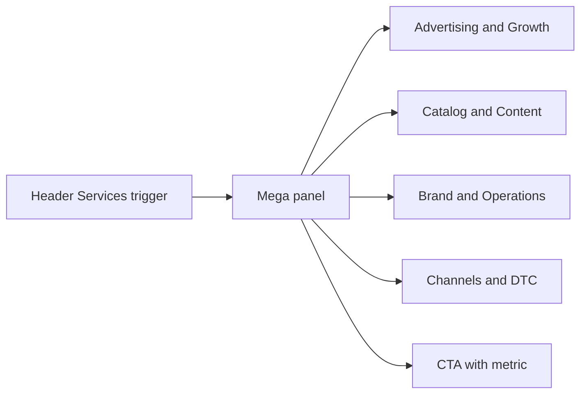

# Navbar and Mega Menu Redesign

## Problem (Verified)

Live staging: [https://ecom-gliders.vercel.app/](https://ecom-gliders.vercel.app/)

Current mega menu in [`content/config/navigation.json`](content/config/navigation.json) + [`src/components/layout/mega-menu-panel.tsx`](src/components/layout/mega-menu-panel.tsx):

- Flat **Core Services / Other Services** taxonomy (reads CMS leftover, not boutique agency)
- Generic one-line blurbs (“Full account oversight”)
- Equal-weight text list — no featured flagship, no icons, no hierarchy
- CTA panel soft (“Not sure what you need?”) with no proof
- Old live site had richer service coverage (Reporting, Search Ranking, Sourcing, CTR) that was dropped without a better IA

This matches why the shell feels “bachgana”: engineering is fine; **information design and visual hierarchy** are weak.

## Research takeaway (what industry-grade looks like)

| Pattern                                            | Source                                                                | Apply                                             |
| -------------------------------------------------- | --------------------------------------------------------------------- | ------------------------------------------------- |
| Wide Services panel + **inline CTA**               | Olifant / Sequence (project Design-Inspiration + Competitor-Analysis) | Keep CTA column; upgrade content                  |
| Services grouped by **capability**, not Core/Other | Boutique Amazon agencies                                              | New category columns                              |
| Outcome-led link copy                              | Niche standards                                                       | Rewrite descriptions                              |
| Sticky header CTA always visible                   | Competitors                                                           | Keep Free Audit; polish                           |
| Trust strip above header                           | Olifant/Sequence                                                      | Enable announcement bar with verified claims only |

**Multi-level meaning for this project:** Level 1 = Services trigger → Level 2 = named categories → Level 3 = individual services with title + outcome description. Not nested flyout menus (those feel dated). Wide categorized panel is the boutique standard.

## Detailed research: Apple / Amazon idea vs our case

### What Apple does (idea only)

[Apple.com](https://www.apple.com) puts **product lines as top nav tabs**, and **each tab opens its own mega menu**:

- Top tabs: Store, Mac, iPad, iPhone, Watch, AirPods, TV & Home, Entertainment, Accessories, Support
- Inside each mega: left column “Explore [Product]” + right “Shop [Product]” / quick links / support

**Why that works for Apple:** thousands of SKUs, shoppers already think in product names (iPhone, Mac).

**Why we do NOT copy that literally:** eCom Gliders is a **services agency**, not a product catalog. Putting “PPC”, “Listing”, “Trademark” as separate top tabs would make the header noisy and look like a SaaS product strip — not a premium Amazon partner.

### What Amazon does (idea only)

Amazon uses a **Departments / All** mega + many department categories (Electronics, Fashion, etc.) optimized for browsing millions of products.

**Why we do NOT copy that:** seller buyers come with a **problem** (ACOS, ranking, Brand Registry), not a department name. A retail-department menu would feel wrong for B2B agency trust.

### What boutique Amazon agencies do (our real peer set)

From project research ([Competitor-Analysis](obsidian/09-Research/Competitor-Analysis.md), COMPETITIVE-RESEARCH):

| Agency       | Mega pattern                           | Takeaway            |
| ------------ | -------------------------------------- | ------------------- |
| Olifant      | **One** Services mega + CTA panel      | Best structural fit |
| Sequence     | Multi-level services mega + Free audit | Category depth OK   |
| Canopy / MAG | Simple dropdown or light mega          | Clean, not childish |
| AMZ Dudes    | No mega — horizontal + CTA             | Conversion, less IA |

**eCom Gliders decision:** Apple’s _clarity of grouping_ + Olifant’s _one Services mega + CTA_ — not Apple’s many top-level megas.

### Critical distinction: header tabs vs mega categories

Two different things people call “tabs”:

1. **Header tabs** = items in the top bar (Services, Case Studies, …)
2. **Mega categories** = columns _inside_ the Services panel (Advertising & Growth, …)

**Only ONE header tab gets a mega menu: Services.**  
All other header tabs are simple links (cleaner, more premium, less confusing).

```
HEADER TABS (top bar)
├── Services          ← ONLY this opens MEGA MENU
├── Case Studies      ← simple link
├── About             ← simple link
├── Blog              ← simple link
├── Contact           ← simple link
└── [Free Audit]      ← CTA button (not a mega)

INSIDE Services MEGA (category columns — like Apple’s inner groups)
├── Advertising & Growth
├── Catalog & Content
├── Brand & Operations
└── CTA rail (audit + phone + metric)
```

## Target information architecture

### Header tabs — final list

```
[Announcement bar: Amazon Ads Verified Partner | $112M+ revenue managed | 95% retention]
[Logo]  Services▾  Case Studies  About  Blog  Contact     [Free Audit]
```

| Header tab   | Type                  | Why                                                        |
| ------------ | --------------------- | ---------------------------------------------------------- |
| Services     | Mega menu             | Primary commercial discovery                               |
| Case Studies | Link `/case-studies/` | Proof, not a service list                                  |
| About        | Link `/about-us/`     | Trust / team                                               |
| Blog         | Link `/blog/`         | 328 posts — keep visible (competitor gap we already fixed) |
| Contact      | Link `/contact/`      | Direct path                                                |
| Free Audit   | CTA button            | Always visible conversion (industry standard)              |

**Not in header (intentional):** Home, Testimonials, Who We Are, Resources mega, Industries mega — folds into About / Case Studies / Blog.

### Services mega — 3 category columns + CTA (this is the “detailed” part)

```
┌─ Advertising & Growth ─┬─ Catalog & Content ───┬─ Brand & Operations ──┬─ CTA ────────┐
│ ★ Account Management   │ Listing Opt + SEO     │ Trademark + Registry  │ Free audit   │
│   PPC Management       │ Content Writing       │ Company Registration  │ $112M+ proof │
│   Amazon DSP           │ Visual Creativity     │ Website SEO + Dev     │ phone        │
│   Reporting            │ Catalog Management    │ Product Sourcing      │              │
└────────────────────────┴───────────────────────┴───────────────────────┴──────────────┘
                         [ View all services → ]
```

#### Column 1 — Advertising & Growth

Buyer intent: “Grow sales / fix ads / manage account.”

| Service                   | Role in menu            | Outcome-style description (direction)                |
| ------------------------- | ----------------------- | ---------------------------------------------------- |
| Amazon Account Management | **Featured / flagship** | Full-service growth with dedicated in-house managers |
| PPC Management            | Core money driver       | Sponsored Products, Brands, Display — ACOS control   |
| Amazon DSP                | Advanced ads            | Upper-funnel and retargeting beyond SP/SB            |
| Reporting & Analytics     | Transparency            | Weekly/monthly metrics sellers actually use          |

#### Column 2 — Catalog & Content

Buyer intent: “Rank higher / convert better / fix listings.”

| Service                      | Role     | Notes                                                          |
| ---------------------------- | -------- | -------------------------------------------------------------- |
| Listing Optimization and SEO | Core     | Absorbs old “Search Ranking Optimizations” + CTR angle in copy |
| Content Writing              | Core     | Titles, bullets, A+, brand story                               |
| Visual Creativity            | Core     | Images, infographics, A+ design                                |
| Video Creative               | Restored | Listing/ad video — was “Video Editing” on old site             |
| Catalog Management           | Core     | Suppressions, variations, listing health                       |

#### Column 3 — Brand & Operations

Buyer intent: “Set up / protect brand / ops support.”

| Service                      | Role       | Notes                                             |
| ---------------------------- | ---------- | ------------------------------------------------- |
| Trademark and Brand Registry | Protection | USPTO + Brand Registry support                    |
| Company Registration         | Setup      | US entity for sellers                             |
| Product Sourcing             | Ops        | Restored from old live nav; professional spelling |

#### CTA rail (not a service category)

- Eyebrow/metric: verified claim only (`$112M+` / Verified Partner)
- Title: Free Amazon account audit
- Button: Get Free Audit → `/free-audit-2/`
- Phone: +1 (360) 660-1210

## Expanded service inventory research (Shopify, TikTok, ecom gaps)

### A. Already on old live site (Verified — `backup/pages/homepage.html`)

All Services: PPC, Full Account, Content, CTR, Search Ranking, Catalog, Product Sourcing, Reporting.  
Other Services: Company Registration, Product Email marketing, Trademark USPTO, Brand Registry, Website SEO, Website Development, Video Editing, DSP.

**Observed:** Old site did **not** name Shopify, TikTok Shop, or Walmart. Project Brief + About FAQ = **Amazon-first**.

### B. What industry peers sell now (Assumed opportunity)

Peers such as [Eva](https://eva.guru/), Shaazford, Velocity, Canopy commonly package:

- Shopify / DTC store + CRO
- TikTok Shop + creator / paid ads
- Walmart Marketplace + Walmart Connect
- Meta / Google Shopping for DTC
- Email / SMS retention
- Video creative for listings and ads

### C. Concrete mega decision (updated)

**Amazon stays the hero.** Add a **4th category: Channels & DTC** so multi-channel is not dumped under “Other”.

| Column                      | Services                                                                                           |
| --------------------------- | -------------------------------------------------------------------------------------------------- |
| **1. Advertising & Growth** | Account Management (featured), Amazon PPC, Amazon DSP, Reporting & Analytics                       |
| **2. Catalog & Content**    | Listing Optimization & SEO, Content Writing, Visual Creativity, Video Creative, Catalog Management |
| **3. Brand & Operations**   | Trademark & Brand Registry, Company Registration, Product Sourcing                                 |
| **4. Channels & DTC**       | Shopify & Website Development, TikTok Shop Ads, Email & Retention Marketing                        |
| **CTA rail**                | Free audit + verified metric + phone                                                               |

**Restore:** Video Creative, Email & Retention (were on old site).  
**Expand:** Website SEO/Dev → **Shopify & Website Development**.  
**New (user-requested industry):** **TikTok Shop Ads**.  
**Backlog (not in v1 mega unless you confirm you sell it):** Walmart Marketplace, Meta Ads, Google Shopping.  
**Still dropped:** standalone CTR Improvement (folded into Listing/Visual copy).

**URLs (pages later):** keep Amazon paths; add proposed `/shopify-website-development/`, `/tiktok-shop-ads/`, `/email-retention-marketing/`. Nav pass does not build all pages.

**Honesty rule:** Nav can list intended offerings; service page body must not invent case studies/metrics for Shopify/TikTok until delivery is confirmed.

## Implementation approach

### 1. Extend navigation schema (config remains source of truth)

Update [`src/domain/content/schemas/navigation.schema.ts`](src/domain/content/schemas/navigation.schema.ts) and [`nav-link.schema.ts`](src/domain/content/schemas/nav-link.schema.ts):

- Column: keep `id`, `title`, `links`
- Link: add optional `featured: boolean`, `icon: string` (Lucide icon key only — no emoji), richer `description`
- Mega menu: add optional `footerLink` (`View all services`), optional `featured` handling in UI
- CTA: optional `eyebrow` / `metric` fields for proof line

### 2. Rewrite [`content/config/navigation.json`](content/config/navigation.json)

- Replace Core/Other with the **four** categories above
- Outcome-led descriptions (Amazon agency voice, no clichés)
- Align footer Services column with flagship Amazon + Channels highlights
- Keep header items + Free Audit

### 3. Rebuild mega menu UI

Files:

- [`src/components/layout/mega-menu-panel.tsx`](src/components/layout/mega-menu-panel.tsx)
- [`src/components/layout/nav-link-item.tsx`](src/components/layout/nav-link-item.tsx)
- [`src/components/layout/header-nav.tsx`](src/components/layout/header-nav.tsx)
- [`src/components/layout/site-header-shell.tsx`](src/components/layout/site-header-shell.tsx)

Visual contract (still tokens from `design-system.json` only):

- Wider panel (`max-w-7xl` / full bleed under header)
- **4 service columns** + CTA rail (may stack 2x2 on medium widths; 4+1 on large)
- Featured Account Management: subtle surface highlight + “Flagship” text label
- Lucide icons from config `icon` keys
- Clear category headings with accent hairline
- Hover: left accent border or surface-muted
- Panel footer: View all services link

### 4. Mobile parity

Update [`src/components/layout/mobile-nav.tsx`](src/components/layout/mobile-nav.tsx):

- Nested accordion: Services → **four** category sections → links with short descriptions
- Keep Free Audit + phone in drawer footer

### 5. Announcement bar

Enable in [`content/config/site.json`](content/config/site.json) with verified claims only (Verified Partner / $112M+ / 95% retention — already project-verified). Wire existing [`announcement-bar.tsx`](src/components/layout/announcement-bar.tsx).

### 6. Docs

- Update [`obsidian/07-UX/Navigation-Footer-Spec.md`](obsidian/07-UX/Navigation-Footer-Spec.md) to Approved IA above
- Log decision in [`docs/project/DECISIONS.md`](docs/project/DECISIONS.md) + session notes
- Save plan copy to `.cursor/plans/2026-09-02-navbar-mega-menu-redesign.md`

## Out of scope (this pass)

- Redesigning homepage sections / “childish” page feel below the fold
- Building all missing service destination pages
- Changing brand colors/fonts
- Production GSC / P4-05

## Verification

- Desktop Playwright: open Services mega — 4 categories + CTA, no Core/Other; Shopify + TikTok Shop Ads visible under Channels & DTC
- Mobile viewport: category accordion + descriptions
- No hardcoded hex outside tokens
- `navigation.json` validates against Zod
- Staging/local screenshots for evidence in `docs/qa/`


