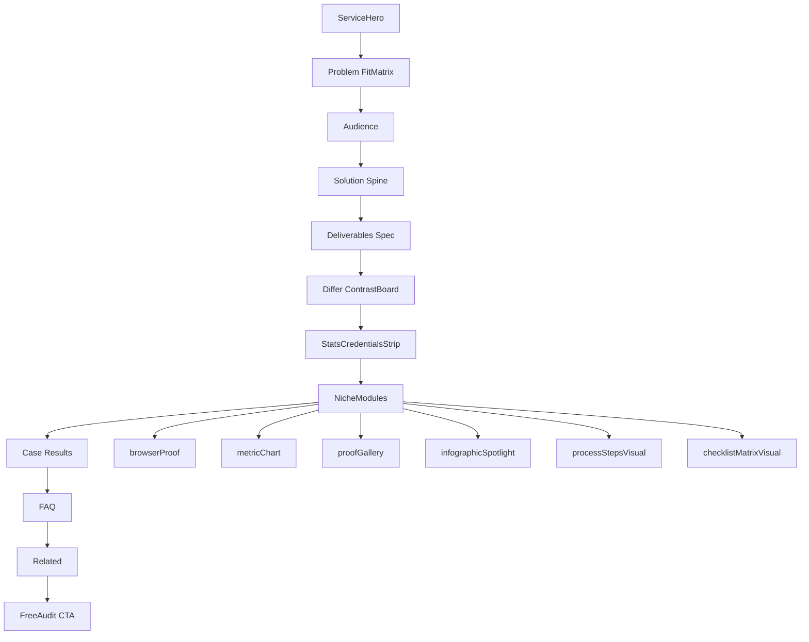

# Services: niche visual density (all 15)

## Overview

Make all 15 service pages as dense and niche-specific as the new case studies by unblocking filtered modules, rendering existing unused `stats`, adding infographic/spotlight modules, and shipping per-service visual recipes from growth, creative, and gap diagrams.

## Problem (Verified)

Case studies feel rich. Service pages feel dry even when JSON already declares modules.

Three stacked root causes:

1. **Filter** in [service-page-template.tsx](src/components/services/service-page-template.tsx): drops `processSteps` and `checklistMatrix` (and `comparisonTable` when `differ` exists). All 15 have `differ`, so comparison never renders.
2. **Unused stats**: every service JSON has top-level `stats` (`$112M+` / `95%` / `20+` / `2018`) — schema-only; never rendered under `src/components/services/`.
3. **Gallery scale bug (Pass 4)**: [proof-gallery-grid.tsx](src/components/services/modules/proof-gallery-grid.tsx) always uses `lg:grid-cols-3` + `aspect-[4/3]` + `sizes … 33vw`. A single wide infographic still occupies **one third** of the row (~348–435×261–326 on staging Shopify/catalog/email). By contrast [browser-proof-stage.tsx](src/components/services/modules/browser-proof-stage.tsx) uses `aspect-[16/10]` and up to `max-w-4xl` / ~70vw — why PPC feels rich.

[docs/project/SERVICE-LAYOUT-RECIPES.md](docs/project/SERVICE-LAYOUT-RECIPES.md) marks all 15 “E-wave COMPLETE” but that status is stale relative to the filter (modules declared, not painted).

## Visual research passes (2026-10-16) — Observed

Method: Playwright on staging + live WP hub + Canopy / AMZ Dudes / Sellexio / Tinuiti / MAG; image inspection of service diagrams; full 15-JSON inventory. Confidence: high for staging DOM and local art; medium for competitor chrome details.

### Pass 6 verdict (results / chart / remaining art) — RESEARCH CLOSED

| Finding | Evidence |
|---------|----------|
| Container width is not the gap | Service + case-study both `container-page` / `max-w-[1320px]` |
| Service Results are text-only | [service-page-template.tsx](src/components/services/service-page-template.tsx) hardPanel cards with `text-stat` — no case-study atmosphere thumbs |
| `metricChart` is visually thin | Horizontal tracks only `h-3` — even PPC’s “chart” is a slim bar row, not a tall viz |
| Preview dialog exists | Gallery + browserProof both open `ImagePreviewDialog` — expand helps, default stamp still looks empty |
| Email + Shopify art already rich | Full enterprise lifecycle / dual-column stack infographics — same spotlight treatment; **do not regenerate** |
| Research closed | Passes 1–6 complete. Additional “do more research” loops will not change the locked approach. **Next user action: APPROVE / execute.** |

### Pass 5 verdict (mobile + ContainedMedia)

| Finding | Evidence |
|---------|----------|
| “Same JPG twice” is **not** two sections | [contained-media.tsx](src/components/services/modules/contained-media.tsx) paints blur fill (`alt=""`, ~full cell) + contain foreground (~shorter). Catalog JSON has one item; template mounts gallery once. |
| Desktop is the dry-page pain | Mobile 390px catalog: frame ~377×283 (near full main width). Desktop 1440px: same art stuck in 33vw 4/3 cell. |
| Mobile PPC still richer by variety | 390px: desktop proof ~379×237 + phone ~199×354 + chart — multiple devices vs catalog’s one stamp. |
| Chrome token drift | Services hardPanel copies with `p-5`/`p-6` variants; case studies use shared `caseStudyHardPanel` without padding. Unify on shared token during ship. |

### Pass 4 verdict (technical — smoking gun)

| Mechanism | Observed effect |
|-----------|-----------------|
| `ProofGalleryGrid` `lg:grid-cols-3` + `aspect-[4/3]` | Single-item dry pages → ~1/3 width postage stamp **on desktop** |
| `ContainedMedia` `object-contain` in 4/3 well | Wide landscape infographics letterbox inside small cell |
| `browserProof` `aspect-[16/10]` + wide stage | PPC/reporting feel dense with same growth AVIFs |
| Service hero | Form + partner badge only — **no** proof/atmosphere image slot |
| Live WP PPC | One ~685×685 client-feedback square; staging PPC already richer via growth crops |
| Growth funnel | Trustpilot ~542px squares; WhatsApp phones ~770×356 — large social proof scale to match |
| Listing anatomy JPG | Already dense teaching infographic — same spotlight treatment as catalog |

### Pass 3 verdict (critical)

Dryness is mostly a **presentation and scale** problem, not missing artwork.

- Catalog and Brand Registry already ship dense dark-theme enterprise infographics (multi-step flows, checklists, lime accent on black). On staging they render at ~261–326px tall and ~348–435px wide, often **twice** (hero thumb + gallery).
- Email / trademark / catalog share the same thin pattern: one diagram at postage-stamp scale, then jump to Results. Process + checklist stay in JSON but never paint.
- Live WP `/services/` uses ~700×700 illustrative squares per niche — staging detail pages feel empty by comparison even when art quality is high.
- All 15 JSON `stats` arrays are **identical** agency KPIs (`$112M+`, `95%`, `20+`, `2018`). Wiring them alone adds chrome, not niche differentiation — Wave A proof services need Verified niche overrides from case/growth captions.

### Staging density contrast

| Page | Visible proof | Displayed size (Observed) | Notes |
|------|---------------|---------------------------|-------|
| `/amazon-ppc-management-agency/` | 2 growth AVIFs + metricChart | Prime Day ~460–575px tall | Richest; unused stats; no process |
| `/amazon-visual-creativity/` | 5 creative frames | ~261–327px each | Gallery-dense; process filtered |
| `/amazon-catalog-management/` | ContainedMedia blur+contain of one diagram | Desktop ~261–326 in 33vw cell; mobile ~377×283 | Art rich; desktop grid kills density |
| `/amazon-trademark-brand-registry/` | Same ContainedMedia pattern | Desktop ~261–326 × 348–435 | Same thin pattern as catalog/email |
| `/email-retention-marketing/` | Same ContainedMedia pattern | Desktop ~261–326 × 348–435 | Driest cohort |
| `/case-study-1/` | Atmosphere full-bleed | ~794×1526 hero | Density bar |

### Full inventory ranks (Verified)

Richest: PPC, reporting, full-service, DSP, visual-creativity.  
Driest (single conceptual JPG): email, Shopify, sourcing, company-reg, trademark (+ catalog tied).  
TikTok JSON lists 5 images (flow + 4 creative) but captions admit no TikTok growth crop — honest reuse only.

### Growth funnel (Verified asset bank)

[docs/research/GROWTH-PROOF-INVENTORY.md](docs/research/GROWTH-PROOF-INVENTORY.md) + live growth page:

- Live Seller crops: brand YoY, 2yr dashboard, Prime Day, 803k, 90-day, small-brand
- Unused in service JSON today: `wa-1…3`, `sales-small-brand`
- Aggregate claims on growth (use only if already approved on site): 137% avg sales increase, 79% ACoS reduction, +197% top account YoY, 3.4x ROAS — do not invent beyond Verified captions

Best service fit (unchanged): PPC / full-service / reporting / DSP only. Catalog, trademark, company reg, sourcing, Shopify, email, TikTok have no Seller-app crop.

### Competitor and live-site patterns (Observed)

| Source | Visual pattern to note | EG action |
|--------|------------------------|-----------|
| Canopy PPC | Logo wall + big KPI strip + 3-phase How we work; almost no Seller screenshots | Steal KPI strip + process visibility; keep EG live crops as advantage |
| AMZ Dudes account mgmt | Numbered 01–08 service rails, Day1→Week2 timeline, Seller Central proof strip, outcome table | Steal numbered process chrome + proof strip idea; do not invent outcome rows |
| Sellexio case studies | Large before→after metric pairs (31K→66K, 48→19% ACoS) | Mirror in Results hard tiles (already linked to real `/case-study-N/`) |
| Tinuiti Amazon | Capability cards + AMC badges + case links; light on screenshots | Capability density via checklist unlock, not badge spam |
| My Amazon Guy PPC | Long educational copy + embedded video; low enterprise chrome | Do not copy — stay visual/proof-led |
| Live EG `/services/` | Huge ~700px niche illustrations per service block | Match **scale** on detail pages via spotlight + hero atmosphere |

### Local art inspection (Verified)

- `catalog-health-system.jpg` and `brand-registry-flow.jpg` are already full enterprise infographics (5-step / 4-step cards, icon systems, footer value bars). They do not need replacement art first — they need full-width spotlight rendering.
- Unused atmosphere candidates already on disk: `catalog-management-v2.png` (warehouse + tablet UI), `*-service.jpg` squares, older `*-v2.png` hub art, `services-hub-hero-browser.jpg`. Prefer these for hero underlap before generating new diagrams.

### What EG should steal vs keep

| Adopt (pattern only) | Keep as EG advantage |
|----------------------|----------------------|
| Full-width infographic scale (WP ~700px / case-study hero energy) | Live growth AVIFs in `browserProof` |
| Early KPI strip + niche overrides where Verified | Honest “conceptual diagram” captions |
| Numbered process rails after Differ (AMZ Dudes / Canopy) | Hard chrome already on Differ / FitMatrix |
| Dense Results before→after tiles (Sellexio pattern) | No fake awards wall or invented outcome tables |

### Asset reality (Verified inventory)

| Bucket | Services |
|--------|----------|
| Growth crops available | PPC, DSP, reporting, full-service |
| Diagram folder only (1 JPG each) | catalog, company-reg, sourcing, trademark, email, Shopify |
| Diagram + creative | listing, content-writing, video-creative, TikTok |
| Creative only | visual-creativity |
| Unused growth still on disk | `wa-*`, `sales-small-brand` |

Module type counts in JSON: `proofGallery` 10+, `browserProof` 4, `metricChart` 2; `infographicSpotlight` / rendered `statsStrip` = 0.

### Root dryness diagnosis (refined Pass 3)

1. **Scale:** Dense infographics are crushed to ~260px gallery thumbs.
2. **Filter:** Process + checklist never render, so there is no second visual band after Differ.
3. **Generic stats:** Identical agency KPIs on all 15 will not feel niche unless overridden on proof services.
4. **Hero:** Light blob + form lacks case-study / WP-hub atmosphere; unused `*-v2` / `*-service.jpg` assets sit idle.
5. **True asset gaps:** Generate new diagrams only if spotlight + unfilter QA still leaves a niche without a legible full-width panel (not the default for trademark/catalog).

## Locked approach

1. Stop over-filtering: re-enable `processSteps` and `checklistMatrix` with numbered hard-chrome rails (AMZ Dudes / Canopy cue) so they do not look like a second Solution or Deliverables block.
2. Keep `comparisonTable` filtered when `differ` exists (Contrast Board already covers that job).
3. Render `service.stats` as CredentialsBar after Differ. For Wave A/B proof services, override with niche Verified KPIs from growth captions or linked case results. Shared agency stats remain default for ops/adjacent pages.
4. Add `infographicSpotlight`: full content-width hard panel using `aspect-[16/10]` or similar (not 4/3 grid cell), target display height **≥480px**, `sizes` ~100vw/80vw. Migrate single-item dry flow JPGs out of `proofGallery` into spotlight. Also harden `ProofGalleryGrid`: when `items.length === 1`, use `col-span-full` + wider aspect so any leftover single galleries cannot regress to 33vw stamps.
5. Cap rendered modules at 4. Ship recipes below. Stop double-rendering the same flow file as a tiny gallery thumb when spotlight already shows it.
6. Assets order: (a) growth AVIFs, (b) existing flow JPGs at spotlight scale, (c) unused `*-service.jpg` / `*-v2.png` for hero atmosphere, (d) generate new diagram only if QA still fails. Never invent performance numbers. Log new assets in DOWNLOAD-LOG.
7. Hero density: atmosphere under sticky header for Wave A/B proof services and dry ops pages with unused atmosphere files (catalog, listing at minimum), keeping the lead form.
8. Bump `metricChart` visual weight (taller tracks / before→after number lockup) so PPC/reporting charts are not `h-3` slivers. Densify Results cards toward case-study `text-stat` tiles (keep text-only; no invented images).

## Architecture

Key files:

- [src/components/services/service-page-template.tsx](src/components/services/service-page-template.tsx)
- [src/components/services/modules/](src/components/services/modules/)
- [src/components/case-studies/layouts/case-study-modules.tsx](src/components/case-studies/layouts/case-study-modules.tsx) — CredentialsBar / ResultsGrid chrome to reuse
- [src/domain/content/schemas/service-page.schema.ts](src/domain/content/schemas/service-page.schema.ts)
- [content/config/services/](content/config/services/)
- Assets: `public/images/growth/`, `public/images/creative/`, `public/images/services/{slug}/`
- [docs/research/GROWTH-PROOF-INVENTORY.md](docs/research/GROWTH-PROOF-INVENTORY.md)

## Schema and renderer changes

- Unfilter `processSteps` + `checklistMatrix` in the template.
- Render `service.stats` via CredentialsBar; allow JSON override of stats values per slug for niche KPIs.
- Extend `serviceModuleSchema` with `infographicSpotlight` (full-width hard panel, `aspect-[16/10]` / min ~480px height, caption). Optional `statsStrip` only if a second niche KPI row is needed beyond CredentialsBar.
- Fix `ProofGalleryGrid` single-item layout (`col-span-full` + wider aspect) as safety net; desktop `lg:grid-cols-3` is the primary stamp cause (mobile already near full width).
- Unify service hardPanel on shared `caseStudyHardPanel` token (padding at call sites).
- Restyle process as numbered hard rails; checklist as Spec-sheet groups with accent top bar.
- Thicken `metricChart` (replace `h-3`-only bars with taller tracks + large endpoint labels). Keep Results text-only but match case-study metric typography weight.
- Soft max 4 modules after Differ + always-on stats strip.
- Rewrite SERVICE-LAYOUT-RECIPES.md status from stale “E-wave COMPLETE” to reflect spotlight + unfilter ship.

## Per-service niche recipe (all 15)

### Wave A — core growth

| Slug | Niche visual story | After Differ | Primary assets |
|------|--------------------|--------------|----------------|
| full-service-amazon-agency | Account operating system | stats + browserProof + checklistMatrix | `sales-dashboard-2yr`, `sales-brand-yoy`; add `sales-small-brand` if space |
| amazon-ppc-management-agency | Profit-first ads control room | stats + browserProof + metricChart | Existing AVIFs; optionally append `wa-1` as honest chat proof (not Seller UI) |
| amazon-listing-optimization | Listing anatomy / CRO | stats + infographicSpotlight + proofGallery + processSteps | listing-anatomy + creative before/after + search-ranking-optimization |
| amazon-content-writing | Title / bullets / A+ structure | stats + infographicSpotlight + proofGallery + checklistMatrix | content-writing-structure + A+ creative |
| amazon-visual-creativity | Portfolio density | stats + proofGallery (keep 5) + processSteps | Full `creative/` set |
| amazon-catalog-management | Catalog health (driest by scale) | stats + infographicSpotlight + processSteps + checklistMatrix | Spotlight `catalog-health-system.jpg` full-width; hero atmosphere from `catalog-management-v2.png` or `amazon-catalog-management-service.jpg`; generate second diagram only if QA still thin |

### Wave B — media / data

| Slug | Niche visual story | After Differ | Assets |
|------|--------------------|--------------|--------|
| amazon-dsp-management | Upper-funnel + Sponsored stack | stats + browserProof + processSteps + checklistMatrix | growth stage; add DSP funnel diagram only if process rails are not enough visual weight |
| amazon-reporting-analytics | Decision dashboards | stats + browserProof + metricChart + checklistMatrix | dashboards; tighten chart footnote |

### Wave C — creative / ops

| Slug | Niche visual story | After Differ | Assets |
|------|--------------------|--------------|--------|
| amazon-video-creative | Storyboard to placement | stats + infographicSpotlight + proofGallery + processSteps | video-creative-storyboard + lifestyle stills |
| amazon-trademark-brand-registry | Compliance pathway | stats + infographicSpotlight + processSteps + checklistMatrix | Spotlight existing `brand-registry-flow.jpg` (≥480px); reuse `amazon-trademark-brand-registry-service.jpg` for hero if needed |
| amazon-company-registration | Entity to sell path | stats + infographicSpotlight + processSteps + checklistMatrix | company-registration-flow |
| amazon-product-sourcing | Spec to sample to PO | stats + infographicSpotlight + processSteps + checklistMatrix | product-sourcing-flow |

### Wave D — adjacent channels

| Slug | Niche visual story | After Differ | Assets |
|------|--------------------|--------------|--------|
| shopify-website-development | Amazon to Shopify stack | stats + infographicSpotlight + processSteps + proofGallery | shopify-amazon-stack |
| tiktok-shop-ads | Short-form commerce loop | stats + infographicSpotlight + proofGallery + processSteps | tiktok-shop-flow + creative reuse with honest captions |
| email-retention-marketing | Lifecycle / LTV | stats + infographicSpotlight + processSteps + checklistMatrix | email-retention-lifecycle (`wa-*` is WhatsApp PPC chat — do not mislabel as email) |

## Claims and asset rules

- Stats strip: use existing JSON `stats` values already approved for the site; do not invent new aggregates.
- Charts and browserProof: only Verified numbers from growth inventory, case studies, or approved homepage claims.
- Process/infographic art may be conceptual without fake ROAS or revenue; captions must say so when not a Seller crop.
- Log every new asset in DOWNLOAD-LOG with source (growth, WP, or generated).
- Results cards stay linked to real `/case-study-N/` metrics.

## Implementation phases

1. Unblock plus schema: remove process/checklist filter; render `service.stats` strip; add `infographicSpotlight`; restyle process/checklist.
2. Wave A visual pass: PPC, full-service, listing, visual, catalog (second diagram), content.
3. Wave B through D: remaining nine services plus gap assets.
4. Hero polish: atmosphere under header for A/B proof services only.
5. Docs plus verify: SERVICE-LAYOUT-RECIPES update; Playwright all 15 slugs vs case-study-1 density bar; staging deploy.

## Out of scope

- Full SEO copy rewrite for every service
- Fake awards walls or Canopy-scale logo spam
- Removing Free Audit form from service heroes
- URL changes
- Misusing WhatsApp PPC chats as email/TikTok proof

## Success criteria

- No service page renders only a lone thin (~260px) image between Differ and Results
- Every service shows the stats strip; Wave A/B proof services use niche Verified KPIs where available
- Dry ops pages show flow art at ≥480px via `infographicSpotlight` (not gallery postage stamps)
- Catalog: full-width spotlight + rendered process/checklist; unused atmosphere wired into hero
- Density closer to `/case-study-1/` and live WP hub illustration scale without invented metrics
- Staging verified for all 15 URLs

## Todos

- [ ] unblock-modules — Unfilter processSteps/checklistMatrix; render service.stats strip; add infographicSpotlight (≥480px)
- [ ] wave-a — Wave A: full-service, PPC, listing, content, visual, catalog (spotlight scale + unused atmosphere; niche stats overrides)
- [ ] wave-b-d — Wave B–D: remaining 9; spotlight existing flows; generate art only after QA fail
- [ ] hero-polish — Atmosphere hero for A/B proof + dry ops with unused `*-v2` / `*-service.jpg`
- [ ] docs-verify-deploy — Update SERVICE-LAYOUT-RECIPES; Playwright all 15; staging deploy
