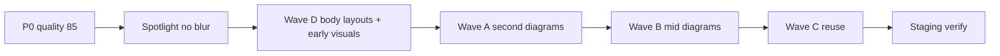

# Per-service graphics + body section layouts

## Research (Verified)

### P0 — spotlights broken

Sole `quality={90}` in `src/` is [`infographic-spotlight.tsx`](src/components/services/modules/infographic-spotlight.tsx); allowlist is `[70,75,80,85]`. All 10 spotlight pages: sharp FG 400, blur-only visible. Galleries/browserProof at 85 OK. Clamp to **85**.

### Body sections are text twins (Pass 4 staging geometry)

Catalog @ 1440px — **Problem and Solution are identical grids**:

| Section | height | li size (×4) |
|---------|--------|--------------|
| Problem | 510px | 612×134 |
| Solution | 510px | 612×134 |
| Audience | 490px | full-width rows (already distinct) |
| Deliverables | 607px | spec sheet cells |
| Differ | 535px | contrast board |

DOM order today: `… → solution → deliverables → differ → infographic-spotlight → process → checklist → results`. First `figure` is **after** Deliverables (`figureBeforeDeliverables: false`).

Schema: body sections have **no image fields**. [`SERVICE-LAYOUT-RECIPES.md`](docs/project/SERVICE-LAYOUT-RECIPES.md) documents modules only — not body grammars.

### Wave D reuse map (copy, don’t invent)

| Body section | Copy chrome from | Net-new |
|--------------|------------------|---------|
| Stats lead ledger | [`trust-bar-section.tsx`](src/components/sections/trust-bar-section.tsx) lime metric tile + [`CredentialsBar`](src/components/case-studies/case-study-modules.tsx) | First cell `bg-accent` |
| Problem primary+satellites | Case-study challenge + [`KeyIssuesList`](src/components/case-studies/case-study-modules.tsx); optional ink field from [`pain-strip-section.tsx`](src/components/sections/pain-strip-section.tsx) | Promote `points[0]` full-width |
| Audience chips | Keep divide strip; chip row cue from market chips | Anchor chips above list |
| Solution spine | Seller-journey connector / Process Spine notes — **not** [`StrategyStages`](src/components/case-studies/case-study-modules.tsx) (that is today’s twin) | Vertical lime spine component |
| Deliverables / Differ | Keep Spec Sheet / Contrast Board | Index codes + column lime rule |
| FAQ | Deliverables lime top bar pattern | Hard-panel wrap |
| Icons | `assets/icons/` = AI brands only; no Problem SVGs | Use index codes only (no icon rows) |

### Pass 5 — content counts + breakpoints + module-cap

**All 15 services** have identical body counts: Problem 4 / Audience 4 / Solution 4 / Deliverables 8 / Differ 4. Primary+satellites (`points[0]` + three) and Solution spine (4 steps) need **no content edits**.

| Viewport | Problem vs Solution |
|----------|---------------------|
| 390 mobile | Same full-width stack (widths all 348) |
| 768 tablet | Same stack (widths all 347) — `md:grid-cols-2` not yet active or still equal |
| 1440 desktop | Identical 2×2 (612×134) |

PPC order also late: `…solution → deliverables → differ → browser-proof → acos-chart → results`.

**Module cap vs Wave A/B (Verified):**

| Cohort | Modules today | Room for +1 spotlight? |
|--------|---------------|------------------------|
| Dry six (catalog…email) | spotlight + process + checklist = **3** | Yes → 4 (both spotlights early; process+checklist late) |
| DSP | browser + process + checklist = 3 | Yes |
| PPC | browser + chart = 2 | Yes |
| reporting | browser + chart + checklist = 3 | Yes |
| full-service | browser + checklist = 2 | Yes |
| listing, video | already **4** | No new modules — D2 split only |
| content, TikTok | 3 | Wave C reuse into gallery; no forced 4th |
| visual | gallery + process + checklist = 3 | Leave |

FAQ: [`FaqAccordion`](src/components/sections/faq-accordion.tsx) already supports `variant="lime"` (homepage [`faq-section.tsx`](src/components/sections/faq-section.tsx) uses it). Service template currently uses default — switch to lime + hard-panel wrap.

### Pass 6 — preview dialog, chips, live parity, research close

| Finding | Evidence |
|---------|----------|
| In-page spotlight FG broken; **lightbox OK** | Preview dialog uses q=75 blur + **q=85** sharp (`nw=960`). Only inline ContainedMedia `quality={90}` fails. |
| Audience chip titles | Longest **55 chars** (“Sellers dealing with suppressions…”). Chip row must allow 2-line wrap or `line-clamp-2` + `title` attr — no single-line ellipsis-only. |
| Problem primary titles | 29–46 chars — fit full-width primary rail without truncation. |
| Live WP `/amazon-catalog-management/` | **404** on ecomgliders.com (Observed). Body-layout parity vs WP not available at that path; staging is source of truth. |
| Art generation | Prior E-wave used AI 1280×720 system diagrams + DOWNLOAD-LOG (Verified in VERIFICATION-LOG). Wave A/B same provenance path. |

### Pass 7 — Results / metricChart (scope check)

| Finding | Evidence |
|---------|----------|
| Service **Results** = text-only | PPC `#service-results`: **0 imgs**, 2 metric articles (~456px). Case hub has ~28 case images. |
| `metricChart` already thick | PPC `#service-acos-chart` ~**577px**; tracks `h-8` (not the old h-3). No chart redesign needed in this plan. |
| Results thumbs | Would need schema `image` on `results.items` + case crops — **deferred** (separate wave). Not required for body-layout + spotlight fix. |

**Research closed.** Passes 1–7 add no further changes to the locked approach (P0 → D → A/B/C). Results image cards stay out of scope.

**Next user action: APPROVE / execute.** Further “dekho or” without a new requirement will get this same close.

### Density ranks (modules)

Dry ops = 1 diagram (broken); mid = browserProof only; rich = galleries. Wave A/B still required after body layout work.

---

## Approach (committed)



1. P0 + spotlight render fix  
2. **Wave D — body section layouts + early visual interleave** (user’s new ask)  
3. Wave A/B/C — more niche diagrams + reuse  

Module hard cap stays 4. No fake Seller Central UI. No emoji/Unicode icons.

---

## Wave D — section-dependent layouts (non-proof body)

Primary file: [`service-page-template.tsx`](src/components/services/service-page-template.tsx). Extract under `src/components/services/sections/` when template exceeds ~300 lines: `service-problem-section.tsx`, `service-solution-section.tsx`, `service-audience-section.tsx` (stats stays in [`service-stats-strip.tsx`](src/components/services/service-stats-strip.tsx)).

### D1 — Distinct composition per section (shared across all 15)

| Section | Current | Committed layout | Implementation cue |
|---------|---------|------------------|--------------------|
| **Stats** | Equal 4-cell DL | **Lead ledger** — first cell lime fill; rest ink + lime top rule | Port trust-bar `MetricTile` accent into stats strip |
| **Problem** | Equal 2×2 (≡ Solution geom) | **Primary + satellites** — `points[0]` full-width ink rail + left accent bar; rest compact 2/3-col | Case-study challenge + KeyIssuesList structure |
| **Audience** | Divide strip (OK) | Keep strip; add **title chip row** above (`#audience-0` anchors); chips `line-clamp-2` (titles up to 55 chars) | No JS tabs |
| **Solution** | Equal 2×2 (≡ Problem) | **Vertical stage spine** — numbered lime discs + connector; stack mobile; optional 2-col on lg with spine in gutter | Seller-journey connector; **forbid** StrategyStages card twin |
| **Deliverables** | Spec sheet | Keep; add `01`… index column | Template-only |
| **Differ** | Contrast board | Keep; desktop vertical lime column rule | Template-only |
| **FAQ** | Bare accordion (default variant) | Hard panel + lime top bar; pass `variant="lime"` | Homepage faq-section already uses lime |
| **Results** | Metric cards | Unchanged | — |

**Geometric success check (Playwright):** after ship, Problem first `li` width ≈ full content column; Solution `li` widths must **not** all equal Problem’s 612×134 twin pattern.

Guardrails: no dashboard, no icon rows, no per-point image schema, no pain-strip bubble animation on service pages.

### D2 — Split module placement (graphics mid-narrative)

Split in template (and optionally in [`service-modules.tsx`](src/components/services/modules/service-modules.tsx) via `filter` prop):

- **`earlyVisuals`:** `infographicSpotlight` \| `browserProof` \| `proofGallery` \| `metricChart`
- **`lateOps`:** `processSteps` \| `checklistMatrix` \| `comparisonTable` (still drop comparison when Differ exists)

Target DOM order:

```
Hero → Stats → Problem → Audience → Solution
  → earlyVisuals
  → Deliverables → Differ
  → lateOps
  → Results → FAQ → Related → CTA
```

Dry page example (4 modules): both spotlights early; process + checklist late. Cap remains 4. No schema change.

---

## P0 + spotlight render

- `quality={90}` → `85`  
- ContainedMedia `variant="spotlight"`: no blur twin  

---

## Wave A — second infographic (dry six)

| Slug | Keep | Add (#2 distinct) |
|------|------|-------------------|
| catalog | health system | **Suppression triage decision tree** |
| trademark | enrollment pathway | **Post-enrollment tool matrix only** |
| company-reg | readiness flow | **Document + identity gate matrix** |
| sourcing | evaluation flow | **Landed-cost waterfall only** |
| shopify | channel stack | **Sync mechanics (inventory/price/content)** |
| email | lifecycle system | **Day 0–45 journey map** |

Both spotlights land in **earlyVisuals**. Process + checklist stay late. Dry six are at 3 modules today — +1 fits the cap.

Do **not** add a second spotlight on listing/video (already 4 modules). Those pages get D2 early/late split only.

---

## Wave B — mid-tier teaching diagrams

PPC / reporting / DSP / full-service: one new spotlight each (campaign architecture / weekly decision stack / DSP layer cake / pod map). Placed in earlyVisuals with existing browserProof. Each has room under the 4-module cap (see Pass 5 table).

---

## Wave C — rich reuse

Listing/content: wire `search-ranking-optimization.png` into gallery. Visual/TikTok: confirm sharp after P0.

---

## Docs and verification

- SESSION-STATE, CHAT-SUMMARIES, VERIFICATION-LOG, SERVICE-LAYOUT-RECIPES (section recipes + early/late module split)
- Playwright:
  - Spotlights: FG `naturalWidth > 0`
  - Catalog DOM order: first `figure` / browser stage **before** `#service-deliverables`
  - Problem: first issue full-width; Solution: spine layout ≠ Problem grid
  - Dry: 2 spotlights; mid: ≥1 teaching spotlight

## Out of scope

- Per-point images in Problem/Audience schema  
- Raising 4-module cap / new module types  
- Fake Seller Central screenshots  
- Regenerating all existing flow JPGs  

## Success criteria

- Spotlights sharp and readable (no blur twin)  
- Body sections visually distinct by type (Problem ≠ Solution ≠ Audience ≠ Deliverables)  
- Teaching/proof graphics appear **after Solution**, before Deliverables  
- Six dry pages: 2 niche infographics; four mid pages: +1 teaching diagram  
- Professional copy; no decorative Unicode/emoji  
