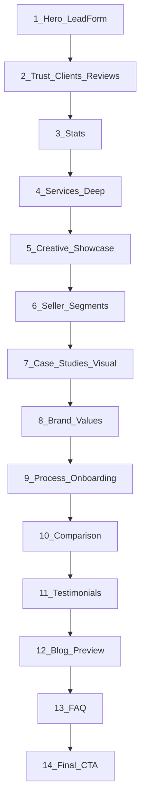

# Homepage Landing Page Audit and Blueprint

> **COMPLETE 2026-09-03** — Waves A–F finished. Homepage plan execution done.  
> Remaining gaps: privacy/terms pages, blog pagination, 6th testimonial, more creative stills, GSC (P4-05).  
> Part C2 defaults remain in force for open confirmations unless overridden.

**Evidence date:** 2026-09-03  
**Sources:** [`content/config/homepage.json`](content/config/homepage.json), section components under [`src/components/sections/`](src/components/sections/), [`backup/pages/homepage.html`](backup/pages/homepage.html), Playwright live pass on https://ecomgliders.com/, competitor docs in [`docs/seo/COMPETITIVE-RESEARCH.md`](docs/seo/COMPETITIVE-RESEARCH.md) + live AMZ Dudes headings, prior hero audit [`docs/research/HERO-COMPETITOR-UI-AUDIT-2026-09-03.md`](docs/research/HERO-COMPETITOR-UI-AUDIT-2026-09-03.md).

**Verdict:** Current home has a solid **conversion skeleton** (12 wired sections + lead form), but it is **proof-thin and image-poor** compared to the old Elementor homepage and vs AMZ Dudes / Olifant / Canopy. Old site wins on logos, creative gallery, values story, review badges, and featured press. New site wins on structure, SEO/FAQ depth, comparison table, and cleaner IA. Target: keep new IA spine, **reintroduce old-site proof layers with professional copy**, migrate assets from [`backup/assets/images/uploads/`](backup/assets/images/uploads/).

### How this plan grows (locked process)

- High-level IA stays in sections 1–8 below (overview).
- **Deep section specs** live under **Part B — Section-by-section deep plans**.
- User prompts one section at a time (e.g. “section 2”, “trust bar”). Agent researches (current code + old site + competitors + assets) and **appends/updates only that section** in Part B — no implementation until user says execute.
- Status legend per deep plan: `DRAFT` → `LOCKED` → `IMPLEMENTED` → `VERIFIED`.

---

## 1. Current homepage code (Verified)

**Wiring:** `page.tsx` → `getHomepage()` → `HomepageSectionRenderer` → 12 enabled sections from [`homepage.json`](content/config/homepage.json).

| #   | Section          | Status                                                                                  |
| --- | ---------------- | --------------------------------------------------------------------------------------- |
| 1   | Hero + lead form | Polished conversion path; form compact pass done; `deferredVisual` BrowserMockup unused |
| 2   | Trust bar        | Only 3 partner marks; Amazon badge duplicated with hero                                 |
| 3   | Stats            | 4 honest metrics OK                                                                     |
| 4   | Services         | 6 cards, one-line copy, Lucide only                                                     |
| 5   | Seller segments  | 3 text cards, no CTAs                                                                   |
| 6   | Case studies     | 3 metric cards, **no images**                                                           |
| 7   | Process          | 4 steps, text only                                                                      |
| 8   | Comparison       | Strong AEO table                                                                        |
| 9   | Testimonials     | 5 named quotes; config notes 6th still needed                                           |
| 10  | Blog preview     | 3 posts, **no featured images**                                                         |
| 11  | FAQ              | 10 solid Q&As + JSON-LD                                                                 |
| 12  | Final CTA        | Audit + phone + email                                                                   |

**Gaps vs conversion agency LPs:** almost no photography/creative proof; no client logo wall; no review platform badges; no mid-page visual proof (mockup deferred); thin service/segment depth; no press row.

**Assets live in `public/images` today:** logo, Amazon Verified Partner, eLEEVATE, SSP, AI SVGs. Client logos, GoSports art, Trustpilot/Google badges, press marks, creative samples exist in **backup uploads** but are not production-wired.

---

## 2. Old site homepage (Observed from backup + live)

**Live title:** Amazon PPC Agency – SEO & Account Management | eCom Gliders  
**Stack:** WordPress + Elementor (heavy plugin CSS; not to rebuild).

**Section flow (content order):**

1. **Hero** — H1 PPC-focused (“High-Converting PPC Ads…”), Free Audit CTAs, large Amazon FBA imagery
2. **Client logos** — “OUR Clients / Trusted by” marquee (`2-1`…`10.png`, etc.)
3. **Featured result** — GoSports **310%** sales increase spotlight
4. **Creative showcase** — “Get Amazon creative…” product/listing creative gallery
5. **Brand values** — “We’re Real…” + 4 pillars (Strategic Brand Engineering, Immersive Client Collaboration, Momentum-Focused Systems, Integrity-Led Execution)
6. **Services block** — “Pro-level Amazon Account Management Services”
7. **Testimonials** — named quotes + Trustpilot / Google review badges
8. **Stats** — $112M+ / 95% / 20+ / since 2018
9. **Onboarding** — “Onboarding That Gets You Selling Faster…”
10. **Mid CTA** — “Turn Potential Into Profit…” / Book a call
11. **Featured in** — DesignRush, JBMS360, News Break, Vents Magazine
12. **Why us / FAQ accordion** — deep answers (marketplaces US/UK/CA/EU, PPC process, creative, pricing models, 4-step start)
13. **Newsletter** — subscribe block
14. **Footer partner strip** — “A partner, not a vendor” + services links

**Old-site KEEP (content/assets):** client logos; GoSports 310% story art; creative gallery frames; Trustpilot + Google badge images; press logos; FAQ depth (especially marketplaces + get-started steps); verified metrics.

**Old-site IMPROVE (copy):** rewrite AI-ish / unprofessional lines per rule 13 (`Seller Hacks`, “We’re Real…”, vague creative H2). Prefer current professional H1/meta over old PPC-only H1 for account-management positioning.

**Old-site REMOVE:** Elementor bloat, inactive heading noise, emoji/Unicode UI, newsletter until ESP is confirmed and wired (exclude from this homepage build).

---

## 3. Competitor patterns (Adopt / Skip)

| Pattern          | MAG / Canopy / Olifant                                 | AMZ Dudes (live)          | eCom Gliders target                     |
| ---------------- | ------------------------------------------------------ | ------------------------- | --------------------------------------- |
| Hero             | Proof visual / people                                  | Form + growth audit       | **Keep form-in-hero** (already shipped) |
| Trust under hero | Logo density + reviews                                 | Satisfied clients         | **Client logos + review badges**        |
| Stats            | Dense                                                  | “Proof in real numbers”   | Keep 4 honest stats                     |
| Services         | Pillars / numbered                                     | Full roof grid            | Deeper 6-card grid                      |
| Creative proof   | Cases / galleries                                      | Creative that converts    | **Restore creative strip**              |
| Cases            | Metric + visual                                        | Screenshot/results        | **Cases with images**                   |
| Process          | 3–4 steps                                              | Growth strategy CTA       | Process + old onboarding steps          |
| Comparison       | Sequence-style                                         | —                         | Keep                                    |
| FAQ              | Deep + schema                                          | Long FAQ                  | Keep + merge best old answers           |
| Skip             | Dark cinematic, fake #1, office spam, metric inflation | Emoji UI, claim inflation | Skip                                    |

**Differentiation (locked):** in-house specialists, 95% retention, Amazon Ads Verified Partner, blog moat, GoSports 310% — not enterprise scale or proprietary software.

---

## 4. Locked target landing IA (14 sections)

Replace thin proof with old-site strengths; do not rebuild Elementor layout.



| #   | Section           | Action          | Detail                                                                                                                                                                        |
| --- | ----------------- | --------------- | ----------------------------------------------------------------------------------------------------------------------------------------------------------------------------- |
| 1   | Hero              | KEEP + polish   | Lead form stays. Partner badge + dual CTA. No BrowserMockup in hero.                                                                                                          |
| 2   | Trust bar         | REPLACE density | Partner badges + **client logo marquee** from backup `2025/04/{2-1..10}.png` + Trustpilot/Google badge images (link out if profiles exist). Deduplicate Amazon badge vs hero. |
| 3   | Stats             | KEEP            | Same 4 verified metrics.                                                                                                                                                      |
| 4   | Services          | IMPROVE         | 2–3 sentence descriptions; outcome line; keep Lucide; links unchanged.                                                                                                        |
| 5   | Creative showcase | INTRODUCE       | New `creativeShowcase` type from old “Get Amazon creative” gallery; migrate listing/creative frames from backup uploads; CTA to `/amazon-visual-creativity/`.                 |
| 6   | Seller segments   | IMPROVE         | Add CTA per segment → `#hero-lead-form` or relevant service.                                                                                                                  |
| 7   | Case studies      | IMPROVE         | Add images (`gosports.png` + 2 more from case backup); keep metric-first cards; CTA to `/case-studies/`.                                                                      |
| 8   | Brand values      | INTRODUCE       | New `brandValues` 4 pillars; rewrite titles/body to professional agency voice (no “We’re Real…” marketing fluff).                                                             |
| 9   | Process           | IMPROVE         | Keep 01–04; enrich copy from old onboarding steps (survey → strategy call → plan → setup). Embed **BrowserMockup** here as execution proof (`deferredVisual`).                |
| 10  | Comparison        | KEEP            | Agency vs DIY.                                                                                                                                                                |
| 11  | Testimonials      | IMPROVE         | Add 6th named quote from old site/backup; show review badges once (if not already in trust).                                                                                  |
| 12  | Blog              | IMPROVE         | Featured images from post media when available.                                                                                                                               |
| 13  | FAQ               | IMPROVE         | Merge stronger old answers (marketplaces US/UK/CA/EU; PPC process bullets; get-started steps) into existing 10 items; keep FAQPage JSON-LD.                                   |
| 14  | Final CTA         | KEEP            | `/free-audit-2/` + phone + email.                                                                                                                                             |

**Explicitly out of this build:** homepage newsletter; WhatsApp float; exit-intent modal; dark cinematic hero; unverified awards walls.

**Press / Featured in:** fold into Trust bar as a second row (DesignRush, JBMS360, News Break, Vents) using backup press PNGs — not a 15th full section.

---

## 5. Asset migration plan (from old site backup)

Use skill [`.cursor/skills/asset-management/SKILL.md`](.cursor/skills/asset-management/SKILL.md).

| Asset set           | Source (backup)                                                               | Dest                                                 |
| ------------------- | ----------------------------------------------------------------------------- | ---------------------------------------------------- |
| Client logos        | `backup/assets/images/uploads/2025/04/{2-1,3-1,4-1,5-1,6-1,7-1,8-1,9,10}.png` | `public/images/clients/`                             |
| GoSports / case art | `.../gosports.png`, case-study media                                          | `public/images/cases/`                               |
| Review badges       | `uploads/2025/03/Trustpilot-1.png`, `Google-reviews2webp.webp`                | `public/images/reviews/`                             |
| Press logos         | Featured-on-\* PNGs from homepage HTML inventory                              | `public/images/press/`                               |
| Creative gallery    | Creative/listing frames referenced on old home                                | `public/images/creative/`                            |
| Provenance          | —                                                                             | `docs/research/DOWNLOAD-LOG.md` + `assets/licenses/` |

Optimize via existing Next image pipeline (AVIF/WebP, lazy, sizes). Skip low-quality ChatGPT-generated blog stock unless approved.

---

## 6. Code / content touchpoints

- Config: [`content/config/homepage.json`](content/config/homepage.json) — section data + new types
- Schema: [`src/domain/content/schemas/homepage.schema.ts`](src/domain/content/schemas/homepage.schema.ts) — `creativeShowcase`, `brandValues`
- Renderer: [`homepage-section-renderer.tsx`](src/components/sections/homepage-section-renderer.tsx)
- New components: `creative-showcase-section.tsx`, `brand-values-section.tsx`
- Expand: `trust-bar-section.tsx`, `case-studies-section.tsx`, `process-section.tsx`, `services-section.tsx`, `seller-segments-section.tsx`, `blog-preview-section.tsx`
- Docs after approval/implement: [`obsidian/09-Research/Current-Site-Audit.md`](obsidian/09-Research/Current-Site-Audit.md) KEEP/REMOVE/IMPROVE/REPLACE/INTRODUCE; [`docs/project/CONTENT-AUDIT-LOG.md`](docs/project/CONTENT-AUDIT-LOG.md); [`docs/ai/SESSION-STATE.md`](docs/ai/SESSION-STATE.md); plan copy under [`.cursor/plans/`](.cursor/plans/)

---

## 7. Implementation phases (after plan approval)

1. **Asset ingest** — copy/optimize logos, cases, reviews, press, creative; log provenance
2. **Trust + stats polish** — client marquee, review/press row, badge dedupe
3. **New sections** — creative showcase + brand values (schema + components + JSON)
4. **Proof upgrade** — case images, process + BrowserMockup, segment CTAs, service copy depth
5. **Social/SEO content** — 6th testimonial, FAQ merge from old site, blog thumbnails
6. **Verify** — desktop/mobile screenshots, axe, form still submits, image lazy/LCP check; log in [`docs/qa/VERIFICATION-LOG.md`](docs/qa/VERIFICATION-LOG.md)

---

## 8. KEEP / REMOVE / IMPROVE / REPLACE / INTRODUCE (summary)

- **KEEP:** 12-section spine, form-in-hero, dual CTA, verified metrics, comparison, FAQ schema, professional positioning H1/meta
- **REMOVE (from rebuild):** Elementor stack, newsletter (this phase), duplicate Amazon badge noise, unprofessional old slogans
- **IMPROVE:** trust density, services copy, cases/blog imagery, process + onboarding copy, testimonials count, FAQ marketplace accuracy
- **REPLACE:** thin trust bar → clients + reviews + press
- **INTRODUCE:** creative showcase, brand values, BrowserMockup in process, client logo marquee

---

# Part B — Section-by-section deep plans

Deep specs accumulate here. Each section uses the same template: Goal, Research, Decision, Spec, Assets, Copy, Code touchpoints, Acceptance, Out of scope.

| Section | Status |
|---------|--------|
| 1 Hero | LOCKED |
| 2 Trust bar | LOCKED |
| 3 Stats | LOCKED |
| 4 Services | LOCKED |
| 5 Creative showcase | LOCKED |
| 6 Seller segments | LOCKED |
| 7 Case studies | LOCKED |
| 8 Brand values | LOCKED |
| 9 Process | LOCKED |
| 10 Comparison | LOCKED |
| 11 Testimonials | LOCKED |
| 12 Blog preview | LOCKED |
| 13 FAQ | LOCKED |
| 14 Final CTA | LOCKED |
| Part C cross-cut | LOCKED |

---

## B1. Hero (section id `hero`) — LOCKED

**Prompt order:** 1 of 14  
**Evidence date:** 2026-09-03  
**Confidence:** High (code Verified; old site Observed via backup HTML + live Playwright; competitors Observed via prior hero audit + AMZ Dudes live headings)

### Goal

First viewport must convert deliberative Amazon sellers (mostly 30+) without looking like a cheap lead-gen page: clear positioning H1, dual CTA, honest trust chip, and a **compact lead form** fully usable above the fold on desktop ~1440x900.

### Research

#### Current code (Verified)

- Component: [`src/components/sections/hero-section.tsx`](src/components/sections/hero-section.tsx)
- Config: [`content/config/homepage.json`](content/config/homepage.json) `sections[0]`
- Form: [`ConfigurableForm`](src/components/forms/configurable-form.tsx) `density="compact"` `columns={2}` → [`submitAuditForm`](src/app/(marketing)/free-audit-2/actions.ts) (honeypot `website`, consent required)
- Layout: split `lg:grid-cols-[1.05fr_0.95fr]`; shell `py-8 sm:py-12 lg:py-14`
- Typography: `.text-hero` = `clamp(2.5rem, 4.2vw, 3.5rem)` ≈ **40–56px** ([`globals.css`](src/app/globals.css)) — now in competitor band (prior audit noted 36px gap; fixed by token)
- Visual mode: `visual.type: "leadForm"`; `deferredVisual.browserMockup` present in JSON but **not read by component**
- Fields: name*, email*, company, phone*, Amazon store URL, monthly revenue select, message; consent short copy
- Primary CTA href: `#hero-lead-form` (scroll to card); secondary: `/case-studies/`
- Partner badge: `/images/amazon-verified-partner.png` → Amazon Ads partner directory URL
- Trust line: “Helping sellers since 2018”

#### Old site hero (Observed)

- H1: “High-Converting PPC Ads That Attract More Buyers.” (PPC-narrow; weaker for full-service account management SEO)
- Support: “Doing everything right but still not seeing sales? Your PPC needs a smarter strategy.”
- CTAs: “Free audit” / “Get a Free Audit” / “ACHIEVE AMAZON SALES GOALS” (all-caps = unprofessional per rule 13)
- Visual: large Amazon FBA / private-label imagery (not a form)
- Trust near hero: eLEEVATE + Verified Partner badge images
- **Do not restore** old H1 or ALL-CAPS CTA; **do restore** partner/trust imagery pattern (already partially done)

#### Competitors (Observed)

| Source | Hero pattern | Adopt for us | Skip |
|--------|--------------|--------------|------|
| AMZ Dudes (acct mgmt + home) | Split + **form card** / “Get your Amazon Growth Audit” | Form-as-visual, accent primary CTA, stats immediately below | “#1” claims, emoji UI |
| Canopy | Split + people/metrics proof | Dual CTA (audit + proof), calm premium tone, soft atmosphere | Dark hero, scale inflation |
| MAG | Split + founder + metric device | Metric proof language for later sections | Founder-celebrity dependency |
| AMZ One Step | Dark full-bleed | — | Dark cinematic, ALL CAPS, unverified % |
| Prior doc decision | Rejected form-in-hero for 30+ | **Superseded 2026-09-03** by shipping form-in-hero for conversion; trust density moved to section 2 | — |

Full scorecard: [`docs/research/HERO-COMPETITOR-UI-AUDIT-2026-09-03.md`](docs/research/HERO-COMPETITOR-UI-AUDIT-2026-09-03.md)

### Locked decisions

1. **Keep form-in-hero** (AMZ Dudes conversion pattern). BrowserMockup stays deferred → Process (section 9).
2. **Keep current H1** (account-management positioning + SEO alignment with meta title). Do not revert to old PPC-only H1.
3. **Primary path:** accent button scrolls to `#hero-lead-form`; form submit is the real conversion; secondary = case studies.
4. **Fold budget:** form card stays compact (`h-10` controls, tight gaps, short consent). Submit + consent must remain visible in first desktop viewport without requiring scroll inside the card when possible.
5. **No hero cards clutter:** no stat strip, no floating badges on media, no second visual column besides the form.
6. **Atmosphere:** rely on existing `PageAtmosphere` wash; do not add purple glow / dark full-bleed.

### Spec (WHAT to ship when implementing)

**Layout**

- Desktop: 2-column; copy left, form right; `items-start` (not center) so form top aligns with H1 block.
- Tablet/mobile: stack copy → form; form full width; primary CTA full width on mobile.
- Max content width inherits `container-page` (1320px band).

**Left column (order)**

1. Eyebrow (uppercase, small): Amazon Ads Verified Partner  
2. H1  
3. Subheadline (1–2 lines)  
4. CTA row: accent “Get your free audit” → `#hero-lead-form` + text link “See client results”  
5. Support line (specialists / reporting)  
6. Partner badge image + “Helping sellers since 2018”

**Right column**

- Card: border, light shadow, compact padding (`p-3.5` → `lg:p-5`)
- H2 form heading + one-line subheading  
- Compact 2-col grid fields; message full width; consent; primary submit full width  
- `scroll-mt-24` on `#hero-lead-form` for sticky header clearance

**SEO / AEO**

- Page H1 remains the hero headline (single H1).
- Form H2 is not a competing page H1.
- Meta stays: “Amazon Account Management Agency | eCom Gliders”.

### Locked copy (professional)

| Element | Copy |
|---------|------|
| Eyebrow | Amazon Ads Verified Partner |
| H1 | Full-service Amazon growth for ambitious FBA brands |
| Subheadline | We manage PPC, listing optimization, content, and catalog health so your Amazon brand scales with clear priorities. |
| Primary CTA | Get your free audit |
| Secondary CTA | See client results |
| Support | Dedicated specialists assigned to your account, with reporting tied to sales, ACOS, and catalog health. |
| Trust line | Helping sellers since 2018 |
| Form H2 | Get your free audit |
| Form sub | A strategist follows up within one business day. |
| Submit | Get your free audit |
| Consent | I agree to the privacy policy and to being contacted about this request. |

**Reject / do not use:** old ALL-CAPS “ACHIEVE AMAZON SALES GOALS”; old PPC-only H1; emoji arrows as icons (Lucide `ArrowRight` OK).

### Assets

| Asset | Path | Notes |
|-------|------|-------|
| Partner badge | `public/images/amazon-verified-partner.png` | Already live; keep `priority`/`sizes` discipline — badge is small, not LCP if logo in header is LCP |
| Hero photography | Old FBA PNG/GIF in backup | **Do not put in hero** while form is the visual; optional later atmosphere only if approved |
| Form | N/A | No decorative icons inside fields |

### Code touchpoints (implementation later)

- [`hero-section.tsx`](src/components/sections/hero-section.tsx) — layout/spacing only if fold still fails QA
- [`configurable-form.tsx`](src/components/forms/configurable-form.tsx) — compact density already; adjust only if submit still below fold
- [`homepage.json`](content/config/homepage.json) hero `data` — copy tweaks only with CONTENT-AUDIT-LOG
- Do **not** wire `deferredVisual` here

### Acceptance criteria

- Desktop 1440x900: H1 + form fields through **submit button** visible without scrolling the page (or only minimal scroll &lt; 40px). **STATUS:** Verified 2026-09-03 Wave E — submit fully above fold at 1440×900 / 1366×768 / 1280×720 / 1024×768 after announcement + denser trust; short-viewport pad tighten added for ≤760px height.
- Mobile 375: form usable; no horizontal overflow; tap targets ≥ 40px.
- Keyboard: tab order left copy → form fields → consent → submit; focus rings visible.
- Submit: honeypot + consent validation; success/error in `#hero-audit-form-status` region.
- Partner badge link opens Amazon directory in new tab with `rel="noopener noreferrer"`.
- No decorative emoji; no unverified “#1” claims.

### Out of scope for Hero

- Client logo marquee (section 2)
- Stats row (section 3)
- BrowserMockup (section 9)
- Mid-page second audit form (section 14 / `/free-audit-2/`)

### Remaining hero polish (if needed before LOCKED)

1. Re-check fold after announcement bar + sticky header on real device widths.
2. Confirm revenue select options match `/free-audit-2/` field contract (same action).
3. Mark DRAFT → LOCKED when user approves this B1 block.

---

## B2. Trust bar (section id `trust-bar`) — LOCKED

**Prompt order:** 2 of 14  
**Evidence date:** 2026-09-03  
**Confidence:** High for assets/code (Verified on disk + component); Medium for review profile URLs (Trustpilot/Google hrefs **not** in old homepage HTML — badges are static images only)

### Goal

Immediately under the hero, hand off credibility: **who trusts us** (client brands), **what partners certify us** (Amazon / SSP / logistics), **where we are reviewed** (Trustpilot + Google badge images), and a light **featured-in** press row — without duplicating the hero partner badge or turning into a Canopy-scale awards wall.

### Research

#### Current code (Verified)

- Component: [`trust-bar-section.tsx`](src/components/sections/trust-bar-section.tsx) + [`trust-logo.tsx`](src/components/sections/trust-logo.tsx)
- Config: [`homepage.json`](content/config/homepage.json) `trust-bar`
- Structure today: centered column → optional badge → `statLine` (“$112M+ revenue managed”) → 3 logos in a wrap row
- Logos today: eLEEVATE, **Amazon Verified Partner (duplicate of hero)**, SSP
- `TrustLogo` UI: bordered `h-16` tile, lazy image, fallback `Badge` on error; optional external `Link`
- Tone: `SectionShell` `muted`, `py-8 sm:py-10`
- **Gap:** no client brand logos, no review badges, no press row; Amazon badge repeated; `statLine` overlaps Stats section metrics

#### Old site (Observed — backup HTML)

| Block | Copy / assets |
|-------|----------------|
| Client logos | Eyebrow “OUR Clients”; “Our work speaks for itself Trusted by:”; **10 logos**: `1st-brand.png`, `2-1`…`8-1`, `9.png`, `10.png` under `uploads/2025/04/` — all files **Verified present** in backup (3–18 KB each) |
| Review badges | Near testimonials: `Trustpilot-1.png`, `Google-reviews2webp.webp` (`uploads/2025/03/` + wp-media copies) |
| Featured in | DesignRush, JBMS360, News Break, Vents Magazine PNGs under `uploads/2025/09/` / wp-media |
| Partner marks | eLEEVATE, Verified Partner, SSP also appear elsewhere on old home |

**Alt text debt (Observed):** client logos mostly alt=`best amazon fba agency eCom Gliders` — unusable for a11y/SEO. New alts must be brand names once identified, or neutral “Client brand logo N” until names confirmed.

**Review links:** no `trustpilot.com` / Google Maps profile URLs found in homepage HTML. DesignRush profile **Observed:** `https://www.designrush.com/agency/profile/ecom-gliders`.

**AI logos in Featured region:** ChatGPT/Claude/Perplexity/Gemini appear on old home near press — **do not** put in trust bar (already handled by announcement bar).

#### Competitors (Observed)

| Source | Pattern | Adopt | Skip |
|--------|---------|-------|------|
| MAG (live 2026-09-03) | “Trusted by major brands…” + dense grayscale client logo strip under hero | Client logo density + muted treatment | Claiming “major brands” without matching roster |
| Sequence / Design-Inspiration | Review scores + trust density | Review badge row | Fake Clutch score we do not have verified |
| Canopy | 17+ awards wall | — | Awards spam / unverified Inc/Stevie claims |
| AMZ Dudes | Satisfied-clients proof near top | Immediate post-hero social proof | Emoji chrome |
| Prior IA lock | Press folded into trust, not separate section | Second row for press | Extra full section |

### Locked decisions

1. **Three-row trust strip** inside one `trustBar` section (not three sections):  
   - Row A: Partner / certification marks (no Amazon duplicate if already in hero — **Amazon badge only in hero**; trust bar keeps eLEEVATE + SSP + optional other non-duplicate certs)  
   - Row B: Client logo marquee/wrap (8–10 logos from backup)  
   - Row C: Review badges (Trustpilot + Google images) + Featured-in press logos (4)
2. **Remove `statLine` from trust bar** — stats belong in section 3 (avoid triple-counting $112M+ with hero/trust/stats).
3. **Client logos:** grayscale or reduced opacity default; full color on hover (MAG pattern) — CSS only, no filters that break PNG transparency badly; test on light muted background.
4. **Marquee:** CSS infinite scroll on `md+` if ≥8 logos; static wrap on mobile (accessibility: `prefers-reduced-motion: reduce` → static wrap). Pause on hover/focus.
5. **Links:** DesignRush press logo → DesignRush profile URL. Trustpilot/Google badges → link only after profile URLs are confirmed (otherwise static `img`, no fake href).
6. **Copy:** replace “OUR Clients” / “Our work speaks for itself” with professional eyebrow + one line.

### Spec

**Layout**

```
[ muted SectionShell ]
  eyebrow (optional): Trusted by Amazon brands
  subline: Partners, client brands, and independent reviews
  Row A — certs: eLEEVATE | SSP   (flex center, gap)
  Row B — clients: logo track (marquee or wrap)
  Row C — reviews + press: Trustpilot | Google | DesignRush | JBMS360 | News Break | Vents
```

**Component changes (when implementing)**

- Extend `homepage.json` `trustBar.data` shape:
  - `eyebrow`, `subheading` (optional strings)
  - `partners[]` (replace overloaded `badge`+duplicate logos)
  - `clients[]` `{ label, image, alt }`
  - `reviews[]` `{ label, image, alt, href? }`
  - `press[]` `{ label, image, alt, href? }`
  - Remove `statLine` (or ignore if present)
- Update schema in `homepage.schema.ts`
- Refactor `TrustBarSection` into three rows; reuse `TrustLogo` with a `variant`: `cert` | `client` | `badge` (client = no heavy border card if it fights marquee; prefer quieter mark)

**Visual rules**

- No card grid that looks like a dashboard
- One job: trust handoff after hero
- Quiet typography; logos do the work
- Max height per logo ~32–40px clients; review/press ~28–36px

### Locked copy

| Element | Copy |
|---------|------|
| Eyebrow | Trusted by Amazon brands |
| Subheading | Partners, client brands, and independent reviews |
| Partners labels | eLEEVATE Logistics; Amazon SSP Partner |
| Reviews alts | Trustpilot reviews; Google reviews |
| Press alts | Featured on DesignRush; Featured on JBMS360; Featured on News Break; Featured on Vents Magazine |

**Reject:** “OUR Clients”, “Our work speaks for itself”, keyword-stuffed image alts, AI tool logos in this section, inventing Clutch 5.0 without evidence.

### Assets (migrate on implement)

| Set | Source | Dest |
|-----|--------|------|
| Clients | `backup/.../uploads/2025/04/{1st-brand,2-1,3-1,4-1,5-1,6-1,7-1,8-1,9,10}.png` | `public/images/clients/` |
| Reviews | `.../2025/03/Trustpilot-1.png`, `Google-reviews2webp.webp` | `public/images/reviews/` |
| Press | `.../2025/09/Featured-on-*.png`, `Top-Digital-Marketing-Agencies-3.png` | `public/images/press/` |
| Partners | already in `public/images/trust/` + SSP | keep |

Log each in `docs/research/DOWNLOAD-LOG.md`. Prefer meaningful filenames: `client-01.png` … until brand names confirmed; update alts when names known.

**Requires confirmation:** real client brand names for alts; Trustpilot + Google Business profile URLs.

### Acceptance criteria

- Amazon Verified Partner appears **once** above the fold region (hero only), not again in trust logos list.
- ≥8 client logos render; no broken images; lazy-loaded; `sizes` appropriate.
- Review + press row visible on desktop without crowding hero fold (trust is **below** hero — OK if below fold).
- `prefers-reduced-motion`: no marquee animation.
- DesignRush logo links to verified profile; other press logos static unless URLs confirmed.
- No `$112M+` text in this section after refactor.
- Keyboard: marquee controls/links focusable; no keyboard trap.

### Out of scope

- Stats numbers (B3)
- Testimonial quotes (B11)
- Announcement AI chips (global header)

---

## B3. Stats (section id `stats`) — LOCKED

**Prompt order:** 3 of 14  
**Evidence date:** 2026-09-03  
**Confidence:** High (metrics Verified as company claims used site-wide; UI Verified in code)

### Goal

One tight **proof strip** of four honest company metrics, glued under trust (AMZ Dudes “proof in the numbers” pattern), scannable on mobile as 2x2 then 4-up on desktop — no animation counters required for v1.

### Research

#### Current code (Verified)

- [`stats-section.tsx`](src/components/sections/stats-section.tsx): 4 `Card`s in `sm:2` / `lg:4` grid
- Config items:
  - `$112M+` — Revenue managed  
  - `95%` — Client retention  
  - `20+` — In-house specialists  
  - `2018` — Helping sellers since  
- Uses `text-stat` token + bordered cards on `bg-surface`

#### Old site (Observed)

- Same four numbers appear (sometimes as H2s): `$112M+`, `95%`, `20+`, since 2018
- Supporting lines Observed: “Customers achieved over $112M+ in Amazon sales”; “95% customer retention since 2018”; “Dedicated in-house team of 20+ Amazon experts”
- Headings nearby: “Client success isn’t a goal, it’s our standard.” / “The proof is in the numbers” — tone partially unprofessional; **do not** reuse first line; optional quiet eyebrow OK

#### Competitors (Observed)

| Source | Pattern | Adopt | Skip |
|--------|---------|-------|------|
| AMZ Dudes | Large stat cards near top | Four large numbers, early placement | Inflated or unverifiable ROI % |
| Olifant | Revenue ticker of client wins | — | Scrolling ticker (motion noise; we lack per-win feed) |
| Canopy | Footer/repeated stats | Single placement only | Repeating stats in footer this phase |
| Competitive table | eCG $112M+ vs peers’ $B scale | Honest framing; do not inflate | Competing on $10B claims |

### Locked decisions

1. **Keep exactly these four metrics** — already verified claims in project rules; no fifth vanity metric without evidence.
2. **Placement:** immediately after Trust bar (current order stays).
3. **Remove card-heavy look slightly:** prefer quieter cells (border or divider, less “dashboard card”) — still readable; avoid multi-shadow.
4. **No count-up animation** in v1 (a11y + simplicity). Optional later under reduced-motion gate.
5. **Optional eyebrow only:** “The proof is in the numbers” is acceptable if rewritten to “Proof in the numbers” (drop cute framing) — or omit eyebrow and let numbers speak (preferred default: **no section heading**, matching current component).
6. Deduplicate: trust bar no longer shows `$112M+` text (see B2).

### Spec

**Layout**

- Full-width section, default (non-muted) or subtle contrast vs trust muted band so trust→stats rhythm alternates: trust `muted` → stats `default`.
- Grid: 2 cols mobile, 4 cols `lg+`.
- Each cell: large value + short label; equal height; adequate padding (`p-5`–`p-6`).

**Data shape (unchanged)**

```json
"items": [
  { "value": "$112M+", "label": "Revenue managed" },
  { "value": "95%", "label": "Client retention" },
  { "value": "20+", "label": "In-house specialists" },
  { "value": "2018", "label": "Helping sellers since" }
]
```

### Locked copy

| Value | Label |
|-------|-------|
| $112M+ | Revenue managed |
| 95% | Client retention |
| 20+ | In-house specialists |
| 2018 | Helping sellers since |

**Reject:** “Client success isn’t a goal, it’s our standard.”; fake ACOS%/ROI stats; “$10B+” peer mimicry.

### Assets

None (typography only). Ensure `text-stat` remains ≥ competitor readability (~32–40px+).

### Acceptance criteria

- Four metrics only; labels match locked copy.
- No duplicate `$112M+` string in Trust bar after B2 implement.
- Responsive 2x2 → 4-up; no overflow; contrast AA for value/label on background.
- Screen readers: list of stats, not decorative empty cards.

### Out of scope

- Per-client win ticker
- Case study metrics (those stay on case cards in B7)
- Footer stats repeat

---

## B4. Services (section id `services`) — LOCKED

**Prompt order:** 4 of 14  
**Evidence date:** 2026-09-03  
**Confidence:** High for current URLs/components; Medium for old-site service copy rewrite (Observed marketing tone needs professional rewrite)

### Goal

Present six core Amazon capabilities as a scannable **3x2 grid** that sells depth (not one-liners), routes to dedicated service URLs, and matches MAG/SalesDuo clarity without AMZ Dudes’ 09-item overwhelm.

### Research

#### Current code (Verified)

- [`services-section.tsx`](src/components/sections/services-section.tsx): muted shell, `SectionHeading`, `ElegantCard` grid `md:2` / `lg:3`, Lucide via [`section-icon.tsx`](src/components/sections/section-icon.tsx), “Learn more about {title}” link buttons
- Config six items with short descriptions and dedicated paths:
  - `/full-service-amazon-agency/`
  - `/amazon-ppc-management-agency/`
  - `/amazon-listing-optimization/`
  - `/amazon-content-writing/`
  - `/amazon-visual-creativity/`
  - `/amazon-catalog-management/`
- Icons: briefcase, target, search, file-text, image, layers

#### Old site (Observed)

- Heading: “Pro-level Amazon Account Management Services”
- Intro: elevates presence from backend to front-facing design (usable idea; rewrite tone)
- Partial service blurbs Observed:
  - PPC: “scale your sales and cut the fluff — with ad strategies that actually work” (**Reject** slang)
  - Content Writing: SEO + copywriting turn browsers into buyers
  - Visual Creativity: listing images, A+ Content, storefronts
  - Search Ranking Optimizations: visibility / rankings
- Links on old home often hash anchors (`/services/#service_N`) — **worse SEO**; keep new dedicated URLs
- Old home does not cleanly list all six as equal cards; new grid is stronger IA

#### Competitors (Observed / docs)

| Source | Pattern | Adopt | Skip |
|--------|---------|-------|------|
| MAG | 4-pillar grid: icon, title, 2-line desc, link | Card anatomy | Limiting to only 4 pillars |
| AMZ Dudes | Numbered 01–09 list | Optional quiet index numbers 01–06 | Nine shallow items + emoji |
| SalesDuo | Agency-type / channel segmentation | Clear service boundaries | AI-powered claim inflation |
| Design-Inspiration | MAG card anatomy for eCG | 2–3 sentence descriptions | Stock photos on every card |

### Locked decisions

1. **Keep six services and current hrefs** (already mapped to real service configs under `content/config/services/`).
2. **Deepen descriptions** to 2 sentences (~25–40 words): what we do + outcome buyers care about.
3. **Optional quiet numbers** `01`–`06` in card corner for AMZ Dudes scannability — small, not loud.
4. **Keep Lucide icons** (no emoji; no random Elementor icons). Do not replace with stock photography on service cards (imagery belongs in Creative + Cases).
5. **CTA label:** “Learn more” is enough if `aria-label` includes service title (already does); visible text can shorten to “Learn more” for less repetition.
6. **Section heading** stays professional (current is fine); reject “Pro-level” flex wording.
7. Whole card clickable is nice-to-have; not required if link remains clear.

### Spec

**Layout:** muted band → heading/sub → 3x2 cards. Each card: icon (+ optional number), H3 title, 2-sentence body, text link with ArrowRight.

**Locked copy**

| Title | Description |
|-------|-------------|
| Amazon Account Management | Dedicated oversight of your Seller Central account, priorities, and growth plan. One in-house team coordinates ads, listings, and catalog health. |
| PPC Management | Sponsored Products, Brands, and Display built for profitable scale. Structure, bids, and search-term control stay active as catalogs grow. |
| Listing Optimization and SEO | Keyword research and listing content aligned to how shoppers search and convert. Improve visibility without stuffing or thin rewrites. |
| Content Writing | Titles, bullets, descriptions, A+ narrative, and brand story written for Amazon shoppers. Clear claims, scannable structure, consistent voice. |
| Visual Creativity | Main images, secondary sets, infographics, and A+ layouts designed for click-through and conversion. Built to Amazon image and Brand Registry norms. |
| Catalog Management | Listing health, suppressions, variations, and catalog cleanup handled before they stall sales. Keep ASINs findable, accurate, and buyable. |

**Section chrome**

| Element | Copy |
|---------|------|
| Heading | Amazon growth services |
| Subheading | Six core capabilities from one in-house team |

**Reject:** “cut the fluff”, “Pro-level”, “Unlock higher visibility” hype, hash-only service links, emoji icons.

### Assets

None required beyond Lucide. Service page art stays on service templates.

### Acceptance criteria

- Six cards; all hrefs 200 on staging; no `/services/#` hashes.
- Descriptions match locked length/tone; CONTENT-AUDIT-LOG entries when replacing one-liners.
- Keyboard focus order sensible; entire link accessible name includes service title.
- Mobile: 1-col then 2-col; no card overflow; icon contrast AA.

### Out of scope

- Extra services (DSP, TikTok, Shopify, sourcing) — link from mega menu / footer, not this six-pack
- Creative portfolio imagery (B5)
- Numbered 09-item mega list

---

## B5. Creative showcase (section id `creative-showcase`, type `creativeShowcase`) — LOCKED

**Prompt order:** 5 of 14  
**Evidence date:** 2026-09-03  
**Confidence:** Medium — old heading exists, but **Observed** follow-on content is Vimeo + values timeline, not a true image gallery; listing creative stills need curated QA

### Goal

Prove visual capability with **real Amazon listing creative** (and optional showreel), then route to `/amazon-visual-creativity/` — without confusing this block with Brand Values (B8) or client logo trust (B2).

### Research

#### Current code (Verified)

- **No** `creativeShowcase` section type yet (planned INTRODUCE)
- Service depth already exists: [`content/config/services/amazon-visual-creativity.json`](content/config/services/amazon-visual-creativity.json)
- Homepage is image-poor after hero form change

#### Old site (Observed)

- H2: “Get Amazon creative that make your products stand out” (grammar + informal — rewrite)
- Widgets immediately after: buttons, icon-boxes, **`tp-video-player` (Vimeo)**, then values timeline (“We’re Real…”)
- Vimeo IDs **Observed in backup HTML:** `1076971749`, `1168263614` (confirm which sits in creative band at implement time)
- CTA nearby: “Book A Call With us” → map to audit CTA professionally
- **Not Observed:** Elementor image carousel of A+ frames under that H2

#### Asset QA (Verified by opening files)

| File | Finding | Use in B5? |
|------|---------|------------|
| `2026/02/Client-feedback-for-eCom-Gliders-...png` | Real product main-image style (Les Plaisirs cutting boards) + Amazon UI chrome | **Yes — primary still** |
| `2025/04/2-3.png` | Culturelle logo | No (belongs in clients if approved) |
| `2025/04/8-5.png` | DSP Platforms illustration | No (not listing creative) |
| `2025/04/3-4.png` | Product email marketing illustration | No |
| `2025/06/visual-selection-7-...png` | “Additional Services” neon infographic | No for creative proof |
| Many `*-4.png` / blog PNGs | Marketing/blog art | No unless visual QA proves listing creative |

**Requires confirmation:** curate 3–5 more authentic listing/A+ stills from case-study media, visual creativity page backup, or client-approved exports before ship. Do not fake a gallery with logos/illustrations.

#### Competitors (Observed / docs)

| Source | Pattern | Adopt | Skip |
|--------|---------|-------|------|
| AMZ One Step | Before/after creative galleries | Still grid of real work | Dark cinematic chrome |
| AMZ Dudes | “Creative that converts” proof language | Outcome-framed heading | Empty decorative collage |
| Evolve | Creative-first content | Link-out to deep visual page | Making homepage a full portfolio dump |

### Locked decisions

1. **Introduce** `creativeShowcase` between Services (B4) and Seller segments (B6) per IA map.
2. **Composition:** heading + short support + **optional lazy Vimeo** (privacy `dnt`, no autoplay sound) + **4–6 stills** in a simple responsive grid (not a card dashboard).
3. **Stills rule:** only images that are clearly Amazon listing/A+/storefront creative or PDP-style product photography used in client work. Logos and generic service illustrations are disallowed.
4. **Seed still:** migrate Les Plaisirs / Client-feedback asset → `public/images/creative/` with professional alt (product + brand, no keyword stuffing).
5. **CTA:** primary text link or button to `/amazon-visual-creativity/`; secondary optional `#hero-lead-form`.
6. **Video:** include only after confirming which Vimeo ID is the creative showreel (not an unrelated about video). Prefer one embed max.
7. Brand Values stay in **B8** — do not merge “We’re Real” pillars into this section.

### Spec

**Data shape (new)**

```json
{
  "heading": "...",
  "subheading": "...",
  "video": { "provider": "vimeo", "id": "########", "title": "..." },
  "items": [
    { "image": "/images/creative/....webp", "alt": "...", "caption": "optional" }
  ],
  "cta": { "label": "Explore visual creativity", "href": "/amazon-visual-creativity/" }
}
```

**Layout**

- Default (non-muted) band for contrast after services muted
- Desktop: video left or full-width above; stills 2x2 / 3-col grid below
- Mobile: stack; video 16:9; images lazy with explicit width/height to limit CLS
- No floating badges on images; no emoji

### Locked copy

| Element | Copy |
|---------|------|
| Heading | Amazon creative that helps products stand out |
| Subheading | Listing imagery, infographics, and A+ layouts built for shopper clarity and conversion. |
| CTA | Explore visual creativity |
| Sample alt (seed) | Les Plaisirs wooden cutting board set product image with Amazon listing indicators |

**Reject:** “Get Amazon creative that make…”, “Book A Call With us” casing, “Scroll-stopping” hype without proof, keyword-stuffed filenames in UI.

### Assets (implement)

1. Visual QA pass on candidate stills; approve list in DOWNLOAD-LOG  
2. Copy approved files → `public/images/creative/` (+ web-optimized derivatives via Next image)  
3. License/provenance: client work from old site backup; document source path  
4. Vimeo: facade/poster frame if possible; load iframe on interaction or after idle to protect LCP

### Acceptance criteria

- Section renders only when ≥3 approved stills **or** (1 approved video + ≥2 stills).
- No client logos or DSP/email illustrations labeled as creative work.
- Lighthouse: video not LCP; images lazy; CLS stable.
- CTA reaches visual creativity page.
- Reduced motion: respect OS setting (no autoplay).

### Out of scope

- Full portfolio CMS
- Before/after slider (nice later if paired assets exist)
- Brand values timeline (B8)

---

## B6. Seller segments (section id `seller-segments`) — LOCKED

**Prompt order:** 6 of 14  
**Evidence date:** 2026-09-03  
**Confidence:** High for current UI; Medium for old-site parity (old home has FAQ beginner language, not a dedicated 3-card segment strip)

### Goal

Help visitors self-identify (new / scaling / multi-ASIN) and move to audit without implying we only serve enterprise or wholesale like larger competitors.

### Research

#### Current code (Verified)

- [`seller-segments-section.tsx`](src/components/sections/seller-segments-section.tsx): heading + 3 `Card`s; **no CTAs, icons, or links**
- Config segments: `new-sellers`, `scaling-brands`, `multi-asin` — one-line descriptions each
- Heading: “Who we serve” / “Account management matched to catalog stage and growth goals”

#### Old site (Observed)

- No AMZ-Dudes-style seller tabs on homepage
- FAQ explicitly serves beginners and experienced sellers (Seller Central setup through launch; audits for existing sellers)
- Competitive docs note old site weakness: limited homepage segmentation vs AMZ Dudes

#### Competitors (Observed / docs)

| Source | Pattern | Adopt | Skip |
|--------|---------|-------|------|
| AMZ Dudes | Tabs: new, growing, enterprise, wholesale | Self-segmentation + path to CTA | 4th wholesale/enterprise tab we cannot honestly over-claim |
| SalesDuo | Agency-type tabs | Clear who-it’s-for framing | AI-powered labels |
| Canopy | 8+ industry verticals | — | Vertical spam we lack proof density for |
| Design-Inspiration | AMZ Dudes tabs → eCG 3 cards | Cards over tabs for simpler a11y | Complex tab panels |

### Locked decisions

1. **Keep three segments** (new, scaling, multi-ASIN). Do not add wholesale/enterprise unless positioning and proof are approved later.
2. **Cards stay** (not tabs) for keyboard/SSR simplicity.
3. **Each card gets a CTA** → `#hero-lead-form` with segment-specific label (“Get a launch audit”, “Get a growth audit”, “Get a catalog audit”).
4. **Deepen body** to 2 sentences; optional quiet Lucide icon per segment (`rocket`/`trending-up`/`layers` — extend `SectionIcon` map).
5. **No pricing** on cards.
6. Whole-card link optional; visible text link required.

### Spec

**Layout:** default shell → heading → `md:grid-cols-3` → title, body, link.

**Locked copy**

| id | Title | Description | CTA |
|----|-------|-------------|-----|
| new-sellers | New sellers | Build listings, ads, and catalog foundations before wasted spend compounds. We guide setup and early optimization with clear priorities. | Get a launch audit |
| scaling-brands | Scaling brands | Grow revenue while keeping ACOS under control. A dedicated account team coordinates PPC, listings, and weekly priorities. | Get a growth audit |
| multi-asin | Multi-ASIN catalogs | Keep listing health and PPC coherent across large catalogs. Suppressions, variations, and campaign structure stay managed together. | Get a catalog audit |

**Section chrome:** keep “Who we serve” + current subheading (professional; no change required).

**Reject:** “enterprise” vanity segment without proof; emoji; fake “for everyone” fluff.

### Assets

Icons only (Lucide). No photography required.

### Acceptance criteria

- Three CTAs scroll to `#hero-lead-form` with sticky-header offset.
- Descriptions ≥2 sentences; no empty cards.
- Mobile stack readable; focus states clear.

### Out of scope

- Industry vertical grid (beauty/home/etc.)
- Tabbed multi-panel UX
- Segment-specific landing pages (unless later IA expands)

---

## B7. Case studies (section id `case-studies`) — LOCKED

**Prompt order:** 7 of 14  
**Evidence date:** 2026-09-03  
**Confidence:** High for metrics/URLs (Verified titles in backup meta); Medium for card imagery quality (some WP featured images are logos, not product shots)

### Goal

Show three **metric-first** proof cards with real case URLs preserved, restore visual weight the old homepage had around GoSports 310%, and route to `/case-studies/`.

### Research

#### Current code (Verified)

- [`case-studies-section.tsx`](src/components/sections/case-studies-section.tsx): muted shell; metric (`text-stat` accent), brand, category, service badge, description, “Read case study”; footer CTA “View all case studies”
- **No images**
- Items locked in config:
  - GoSports — 310% — `/case-study-9/`
  - Kitchen brand — 73% — `/case-study-1/`
  - Supplement launch — 500 units / 30 days — `/case-study-2/`

#### Old site (Observed)

- Prominent GoSports **310%** spotlight + “See Full Story” → case-study-9
- Supporting line about real brands / real problems (rewrite if reused)
- “Explore all case studies” → `/case-studies/`
- Homepage featured fewer than 3 equal cards (competitor research: “only one case study prominently featured” — new 3-card grid is an **IMPROVE**)
- Backup titles Verified:
  - case-study-9: “From Backyard Game to Brand Powerhouse – 310% Growth for GoSports Cornhole”
  - case-study-1: “From Stagnant Sales to 73% Growth – Kitchen Brand Transformation”
  - case-study-2: “Ranked in 3 Weeks, 500 Units Sold in 30 Days – High-Competition Supplement Launch”
- Images Observed in case HTML: `gosports.png` (good); case-1 `1-4.png`; case-2 `2-3.png` (Culturelle logo mark — usable as brand mark only after QA, not as fake product creative)

#### Competitors (Observed / docs)

| Source | Pattern | Adopt | Skip |
|--------|---------|-------|------|
| Olifant | Many metric cards + “be our next success” | Metric headline primacy | Inflating to 15 cards without assets |
| Canopy | Video + 3 metrics per case | Multi-metric later if data verified | Video-required cards now |
| AMZ Dudes | “Proof in real numbers” case grid | Outcome-led cards | Screenshot spam without rights |
| Design-Inspiration eCG proposal | Metric + brand + service + Read case study | Matches current component; add image | Anonymous case cards |

### Locked decisions

1. **Keep the three existing cases and hrefs** (URL preservation). Do not invent metrics.
2. **Add `image` (+ `imageAlt`) per item**; render 16:10 or 4:3 thumb above metric.
3. **GoSports image:** migrate `backup/.../uploads/2025/04/gosports.png` → `public/images/cases/gosports.png`.
4. **Cases 1–2 images:** prefer authentic product/brand art from each case page after visual QA; if only logo marks exist, use muted logo treatment on neutral field (not stretched stock).
5. **Equal 3-column grid** (no giant single spotlight) — GoSports already leads on metric strength; optional later “featured” span.
6. **CTA row** keeps “View all case studies” → `/case-studies/`.
7. Card link: primary “Read case study”; metric/brand remain text (SEO-friendly H3 = brand name).

### Spec

**Extended item shape**

```json
{
  "metric": "310% sales increase",
  "brand": "GoSports",
  "category": "Sports and outdoor",
  "service": "PPC + Account Management",
  "description": "...",
  "href": "/case-study-9/",
  "image": "/images/cases/gosports.png",
  "imageAlt": "GoSports brand case study visual"
}
```

**Layout:** muted band → heading → 3 cards (image → metric → brand → category → badge → body → link) → center secondary button.

**Copy:** keep current homepage.json descriptions (already professional). Optional micro-tighten only via CONTENT-AUDIT-LOG.

**Reject:** “behind-the-scenes look… real results” filler; unverified extra % metrics; stock photos unrelated to the brand.

### Assets

| Case | Source | Dest |
|------|--------|------|
| GoSports | `backup/assets/images/uploads/2025/04/gosports.png` | `public/images/cases/gosports.png` |
| Kitchen | QA from case-study-1 media | `public/images/cases/kitchen-*.png` |
| Supplement | QA from case-study-2 media | `public/images/cases/supplement-*.png` |

Log provenance. Lazy-load; provide `sizes` for 1/3 desktop width.

### Acceptance criteria

- All three hrefs resolve (identical paths).
- Images do not crop critical logos awkwardly; alt text accurate.
- Metric remains the visual hierarchy hero of each card.
- Mobile: stacked cards; tap targets OK.
- No CLS from missing image dimensions.

### Out of scope

- Case index filters (service page / case-studies page later)
- Video embeds on homepage cards
- Adding case-study-3…8 to homepage grid this phase

---

## B8. Brand values (section id `brand-values`, type `brandValues`) — LOCKED

**Prompt order:** 8 of 14  
**Evidence date:** 2026-09-03  
**Confidence:** High for old-site pillar content (Observed in backup HTML); High that current Next homepage lacks this section (Verified)

### Goal

Reintroduce the old site’s four “why us” pillars as a calm differentiation block — professional voice, no slang — placed after case studies so proof precedes philosophy.

### Research

#### Current code (Verified)

- No `brandValues` type/component yet (INTRODUCE per IA)
- Differentiation line elsewhere: in-house specialists, not a call center / software dashboard (competitive research)

#### Old site (Observed)

| Element | Copy |
|---------|------|
| Heading | “We’re Real. We’re Honest. We’re In This With You.” |
| Support | “Clear updates, no sugarcoating, and a team that actually gives a damn.” |
| Pillar 1 | Strategic Brand Engineering — tailored growth blueprints vs tactics-only |
| Pillar 2 | Immersive Client Collaboration — not one-size-fits-all; brand DNA |
| Pillar 3 | Momentum-Focused Systems — scale and sustain without burnout |
| Pillar 4 | Integrity-Led Execution — clear communication, dependable action |
| UI | Elementor timeline (`eae-timeline`) — do **not** rebuild as gimmicky timeline |

**Copy debt:** heading/support violate professional-copy rules (slang, “gives a damn”). Pillar *ideas* KEEP; wording REPLACE.

#### Competitors (Observed / docs)

| Source | Pattern | Adopt | Skip |
|--------|---------|-------|------|
| Olifant / boutique | Personal, principled agency voice | Values after proof | Fake intimacy copy |
| MAG | Trust/credibility density | Substance over slogans | Founder-cult dependency |
| Sequence | Agency vs alternatives (nearby B10) | Keep values distinct from comparison table | Merging values into comparison |

### Locked decisions

1. **New section** `brandValues` after Case studies, before Process.
2. **Four pillars** retained in spirit; titles and bodies fully rewritten (locked copy below).
3. **Layout:** 2x2 grid (desktop) / stack mobile — simple cells with number or Lucide icon; **no** timeline chrome, no emoji.
4. **No CTA required** (proof CTAs live in cases/hero); optional text link “Get your free audit” → `#hero-lead-form` once at section foot.
5. Do not duplicate Services (B4) content — values are *how we work together*, not service catalog.

### Spec

**Data shape**

```json
{
  "heading": "How we partner with brands",
  "subheading": "Direct communication and an in-house team accountable for outcomes.",
  "items": [
    { "title": "...", "description": "...", "icon": "compass" }
  ]
}
```

Extend `SectionIcon` map as needed (`compass`, `users`, `gauge`, `shield-check` or existing equivalents).

### Locked copy

| Old title | New title | New description |
|-----------|-----------|-----------------|
| Strategic Brand Engineering | Strategy beyond isolated tactics | Growth plans tied to brand goals and category position, not disconnected campaign tweaks. |
| Immersive Client Collaboration | Collaboration with your team | Priorities are set with you. Work reflects how you sell and how shoppers decide on Amazon. |
| Momentum-Focused Systems | Systems that sustain growth | Ads, listings, and catalog work run on clear rhythms so scale does not mean constant firefighting. |
| Integrity-Led Execution | Clear, accountable execution | Documented actions, honest updates, and reporting you can verify against account results. |

**Section chrome**

| Element | Copy |
|---------|------|
| Heading | How we partner with brands |
| Subheading | Direct communication and an in-house team accountable for outcomes. |

**Reject:** “We’re Real…”, “gives a damn”, “brand’s DNA”, “no sugarcoating”, AI buzzword stacks (“architect blueprints” hype).

### Assets

None required (icons only).

### Acceptance criteria

- Four items; professional tone per rule 13; logged in CONTENT-AUDIT-LOG when replacing old slogans.
- Distinct from Services and Process visually (values = principles; process = steps).
- Schema + renderer wired; section enabled in `homepage.json`.

### Out of scope

- Video testimonials inside values
- Timeline animation library
- Mid-page “Book a call” address block from old onboarding strip

---

## B9. Process (section id `process`) — LOCKED

**Prompt order:** 9 of 14  
**Evidence date:** 2026-09-03  
**Confidence:** High for current 4-step UI; High for old FAQ onboarding steps; Medium for BrowserMockup placement UX until implemented

### Goal

Explain the path from first contact to ongoing management in four steps, enrich with old-site onboarding honesty (survey → call → plan → setup), and place the deferred **BrowserMockup** as execution proof beside or under the steps.

### Research

#### Current code (Verified)

- [`process-section.tsx`](src/components/sections/process-section.tsx): heading + `ol` of 4 bordered steps (01–04)
- Steps: Audit → Strategy → Execute → Report (one-line each)
- No imagery; no BrowserMockup wired
- Hero JSON still holds `deferredVisual.type: browserMockup` with note to place later; components exist under [`src/components/browser-mockup/`](src/components/browser-mockup/)

#### Old site (Observed)

**Onboarding / mid-CTA band**

- “Onboarding That Gets You Selling Faster Than Ever”
- Bullets: free personalized audit; speak with strategists (not bots); tailored growth plan; 100% confidentiality
- “Turn Potential Into Profit With the Right Partner” + phone (final CTA owns phone — don’t duplicate heavily here)

**FAQ get-started steps**

1. Discovery and onboarding survey  
2. Strategy call / free consultation + audit  
3. Custom plan of action  
4. Onboarding and setup  

Maps cleanly onto current 01–04 with richer descriptions.

#### Competitors (Observed / docs)

| Source | Pattern | Adopt | Skip |
|--------|---------|-------|------|
| Olifant | 3–4 numbered process steps | Numbered clarity | Application-only friction without audit |
| AMZ One Step | Days-to-result process cards | Outcome language in descriptions | Unverified “X days” guarantees |
| Design-Inspiration | Audit → Strategy → Execute | Keep Report as 4th for transparency | Dropping reporting step |

### Locked decisions

1. **Keep four steps** and titles: Audit, Strategy, Execute, Report.
2. **Enrich descriptions** from FAQ/onboarding (locked copy below).
3. **Embed BrowserMockup** in this section (reads `showMockup: true` or `visual` from process data; remove reliance on unused hero `deferredVisual` at implement time — migrate config into process or shared content module).
4. **Layout:** steps row on top; mockup below full-width on `lg` (or steps left / mockup right if space allows without crowding). Prefer **steps then mockup underneath** for mobile simplicity.
5. **Assurance row** (optional compact 4-item text list under steps, before mockup): free audit with form; strategists not bots; tailored plan; confidentiality — rewritten professionally.
6. No address block; no second phone-heavy CTA (B14 owns contact).

### Spec

**Steps locked copy**

| # | Title | Description |
|---|-------|-------------|
| 01 | Audit | Share brand basics, then we review account health, listings, and PPC performance. |
| 02 | Strategy | On a strategy call we agree priorities for ads, listings, and catalog work. |
| 03 | Execute | In-house specialists implement the plan and optimize day to day after onboarding. |
| 04 | Report | Weekly and monthly reporting on sales, ACOS, and catalog health you can verify. |

**Section chrome:** keep “How we work” / “From free audit to ongoing optimization with clear reporting”.

**Assurance line items (optional `assurances[]`)**

- Free account audit with every qualified form submission  
- Strategists you can speak with — not bots or scripted handoffs  
- Growth plan matched to brand goals and competition  
- Confidential handling of product and account data  

**BrowserMockup**

- Use existing mockup config (`browser-mockup.json` / deferred hero metrics `$112M+`, `95%`)
- Static first paint; interactive tabs only if already supported without layout thrash
- Lazy-friendly: below fold OK; do not steal LCP from hero

### Assets

- BrowserMockup = code UI (no new raster required)
- Optional poster/fallback if mockup heavy on low-end mobile (CSS simplify)

### Acceptance criteria

- Four steps with enriched copy; list semantics (`ol`) preserved.
- Mockup visible on desktop; does not break mobile width.
- Assurances (if shipped) are text, not emoji icon rows.
- Config migration: process owns mockup flag; hero `deferredVisual` documented as superseded in CONTENT-AUDIT-LOG / DECISIONS.

### Out of scope

- Guaranteeing “setup to sales in record time”
- WhatsApp / calendar embed
- Full onboarding portal

---

## B10. Comparison (section id `comparison`) — LOCKED

**Prompt order:** 10 of 14  
**Evidence date:** 2026-09-03  
**Confidence:** High for current table UX; High that Sequence-style comparison is a documented adopt pattern; Medium for optional deep-link to DIY article

### Goal

Help deliberative buyers answer “why not just do this ourselves?” with a scannable **Agency vs DIY** table that supports AEO and stays honest (no fake third “generalist agency” column without evidence).

### Research

#### Current code (Verified)

- [`comparison-section.tsx`](src/components/sections/comparison-section.tsx)
- Desktop: semantic `<table>` with Feature / eCom Gliders / DIY columns
- Mobile: stacked cards with `<dl>` per feature (good a11y pattern)
- Six rows already in [`homepage.json`](content/config/homepage.json): dedicated AM, daily PPC, listing/SEO, catalog, reporting, cost
- Tone: muted shell

#### Old site (Observed)

- Homepage does **not** feature a strong DIY comparison table (DIY mentions sparse)
- Separate article exists: `amazon-account-management-vs-diy` — title Observed: “Amazon Account Management vs DIY: What’s Better?”
- “Why eCom Gliders is Your Trusted…” FAQ band covers differentiation in prose, not a table

#### Competitors (Observed / docs)

| Source | Pattern | Adopt | Skip |
|--------|---------|-------|------|
| Sequence | Agency vs in-house vs generalist (3 cols) | Comparison as AEO block | Third column without verified “generalist” positioning content |
| Design-Inspiration | eCG proposed Agency vs DIY | 2-column keep | Turning table into marketing slam piece |
| COMPETITIVE-RESEARCH | Explicit adopt: Agency vs DIY table | Keep on homepage | Inflating DIY weaknesses dishonestly |

### Locked decisions

1. **Keep 2 columns** (eCom Gliders vs DIY / In-house). No third column in this phase.
2. **Keep six features**; lightly enrich cell copy for clarity (not longer essays).
3. **Optional footer link** under table: “Read the full Agency vs DIY breakdown” → `/amazon-account-management-vs-diy/` **only if** that URL is in the migrated URL inventory and will ship; otherwise omit link until page exists on new stack.
4. **Visual:** keep table (not icon checklist). Subtle highlight on agency column header OK; no green check emoji.
5. Placement after Process remains (logic → objections).

### Spec

**Locked rows** (refined cells)

| Feature | eCom Gliders | DIY / In-house |
|---------|--------------|----------------|
| Dedicated account manager | Assigned specialist | Usually no dedicated owner |
| Daily PPC optimization | Active in-house optimization | Manual / whenever time allows |
| Listing and SEO expertise | In-house listing specialists | Steep learning curve |
| Catalog management | Included in full-service work | Easy to defer until issues hit |
| Reporting and transparency | Weekly and monthly reporting | Self-built dashboards |
| Cost | Predictable retainer | Hidden cost of time and mistakes |

**Chrome:** keep heading “Agency vs DIY” and current subheading.

**Reject:** “crush DIY”, unverifiable savings %, emoji checks/crosses as sole meaning.

### Assets

None.

### Acceptance criteria

- Table readable at `md+`; mobile cards preserve both column values.
- Screen reader: header cells associated; feature as `th scope=row`.
- No horizontal overflow on 375px.
- If deep-link added, URL must 200 on staging.

### Out of scope

- 3-column Sequence clone
- Interactive calculators
- Pricing numbers in the table

---

## B11. Testimonials (section id `testimonials`) — LOCKED

**Prompt order:** 11 of 14  
**Evidence date:** 2026-09-03  
**Confidence:** High for five named quotes in config + old home; Medium for sixth quote source (not in homepage HTML quote set)

### Goal

Show **named** social proof (name + role + company) at Olifant-quality attribution standards, reach **six** quotes when a verified sixth is available, and avoid anonymous or star-widget spam.

### Research

#### Current code (Verified)

- [`testimonials-section.tsx`](src/components/sections/testimonials-section.tsx): 2/3-col card grid; blockquote + footer attribution
- Five items in config: Patrick/Les Plaisirs; Ahsan/Grunhirsch; Sophie/Van Den HEUVEL; Priya/SNEMEEY; Abdurrahman/SAFEFINE
- `minimumCountNote` documents sixth still required — **not rendered in UI**
- No avatars, no star ratings, no carousel

#### Old site (Observed)

- Heading: “Hear It from the Brands We've Helped”
- Intro paragraph (marketing-heavy — rewrite if reused)
- Named quotes overlapping current set (Patrick, Sophie, Priya, Abdurrahman Observed on homepage)
- Ahsan/Grunhirsch present in new config but **not** in old homepage `&#8220;` quote extraction (4 quotes) — treat as migrated from other page/backup; keep if attribution verified
- Trustpilot/Google badges live near testimonials on old site — **already planned in B2 Trust**, do not duplicate large badges here
- Nav sometimes points testimonials to `/free-audit-2/#testimonials-eg` — new home keeps section on `/`

#### Competitors (Observed / docs)

| Source | Pattern | Adopt | Skip |
|--------|---------|-------|------|
| Olifant | Named CEO + company; video optional | Named attribution mandatory | Anonymous quotes |
| Design-Inspiration | Minimum 6 named | Target six | Fake 6th |
| Canopy | Video case quotes | Optional later | Video-required |

### Locked decisions

1. **Keep all five current quotes** as attributed client speech (do not “professionalize” away product specifics like pizza knives / ramen bowls).
2. **Add sixth** only from a verified source (backup page, CRM export, or recorded permission). Until then section can ship with five; remove stale `minimumCountNote` from being a silent blocker — track as open content task.
3. **Layout:** static grid (2 then 3 cols). No autoplay carousel (a11y).
4. **No star glyphs / emoji.** Review platform badges stay in Trust (B2).
5. **Heading:** keep “What our clients say” (clearer than old “Hear It…”).
6. Optional: truncate ultra-long quotes with “read more” only if needed; current lengths OK.
7. Avatars: out unless real headshots licensed; do not invent initials avatars that look fake.

### Spec

**Item shape (unchanged)**

```json
{ "quote": "...", "name": "...", "role": "...", "company": "..." }
```

**Chrome**

| Element | Copy |
|---------|------|
| Heading | What our clients say |
| Subheading | Named feedback from Amazon sellers across categories |

**Sixth quote:** `Requires confirmation` — search free-audit testimonials anchor, about page, or case pages during content pass; document source URL/date in CONTENT-AUDIT-LOG before publish.

**Reject:** anonymous “Amazon seller”; invented titles; duplicating Trustpilot widgets; old long privilege intro paragraph.

### Assets

None required. Optional company marks only if already approved in clients set and permission clear (usually skip on quote cards).

### Acceptance criteria

- Every card has name + role + company non-empty.
- Quotes remain accurate to source; no metric fabrication inside quotes.
- Grid does not orphan a single card awkwardly (5 cards: 3+2 on large OK; 6 cards: 2x3 clean).
- `minimumCountNote` either removed after sixth added or converted to internal docs-only note (not user-facing).

### Out of scope

- Video testimonials embed
- Marquee of logos inside this section
- Linking each quote to a case study unless relationship verified

---

## B12. Blog preview (section id `blog-preview`) — LOCKED

**Prompt order:** 12 of 14  
**Evidence date:** 2026-09-03  
**Confidence:** High — 328 local MDX posts Verified; featuredImage fields exist; homepage currently text-only cards

### Goal

Surface the content moat (blog) with three recent posts, correct URL paths, and thumbnails — without turning the homepage into a content dump.

### Research

#### Current code (Verified)

- [`blog-preview-section.tsx`](src/components/sections/blog-preview-section.tsx): muted shell; 3 cards (date, title link, excerpt, Read article); CTA “View all articles” → `/blog/`
- Posts hardcoded in `homepage.json` (3 slugs with dates July 2026)
- **No featured images** in section UI
- Sample post frontmatter includes `featuredImage` pointing at `ecomgliders.com/wp-content/uploads/...` (often ChatGPT-named art)

#### Old site (Observed)

- Homepage does not strongly feature a 3-post blog grid (blog lives in nav/footer)
- Newsletter/subscribe block present on old home — **excluded** from this build (no ESP wired)
- Content moat called out in competitive research as differentiator

#### Competitors (Observed / docs)

| Source | Pattern | Adopt | Skip |
|--------|---------|-------|------|
| Evolve / Sequence | Content library prominence | Blog section on home | Homepage = only content |
| Design-Inspiration | 328-post moat | Keep count honest | Inflating count |

**Local count:** `content/blog/*.mdx` = **328** (Verified) — subheading claim OK.

### Locked decisions

1. Keep **3 posts** + `/blog/` CTA.
2. Add optional `image` / use post `featuredImage` when available; render with `next/image`, lazy, fixed aspect.
3. Prefer **mirrored local** images under `public/images/blog/` when remote WP hosts are unreliable; remote allowlist only if already configured.
4. **QA thumbs:** if featured art is low-quality AI stock, keep card text-only rather than shipping ugly thumbs (per image performance + brand rules).
5. Long-term: drive preview from latest published posts in content repo (sorted by `publishedAt`) instead of hand-maintained JSON — implement as follow-up if repository already supports listing; for this homepage pass, updating JSON + image fields is enough.
6. Preserve exact post URL paths (trailing slash style consistent with site).

### Spec

**Card:** image (optional) → time → H3 title → excerpt (2–3 lines) → Read article.

**Chrome:** keep “Amazon seller insights” / “328 articles on PPC, SEO, and account management”.

**Reject:** newsletter signup; “Seller Hacks” wording; broken remote images without fallback.

### Acceptance criteria

- Three hrefs 200; dates valid `datetime`.
- Images do not cause CLS; lazy below fold.
- `/blog/` CTA works.
- 328 count remains accurate or subheading updated if posts change.

### Out of scope

- Tag filters on homepage
- Infinite article feed
- Newsletter

---

## B13. FAQ (section id `faq`) — LOCKED

**Prompt order:** 13 of 14  
**Evidence date:** 2026-09-03  
**Confidence:** High for current 10 Q&As + FAQPage JSON-LD; High for richer old-site answers (marketplaces, PPC, suspension, A+)

### Goal

Keep MAG-depth FAQ with schema, merge stronger factual answers from the old homepage accordion, and stay within ~10–12 genuine questions (no keyword stuffing).

### Research

#### Current code (Verified)

- [`faq-section.tsx`](src/components/sections/faq-section.tsx) + client [`faq-accordion.tsx`](src/components/sections/faq-accordion.tsx)
- 10 items in `homepage.json`
- [`homepage-json-ld.ts`](src/lib/seo/homepage-json-ld.ts) emits `FAQPage` from enabled FAQ section items

#### Old site (Observed) — 11 schema questions

1. What exactly does your agency do?  
2. Do I need to already be selling on Amazon…?  
3. How long does it take to see results?  
4. What marketplaces do you support? → **US, UK, Canada, EU (DE/FR/IT/ES/NL)** + international help  
5. How do you manage Amazon PPC? (process detail)  
6. Do you manage Amazon advertising (PPC)? (overlap with 5)  
7. Account suspended / health issues?  
8. A+ Content and Storefront design?  
9. What kind of businesses…?  
10. Pricing structure?  
11. How can we start…? (4 steps)

#### Competitors

| Source | Pattern | Adopt |
|--------|---------|-------|
| MAG | 10+ FAQ + schema | Depth + FAQPage |
| Design-Inspiration | 10–12 on home | Cap near 12 |

### Locked decisions

1. **Keep ~10–12 items** (not 20).
2. **Update marketplace answer** to match old verified list (US/UK/CA/EU list), noting confirmation on consultation for edge marketplaces.
3. **Merge** suspension/account-health help into a dedicated FAQ (new item) — high trust value.
4. **Merge** A+/storefront creative into services FAQ or short dedicated item (ties to B5).
5. **Collapse duplicate** old PPC questions into one strong PPC answer (structure, bids, waste control — professional tone, no tool-name spam unless accurate).
6. **Get started** answer should align with B9 process steps + `/free-audit-2/` + phone/email.
7. Answers remain plain text suitable for JSON-LD (no HTML entities mess).
8. Accordion a11y: one panel expandable pattern already — preserve.

### Spec — target item set (locked intent)

| # | Question | Source |
|---|----------|--------|
| 1 | What services does eCom Gliders offer? | Keep + ensure creative/catalog named |
| 2 | How is eCom Gliders different…? | Keep differentiation line |
| 3 | What is included in the free audit? | Keep |
| 4 | How much does Amazon account management cost? | Keep (custom quote) |
| 5 | Do you work with new Amazon sellers? | Enrich with old beginner+experienced nuance |
| 6 | What marketplaces do you support? | **Replace** with US/UK/CA/EU detail |
| 7 | How do you manage Amazon PPC? | **Add/replace** measurement FAQ or swap “How do you measure success?” adjacency — keep measure success; add PPC process as its own item |
| 8 | Can you help with account health or suspensions? | **Introduce** from old |
| 9 | Do you create A+ Content and storefront creative? | **Introduce** from old |
| 10 | How do you measure success? | Keep |
| 11 | What is your client retention rate? | Keep 95% verified claim |
| 12 | How do I get started? | Enrich with survey → call → plan → setup |

If 12 feels long, drop overlap by folding PPC process into services/difference answers — prefer **11** final count.

**Reject:** stuffing brand name into every question; guaranteeing suspension reinstatement; fake pricing.

### Acceptance criteria

- FAQPage JSON-LD matches visible Q&A 1:1.
- Marketplace answer includes US/UK/CA/EU as Observed.
- Accordion keyboard accessible; no layout jump disasters.
- CONTENT-AUDIT-LOG entries for changed answers.

### Out of scope

- Per-service FAQ duplication on homepage
- Chat widget FAQ

---

## B14. Final CTA (section id `final-cta`, type `cta`) — LOCKED

**Prompt order:** 14 of 14  
**Evidence date:** 2026-09-03  
**Confidence:** High for current primary band CTA; High old-site contact facts

### Goal

Close the page with one clear conversion path: free audit page + phone + email — professional, no fake urgency, no newsletter.

### Research

#### Current code (Verified)

- [`cta-section.tsx`](src/components/sections/cta-section.tsx): `tone="primary"` dark band; H2; subcopy; PrimaryButton → `/free-audit-2/`; `tel:` + `mailto:`
- Copy already professional

#### Old site (Observed)

- “Claim your free audit” / “Turn Potential Into Profit…” / “We turn Amazon potential into real, scalable profit…”
- Phone +1 (360) 660-1210; address Albuquerque (footer/org schema owns address — not required in CTA)
- Subscribe/newsletter block — **out**
- Book a call CTAs elsewhere — phone link covers call intent

#### Competitors

| Source | Pattern | Adopt | Skip |
|--------|---------|-------|------|
| Olifant / AMZ Dudes | Final audit CTA + phone | Dual path button + phone | Exit-intent modal |
| Design-Inspiration | Final CTA after FAQ | Keep order FAQ → CTA | Second full form (hero already has form) |

### Locked decisions

1. **Keep** current heading/subheading/CTA label (already on-brand).
2. Primary href stays **`/free-audit-2/`** (dedicated page), not only `#hero-lead-form` — users who scrolled past hero still get full audit form UX.
3. Optional tertiary text link “Or jump to the form above” → `#hero-lead-form` — include for convenience.
4. Phone/email remain visible; use existing site contact facts.
5. No address block in CTA (clutter); address stays footer/JSON-LD.
6. No newsletter; no WhatsApp float; no “Claim!” urgency verbs.

### Spec — locked copy

| Element | Copy |
|---------|------|
| Heading | Start with a free Amazon account audit |
| Subheading | We review PPC, listings, and catalog health, then share clear priorities. No obligation. |
| Button | Get your free audit |
| Phone | +1 (360) 660-1210 |
| Email | info@ecomgliders.com |
| Optional link | Prefer the short form above |

**Reject:** “Claim your free audit”, “scalable profit” hype closer, subscribe module.

### Acceptance criteria

- Contrast AA for text-on-dark / button.
- `tel:` and `mailto:` work on mobile.
- `/free-audit-2/` 200.
- Section is last homepage content section before footer.

### Out of scope

- Embedded second multi-field form
- Calendar booking iframe
- SMS click-to-text

---

## Part B complete — LOCKED

All **14** homepage section deep plans are **LOCKED** (2026-09-03, MASTER CONTINUE lock step).

**Next:** user says `execute` / `implement the plan`, then paste MASTER CONTINUE for **Wave A** (assets).

Part C2 defaults remain in force until overridden.
---

## Part C — Cross-cutting landing systems (research + locked build notes)

**Evidence date:** 2026-09-03  
**Status:** LOCKED companion to B1–B14 (not a 15th content section)

### C1. Global chrome (KEEP / light polish only)

| Surface | Current (Verified) | Landing plan decision |
|---------|--------------------|------------------------|
| Announcement AI bar | [`site.json` `announcementBar`](content/config/site.json) + [`announcement-bar.tsx`](src/components/layout/announcement-bar.tsx); 4 AI actions | **KEEP.** Do not move AI logos into Trust (B2). Re-check hero fold height after trust density ships. |
| Header / mega menu | Sticky nav, Free Audit CTA, phone | **KEEP** patterns already polished; primary CTA stays `/free-audit-2/` or audit intent. |
| Page atmosphere | Soft wash/orbs | **KEEP** Canopy-soft levels; no dark cinematic. |
| Footer | Contact, services, legal | **KEEP**; address + org facts live here / JSON-LD, not Final CTA. |
| Container | `max-w-[1320px]` band | **KEEP** (competitor max-width research). |

### C2. Open confirmations — resolution matrix

| ID | Item | Default if user does not confirm before execute |
|----|------|--------------------------------------------------|
| C2a | Client logo brand names (B2 alts) | Ship with `Client brand logo 01…10` alts; upgrade names when provided |
| C2b | Trustpilot / Google profile URLs (B2) | Ship badges as **static images** (no href) |
| C2c | Extra listing creative stills (B5) | Ship only Les Plaisirs seed (+ any QA-passed stills); if &lt;3 stills, ship **video+stills gate** or defer gallery until assets pass |
| C2d | Which Vimeo ID is creative showreel (B5) | Prefer `1168263614` vs `1076971749` after one Playwright visual check on old home; if unclear, **stills-only** first |
| C2e | Sixth testimonial (B11) | Ship **5** quotes; keep internal task for 6th; no invented quote |
| C2f | Agency vs DIY deep link (B10) | URL **exists in** [`docs/seo/URL-INVENTORY.md`](docs/seo/URL-INVENTORY.md) (`/amazon-account-management-vs-diy/`). Add footer link **only when** route is live on Next app; else omit |

### C3. Implementation waves (after LOCK + execute)

Ordered to unlock visuals early and avoid blocked UI:

1. **Wave A — Assets**  
   Clients, reviews, press, cases (`gosports`), creative seed → `public/images/*` + DOWNLOAD-LOG + licenses.
2. **Wave B — Trust + Stats**  
   B2 three-row trust; remove trust `statLine`; B3 quiet stats cells.
3. **Wave C — Schema + new sections**  
   `creativeShowcase`, `brandValues` types + renderer + JSON order insert.
4. **Wave D — Enrich existing**  
   B4 service copy; B6 segment CTAs; B7 case images; B9 process copy + BrowserMockup + assurances; B10 cell copy + conditional DIY link; B11 (5 quotes); B12 thumbs if QA-ok; B13 FAQ merges; B14 optional hero-form link.
5. **Wave E — Hero fold re-verify**  
   B1 acceptance after announcement + denser trust.
6. **Wave F — Docs + QA**  
   Current-Site-Audit KEEP/REMOVE lists; CONTENT-AUDIT-LOG; SESSION-STATE; screenshots; axe; form submit smoke; VERIFICATION-LOG.

### C4. Verification matrix (homepage)

| Check | Target |
|-------|--------|
| Section order | Matches locked IA including creative + values |
| Forms | Hero audit submit + honeypot + consent |
| URLs | Case/blog/service/CTA paths 200; trailing-slash consistent |
| Images | No broken logos; lazy below fold; LCP not stolen by mockup/video |
| a11y | FAQ accordion, comparison table, marquee reduced-motion |
| SEO | FAQPage JSON-LD matches visible FAQs; meta unchanged unless approved |
| Copy | No rejected slogans from old site in new sections |

### C5. Explicitly still out of homepage build

Newsletter; WhatsApp float; exit-intent modal; dark hero; awards-wall spam; Elementor rebuild; inventing metrics/testimonials.

---

## Part D — Master continue prompt (user pastes this)

Paste the block below as your chat message whenever you want the agent to keep going. It forces **one wave per turn**, plan-file updates, and no skipping ahead until the wave is done.

```text
MASTER CONTINUE — eCom Gliders homepage plan

Context:
- Plan file: homepage_landing_audit (B1–B14 + Part C waves A–F).
- Repo: eCom Gliders. Follow .cursor/rules and AGENTS.md.
- Evidence language only: Verified / Observed / Assumed / Proposed / Requires confirmation / Not yet tested.
- Professional copy only. No emoji UI icons. No invented metrics or testimonials.

Mode rules:
1) If I have NOT said LOCK or execute yet: only refine the plan when I name a section (revise B#). Do not invent B15+.
2) After I say LOCK all (or LOCK B1–B14): mark those sections LOCKED in the plan file; still do not code.
3) After I say execute / implement the plan: leave Plan-only mode and IMPLEMENT using Part C waves in order.

Execution loop (when implementing):
- Do EXACTLY ONE wave this turn (A, then B, then C, then D, then E, then F).
- Read the plan wave checklist first. Research code/assets as needed.
- Implement that wave fully enough to be useful; do not start the next wave.
- Update the plan todos/status for that wave.
- Update docs required by rules when material (SESSION-STATE, CONTENT-AUDIT-LOG, DOWNLOAD-LOG as applicable).
- End your reply with:
  STATUS: <wave> done | remaining: <list>
  NEXT: paste this same MASTER CONTINUE message to proceed
- If blocked (missing confirmation), apply Part C2 defaults, note what you assumed, and continue within the wave.
- Stop after one wave. Wait for me to paste MASTER CONTINUE again.

Open confirmation defaults (Part C2) if I have not answered:
- Client logo alts: Client brand logo 01–10
- Trustpilot/Google: static badges, no href
- Creative: only QA-passed stills; stills-only if Vimeo unclear
- Testimonials: ship 5; no fake 6th
- DIY article link: only if route live on Next app

Start now with the earliest incomplete wave (or LOCK step if not locked).
```

**How you use it**

1. First message (optional): `LOCK all`  
2. Then: `execute` once  
3. Then keep pasting the **MASTER CONTINUE** block until Wave F reports done
