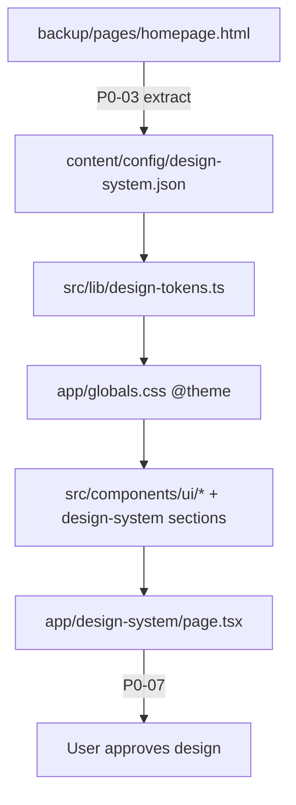

# Phase 0 Execution Plan — Design System Gate

## Current state (verified)

| Item                                                             | Status                                                   |
| ---------------------------------------------------------------- | -------------------------------------------------------- |
| [MASTER_PROMPT.md](MASTER_PROMPT.md)                             | **Verified** — exists at repo root (P0-01 done)          |
| [docs/ai/SESSION-STATE-BUILD.md](docs/ai/SESSION-STATE-BUILD.md) | **Observed** — exists but P0-02 still marked IN PROGRESS |
| `package.json` / Next.js app                                     | **Not yet created**                                      |
| `content/config/design-system.json`                              | **Not yet created**                                      |
| P0-07 user approval                                              | **NOT APPROVED** — blocks Phase 1+                       |

**Next unchecked task in order:** P0-02 (finalize tracker), then P0-03.

---

## Architecture (Phase 0 scope only)



**Single source of truth:** all brand values in [content/config/design-system.json](content/config/design-system.json). Components read tokens via CSS variables only — no hardcoded hex outside JSON + `globals.css`.

---

## P0-02 — Finalize session tracker

- Mark P0-02 **DONE** in [docs/ai/SESSION-STATE-BUILD.md](docs/ai/SESSION-STATE-BUILD.md)
- Standardize filename to `SESSION-STATE-BUILD.md` (plan YAML still references `SESSION-STATUS-BUILD.md` in one place — use SESSION-STATE-BUILD.md everywhere)
- Set next action to P0-03

---

## P0-03 — Extract brand tokens from backup

**Source files:**

- [backup/pages/homepage.html](backup/pages/homepage.html) — CSS variables and inline styles
- Logo URL (observed): `asset-109-removebg-preview-1.png` (729×216, alt "eCom Gliders Logo")

**Observed brand colors** (from `vamtam-theme-options` in homepage HTML):

| Token             | Hex       | Usage                               |
| ----------------- | --------- | ----------------------------------- |
| `primary`         | `#000000` | Button bg, links                    |
| `accent`          | `#EAAB1D` | Link hover, button hover            |
| `accentAlt`       | `#F5930A` | Secondary accent (Elementor blocks) |
| `accentHighlight` | `#ffab00` | Icon highlights                     |
| `textOnDark`      | `#FFFFFF` | Button text                         |
| `border`          | `#E2E2E2` | Input borders                       |
| `shadowAccent`    | `#162699` | Decorative card shadow              |
| `background`      | `#FFFFFF` | Page background                     |

**Fonts** (observed Google Font loads): Manrope, Syne, Kanit, Roboto, Inter Tight. During extraction, grep Elementor CSS in homepage for which font applies to headings vs body. **Proposed default until verified:** Manrope (body), Syne (display/headings) — confirm against rendered page or Elementor class rules.

**Logo asset (P0-03 sub-step):**

- Follow [.cursor/skills/asset-management/SKILL.md](.cursor/skills/asset-management/SKILL.md)
- Download logo PNG to `public/images/logo.png`
- Log provenance in [docs/research/DOWNLOAD-LOG.md](docs/research/DOWNLOAD-LOG.md)

**Output:** [content/config/design-system.json](content/config/design-system.json) using schema from plan lines 203–256 (brand, colors, typography, spacing, radius, shadows, components, motion, usage).

---

## P0-04 — Scaffold Next.js minimal

Scaffold at **repo root** per plan folder structure (coexists with `docs/`, `obsidian/`, `backup/`).

```bash
npx create-next-app@latest . --typescript --tailwind --eslint --app --src-dir --import-alias "@/*" --no-turbopack
```

Then configure:

- **Tailwind v4** — `@import "tailwindcss"` in [app/globals.css](app/globals.css), `@tailwindcss/postcss` in PostCSS
- **shadcn/ui init** — minimal: `button`, `badge`, `card`, `input`, `label`, `textarea`, `select`, `accordion`, `tabs`, `separator`, `navigation-menu`, `sheet`
- **Path alias:** `@/` → `src/`
- **tsconfig** paths for `@/content/*` if needed for JSON imports
- Ensure [.gitignore](.gitignore) already covers `.next/`, `node_modules/`

**Verify:** `npm run dev` starts without errors; default page loads.

**Rules to load:** `05-uiux`, `02-clean-code`, `10-web-performance`

---

## P0-05 — Token pipeline

Create:

| File                                                                             | Responsibility                                                                                  |
| -------------------------------------------------------------------------------- | ----------------------------------------------------------------------------------------------- |
| [src/lib/design-tokens.ts](src/lib/design-tokens.ts)                             | Read + validate `design-system.json` with Zod; export typed `tokens` object                     |
| [src/lib/design-tokens.css.ts](src/lib/design-tokens.css.ts) or inline in layout | Generate CSS custom property map from tokens                                                    |
| [app/globals.css](app/globals.css)                                               | `@theme { --color-brand-primary: var(--ds-primary); ... }` wired from token loader              |
| [app/layout.tsx](app/layout.tsx)                                                 | Inject CSS variables on `<html>` via inline style or data attribute from server-side token read |

**Validation test:** Change one hex in `design-system.json` → restart dev → color swatch on `/design-system` updates.

---

## P0-06 — Build `/design-system` page

Route: [app/design-system/page.tsx](app/design-system/page.tsx)

**16 sections** (each shows live preview + "Config key" label + "Used on" list):

1. Brand identity — `brand`
2. Color palette — `colors`
3. Typography — `typography`
4. Spacing and radius — `spacing`, `radius`
5. Shadows — `shadows`
6. Buttons — `components.button`
7. Badges and tags — `components.badge`
8. Cards — `components.card`
9. Forms — `components.form`
10. Navigation preview — `components.navigation`
11. Footer preview — `components.footer`
12. Containers — `components.container`
13. Browser mockup (static chrome) — `components.browserMockup`
14. Motion samples — `motion`
15. Icons (Lucide samples) — `icons`
16. Usage map table — `usage`

**Component structure** (keep files under 300 lines):

```
src/components/design-system/
  design-system-page.tsx       # orchestrator
  sections/                    # one file per section (brand, colors, typography, ...)
  config-key-label.tsx         # reusable "Config key: colors.primary" badge
```

**Metadata:** `robots: { index: false }` — dev/staging only page.

**Rules to load:** `05-uiux`, `13-professional-copy`, `09-assets-downloads`

**Verify:**

- Desktop (1280px) + mobile (375px) render via Playwright or browser screenshot
- No hardcoded brand hex in component files (grep check)
- `tsc --noEmit` passes
- ESLint clean on touched files

---

## P0-07 — User approval gate (STOP)

After P0-06, **do not proceed to Phase 1**. User must:

1. Run `npm run dev`
2. Open `http://localhost:3000/design-system`
3. Review all 16 sections
4. Reply with approval or specific feedback

If feedback: P0-08 adjusts `design-system.json` only (not component hardcoding).

---

## Documentation updates (end of session)

| File                                                             | Update                           |
| ---------------------------------------------------------------- | -------------------------------- |
| [docs/ai/SESSION-STATE-BUILD.md](docs/ai/SESSION-STATE-BUILD.md) | Check off completed P0 tasks     |
| [docs/ai/SESSION-STATE.md](docs/ai/SESSION-STATE.md)             | Phase 0 progress                 |
| [docs/ai/CHAT-SUMMARIES.md](docs/ai/CHAT-SUMMARIES.md)           | Brand token extraction decisions |
| [docs/qa/VERIFICATION-LOG.md](docs/qa/VERIFICATION-LOG.md)       | Dev server + screenshot evidence |

---

## Risks and mitigations

| Risk                                               | Mitigation                                                                                   |
| -------------------------------------------------- | -------------------------------------------------------------------------------------------- |
| Multiple fonts on current site                     | Extract primary heading + body from Elementor CSS; document choice in DECISIONS if ambiguous |
| Logo not in local backup/assets                    | Download from observed URL; log in DOWNLOAD-LOG                                              |
| create-next-app conflicts with existing root files | Use `.` with existing files; create-next-app skips conflicts or merge manually               |
| shadcn defaults use zinc palette                   | Override all shadcn CSS variables from design-system tokens in globals.css                   |

---

## Self-test gate (Phase 0 completion criteria)

- TypeScript compiles, no lint errors on touched files
- No hardcoded brand colors outside `design-system.json` and `globals.css`
- `/design-system` renders all 16 sections at desktop + mobile
- Each component section shows config key label
- `npm run dev` works
- SESSION-STATE-BUILD.md reflects accurate task status

**NOT verified until P0-07:** User design approval.
