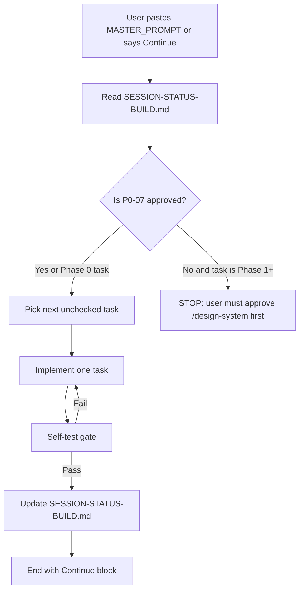
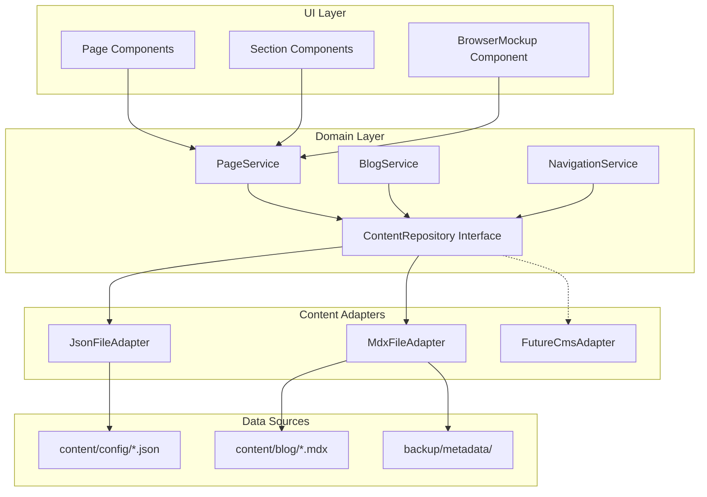

# TypeScript Web Stack and Browser Interaction Plan

## Context

eCom Gliders migration requirements (from completed research):

- **328 blog posts** at root-level URLs (must preserve exactly)
- **26 pages** + service pages, case studies, free audit
- **Design target:** Tier B boutique premium (Olifant) + Tier C conversion (AMZ Dudes)
- **Key UX ask:** Cursor.com-style in-page browser mockups with tabbed views and smooth transitions
- **Content strategy (user decision):** JSON-configurable content in-repo now; CMS/admin panel integration later via abstraction layer
- **Branding rule (non-negotiable):** Preserve eCom Gliders brand exactly. Extract colors, fonts, logo from `backup/`. Do NOT change to competitor palettes (Olifant navy, AMZ Dudes orange, etc.)
- **First deliverable:** Live `/design-system` review page before any marketing pages
- **Operating system:** All work must follow [`cursor_project_prompt_cookbook.md`](cursor_project_prompt_cookbook.md), [`.cursor/rules/`](.cursor/rules/), [`.cursor/skills/`](.cursor/skills/), and [`AGENTS.md`](AGENTS.md) on every session

---

## Rules and skills — mandatory every session

Derived from [`cursor_project_prompt_cookbook.md`](cursor_project_prompt_cookbook.md) Sections 01, 04, 53, 63, 64 and project [`AGENTS.md`](AGENTS.md).

### Always read before any task

| File | Why |
|------|-----|
| [`AGENTS.md`](AGENTS.md) | Project scope, rules index, completion format |
| [`docs/ai/SESSION-STATE-BUILD.md`](docs/ai/SESSION-STATE-BUILD.md) | Current task, what is done, what is next |
| [`.cursor/plans/typescript_web_stack_e4470b1d.plan.md`](.cursor/plans/typescript_web_stack_e4470b1d.plan.md) | Full build plan and task order |
| [`cursor_project_prompt_cookbook.md`](cursor_project_prompt_cookbook.md) Sections 01-02, 53, 63-64 | Core philosophy, anti-hallucination, verification, master prompt |
| [`.cursor/rules/00-project-core.mdc`](.cursor/rules/00-project-core.mdc) | Read before changing, plan before multi-file work |

### Rules to load by task type

| Task type | Required rules |
|-----------|---------------|
| Design system / UI components | `05-uiux`, `02-clean-code`, `10-web-performance`, `13-professional-copy`, `09-assets-downloads` |
| Header, footer, nav | `05-uiux`, `12-migration-seo-preservation`, `13-professional-copy` |
| Homepage / service pages | `05-uiux`, `06-seo-aeo-geo`, `13-professional-copy`, `10-web-performance` |
| Blog migration / routes | `12-migration-seo-preservation`, `06-seo-aeo-geo`, `08-testing-verification` |
| Forms / API routes | `03-security`, `08-testing-verification` |
| Content / JSON config | `01-architecture`, `02-clean-code`, `11-documentation` |
| Browser mockup / Motion | `05-uiux`, `10-web-performance`, `02-clean-code` |
| Any substantial decision | `01-architecture` + document in `docs/project/DECISIONS.md` |

### Skills to load when task matches

| Skill | Load when |
|-------|-----------|
| [`.cursor/skills/asset-management/SKILL.md`](.cursor/skills/asset-management/SKILL.md) | Downloading logos, icons, images from backup or web |
| [`.cursor/skills/seo-audit/SKILL.md`](.cursor/skills/seo-audit/SKILL.md) | Any indexable page: title, meta, schema, H1, FAQ |
| [`.cursor/skills/migration-audit/SKILL.md`](.cursor/skills/migration-audit/SKILL.md) | Blog URL preservation, content migration, redirects |
| [`.cursor/skills/web-audit/SKILL.md`](.cursor/skills/web-audit/SKILL.md) | Visual verification, responsive check, Playwright |
| [`.cursor/skills/research/SKILL.md`](.cursor/skills/research/SKILL.md) | External facts, competitor behavior, live site checks |
| [`.cursor/skills/competitive-research/SKILL.md`](.cursor/skills/competitive-research/SKILL.md) | Keyword or positioning decisions |

**Rule:** If a skill exists for the task, read and follow it before improvising.

### Cookbook workflow (every session)

From cookbook Section 07 and 64:

```
Understand -> Inspect -> Research -> Plan -> Implement -> Verify -> Review -> Document -> Complete
```

**Anti-loop rule (cookbook 01.11):** One discovery pass, one plan pass, one implementation pass, one verification pass. Stop loops. Report exact blockers after one correction pass.

**Evidence language only (cookbook 02.1):** Verified, Observed, Assumed, Proposed, Requires confirmation, Not yet tested.

**Completion format (cookbook 63):** STATUS, IMPLEMENTED, VERIFIED, NOT VERIFIED, DOCUMENTED, REMAINING, NEXT ACTION. Never say COMPLETE without verification evidence.

### Documentation sync (cookbook 57)

After any material decision or completed phase, update:

| File | When |
|------|------|
| [`docs/ai/SESSION-STATE-BUILD.md`](docs/ai/SESSION-STATE-BUILD.md) | Every session end |
| [`docs/ai/SESSION-STATE.md`](docs/ai/SESSION-STATE.md) | Phase changes |
| [`docs/ai/CHAT-SUMMARIES.md`](docs/ai/CHAT-SUMMARIES.md) | Material decisions |
| [`docs/project/DECISIONS.md`](docs/project/DECISIONS.md) | Architecture or direction changes |
| [`docs/qa/VERIFICATION-LOG.md`](docs/qa/VERIFICATION-LOG.md) | After verification passes |
| [`obsidian/12-Decisions/`](obsidian/12-Decisions/) | ADR-style records for patterns introduced |

---

## Branding preservation rules

| Rule | Detail |
|------|--------|
| Colors | Extract from `backup/pages/homepage.html` CSS and `backup/assets/`. Map to tokens in `design-system.json`. Never use competitor colors. |
| Logo | Use existing logo files from backup. SVG preferred. No redesign. |
| Fonts | Match current site fonts from backup. Do not switch to Inter/generic unless current site already uses them. |
| Tone | Professional Amazon agency voice per `.cursor/rules/13-professional-copy.mdc` |
| Metrics | Only verified claims ($112M+, 95%, 20+, since 2018, Verified Partner) |
| Competitor inspiration | Layout patterns and UX only. Never copy colors, copy, or assets. |

All design tokens live in **one file**: `content/config/design-system.json`. Components read tokens from this file or CSS variables generated from it. No hardcoded colors in components.

---

## Phase 0: Design System review page (FIRST — blocks everything else)

Before homepage, services, or blog work, build a live `/design-system` page the user can open in browser and approve.

### Purpose

- User reviews every UI element in one place
- Each element shows: live preview, token name, JSON config key, where it is used on site
- Single configurable point per element — change JSON, whole site updates
- Approval gate: no marketing pages until user says design system is approved

### Route

`app/design-system/page.tsx` (dev/staging only; `noindex` in production or behind env flag)

### Page sections (in order)

| # | Section on /design-system | What it shows | JSON config key |
|---|---------------------------|---------------|-----------------|
| 1 | Brand identity | Logo variants, tagline, partner badge | `design-system.json` -> `brand` |
| 2 | Color palette | All color swatches with hex + token name + contrast ratio | `colors` |
| 3 | Typography | Display, H1-H4, body, small, stat — live text samples | `typography` |
| 4 | Spacing and radius | Visual scale bars for space-xs through space-4xl, radius tokens | `spacing`, `radius` |
| 5 | Shadows | shadow-sm, shadow-md, shadow-lg on sample cards | `shadows` |
| 6 | Buttons | Primary CTA, secondary, ghost, disabled, loading states | `components.button` |
| 7 | Badges and tags | Service tag, metric badge, partner badge | `components.badge` |
| 8 | Cards | Stat card, service card, case study card, testimonial card | `components.card` |
| 9 | Forms | Input, textarea, select, label, error state, success state | `components.form` |
| 10 | Navigation | Header preview, mega menu preview, mobile nav preview | `components.navigation` |
| 11 | Footer | Pre-footer CTA band + 4-column footer preview | `components.footer` |
| 12 | Containers | Section wrapper, content container, grid layouts (2/3/4 col) | `components.container` |
| 13 | Browser mockup | Tab chrome, URL bar, content panel (static preview before Motion) | `components.browserMockup` |
| 14 | Motion | Tab transition, card hover, fade-in samples with reduced-motion fallback | `motion` |
| 15 | Icons | Approved icon set samples (Lucide, no Unicode symbols) | `icons` |
| 16 | Usage map | Table: component -> used on which pages | `usage` |

Each section includes a **"Config key"** label and **"Used on"** list so user knows the single point to edit.

### design-system.json structure

```json
{
  "brand": {
    "name": "eCom Gliders",
    "tagline": "Full-service Amazon account management",
    "logo": { "light": "/images/logo.svg", "dark": "/images/logo-dark.svg" },
    "partnerBadge": "/images/amazon-verified-partner.png"
  },
  "colors": {
    "primary": { "value": "#EXTRACT_FROM_BACKUP", "usage": "Headers, nav, key UI" },
    "accent": { "value": "#EXTRACT_FROM_BACKUP", "usage": "All CTA buttons" },
    "background": { "value": "#FFFFFF", "usage": "Page background" },
    "surface": { "value": "#F8F9FA", "usage": "Cards, sections" },
    "textPrimary": { "value": "#EXTRACT_FROM_BACKUP", "usage": "Body, headings" },
    "textSecondary": { "value": "#EXTRACT_FROM_BACKUP", "usage": "Meta, captions" },
    "border": { "value": "#E5E7EB", "usage": "Dividers, card borders" },
    "success": { "value": "#16A34A", "usage": "Form success" },
    "error": { "value": "#DC2626", "usage": "Form errors" }
  },
  "typography": {
    "fontFamily": { "sans": "EXTRACT_FROM_BACKUP", "mono": "JetBrains Mono" },
    "scale": {
      "display": { "size": "48px", "weight": 700, "lineHeight": 1.1 },
      "h1": { "size": "40px", "weight": 700, "lineHeight": 1.2 },
      "h2": { "size": "32px", "weight": 600, "lineHeight": 1.25 },
      "h3": { "size": "24px", "weight": 600, "lineHeight": 1.3 },
      "h4": { "size": "20px", "weight": 600, "lineHeight": 1.35 },
      "body": { "size": "16px", "weight": 400, "lineHeight": 1.6 },
      "small": { "size": "14px", "weight": 400, "lineHeight": 1.5 },
      "stat": { "size": "40px", "weight": 700, "lineHeight": 1.0 }
    }
  },
  "spacing": { "xs": "4px", "sm": "8px", "md": "16px", "lg": "24px", "xl": "32px", "2xl": "48px", "3xl": "64px", "4xl": "96px" },
  "radius": { "sm": "4px", "md": "8px", "lg": "12px", "full": "9999px" },
  "shadows": { "sm": "...", "md": "...", "lg": "...", "header": "..." },
  "components": {
    "button": { "primary": { "bg": "accent", "text": "#FFFFFF", "radius": "sm", "height": "44px" }, "secondary": { ... } },
    "card": { "stat": { "padding": "lg", "radius": "md", "shadow": "md" }, "service": { ... }, "caseStudy": { ... }, "testimonial": { ... } },
    "container": { "sectionPadding": "3xl", "maxWidth": "1280px", "contentMaxWidth": "768px" },
    "navigation": { "height": "72px", "sticky": true, "ctaLabel": "Free Audit" },
    "footer": { "columns": 4, "preFooterBg": "primary" },
    "browserMockup": { "chromeHeight": "40px", "borderRadius": "lg", "autoRotateInterval": 8000 }
  },
  "motion": {
    "tabTransition": { "duration": 200, "ease": "easeOut" },
    "cardHover": { "translateY": -2, "shadow": "lg" },
    "reducedMotion": "instant"
  },
  "usage": {
    "StatCard": ["homepage.stats", "service-page.stats"],
    "ServiceCard": ["homepage.services", "service-page.related"],
    "BrowserMockup": ["homepage.hero", "service-ppc.hero", "free-audit.preview"]
  }
}
```

CSS variables in `app/globals.css` are **generated from** this JSON at build time (or read at runtime). Components never hardcode values.

### Component architecture (single configurable point)

```
content/config/design-system.json     <-- SINGLE SOURCE (user edits here)
        |
        v
src/lib/design-tokens.ts              <-- reads JSON, exports typed tokens
        |
        v
app/globals.css @theme                 <-- CSS variables from tokens
        |
        v
src/components/ui/*                    <-- shadcn primitives use tokens
src/components/sections/*              <-- section components use tokens + JSON content
```

Every component accepts optional `className` override but defaults come from `design-system.json` only.

---

## MASTER_PROMPT (paste this every Cursor session)

Save to `MASTER_PROMPT.md` at repo root on first execution (P0-01). Based on [`cursor_project_prompt_cookbook.md`](cursor_project_prompt_cookbook.md) Section 64 + eCom Gliders rules/skills.

**How to use:** Paste entire block below, or say: `Continue eCom Gliders build. Follow MASTER_PROMPT.md.`

```markdown
# eCom Gliders Build — Master Prompt

You are the project's senior architect, implementation engineer, UX reviewer, SEO strategist, and verification agent.

Operating system: cursor_project_prompt_cookbook.md + AGENTS.md + .cursor/rules/ + .cursor/skills/

## BEFORE ANYTHING (mandatory read order)

1. docs/ai/SESSION-STATE-BUILD.md — find NEXT unchecked task only
2. .cursor/plans/typescript_web_stack_e4470b1d.plan.md — full plan
3. AGENTS.md — project scope and rules index
4. cursor_project_prompt_cookbook.md — Sections 01, 02, 53, 63, 64
5. .cursor/rules/00-project-core.mdc — always apply
6. Load task-specific rules from plan "Rules to load by task type" table
7. Load matching skill from .cursor/skills/ if task matches
8. Read relevant obsidian/ and docs/ files before changing anything

Do NOT rely on chat history. Repository is source of truth.

## NON-NEGOTIABLES

### Branding
- Preserve eCom Gliders brand from backup/. Extract colors, fonts, logo from backup.
- Do NOT use competitor colors or redesign brand.
- All tokens in content/config/design-system.json only. No hardcoded hex in components.

### SEO and migration
- 328 blog URLs at root level must stay identical. See backup/metadata/blog-inventory.json.
- Every indexable page needs SEO record in docs/seo/SITE-SEO-MAP.md.
- Load .cursor/skills/seo-audit/SKILL.md for pages with metadata or schema.
- Load .cursor/skills/migration-audit/SKILL.md for blog/content migration.

### Architecture and code
- JSON-configurable via content/config/*.json. ContentRepository interface required.
- SOLID, composition over inheritance, no god objects. Read 01-architecture + 02-clean-code rules.

### Security
- No secrets in code. Server-side validation. CSRF on state-changing requests. Read 03-security rule.

### Copy and UI
- Professional Amazon agency voice. No emoji. No Unicode symbols as icons. No AI marketing clichés.
- Read 13-professional-copy, 09-assets-downloads, 05-uiux rules. Design system is a contract (cookbook S25).

### Anti-hallucination (cookbook Section 02)
- Never claim implemented/tested/verified/complete without evidence.
- Use only: Verified, Observed, Assumed, Proposed, Requires confirmation, Not yet tested.
- Substantial decisions: WHAT, WHY, HOW, EVIDENCE, RISK, VALIDATION.

### Dependencies (cookbook Section 55)
- Before new package: verify existing deps, maintenance, license, bundle impact. Paid libs: build in-house.

## SESSION LOOP

1. Read SESSION-STATE-BUILD.md
2. Pick next unchecked task IN ORDER
3. Load rules + skills for that task type (see plan table)
4. If Phase 1+ and P0-07 not approved: STOP — user must approve /design-system
5. Implement ONE task (or phase if user says "keep going")
6. Self-test gate (below)
7. Update SESSION-STATE-BUILD.md, SESSION-STATE.md
8. Material decisions: DECISIONS.md + CHAT-SUMMARIES.md
9. End with Continue block

Workflow: Understand -> Inspect -> Research -> Plan -> Implement -> Verify -> Review -> Document -> Complete

## SELF-TEST GATE

- [ ] TypeScript compiles, no lint errors on touched files
- [ ] No hardcoded brand colors outside design-system.json and globals.css
- [ ] If UI: render browser, desktop + mobile viewport
- [ ] If component: on /design-system with config key label
- [ ] If indexable page: SEO + schema per seo-audit skill
- [ ] If form/API: validation + CSRF per security rules
- [ ] If visual: screenshot or Playwright evidence (cookbook Section 54)
- [ ] Docs updated if material decision

## TASK ORDER (see plan for full P0-P4 checklist)

Phase 0 BLOCKER: P0-01 through P0-07 (user approves /design-system)
Phase 1: P1-01 through P1-09 (after approval)
Phase 2: P2-01 through P2-05
Phase 3: P3-01 through P3-08
Phase 4: P4-01 through P4-05

## CONTINUE BLOCK (end every reply)

STATUS: [task id] — Complete / Partially Complete / Blocked
IMPLEMENTED: [what was built]
VERIFIED: [evidence]
NOT VERIFIED: [gaps]
DOCUMENTED: [docs updated]
REMAINING: [unchecked count]
NEXT ACTION: [exact next task id]
USER ACTION NEEDED: [yes/no]

Do not say COMPLETE without verification (cookbook Section 63).
```

### Alternate short prompts (cookbook Sections 65-67)

| Situation | Paste |
|-----------|-------|
| Continue build | `Continue eCom Gliders build. Follow MASTER_PROMPT.md.` |
| Audit work | `Audit against project rules. Follow cookbook Section 67.` |
| Plan only | `Do not code. Plan only. Follow cookbook Section 65.` |
| Design review | `Show /design-system status. Approved vs pending.` |
| Blog migration | `Continue blog migration. Load migration-audit + seo-audit skills.` |

---

## Interactive task checklist (full order)

User and agent track progress in `docs/ai/SESSION-STATUS-BUILD.md`. Check off one task per session (or more if user says "keep going").

### Phase 0: Design System (BLOCKER — must complete and get user approval first)

| ID | Task | Output | Verify |
|----|------|--------|--------|
| P0-01 | Create MASTER_PROMPT.md | `MASTER_PROMPT.md` at repo root | File exists, pasteable |
| P0-02 | Create session tracker | `docs/ai/SESSION-STATUS-BUILD.md` | Shows P0-03 as next |
| P0-03 | Extract brand from backup | `content/config/design-system.json` with real hex/fonts from backup | Colors match current site screenshot |
| P0-04 | Scaffold Next.js minimal | `package.json`, `app/layout.tsx`, Tailwind v4, shadcn init | `npm run dev` works |
| P0-05 | Build token pipeline | `src/lib/design-tokens.ts` reads JSON -> CSS vars | Tokens change when JSON edits |
| P0-06 | Build /design-system page | `app/design-system/page.tsx` with all 16 sections | Page renders all elements |
| P0-07 | **USER REVIEW** | User opens localhost/design-system | User approves or requests changes |
| P0-08 | Fix design feedback | Adjust design-system.json per user notes | User re-approves |

### Phase 1: Foundation (only after P0-07 approved)

| ID | Task | Output | Verify |
|----|------|--------|--------|
| P1-01 | Tech stack doc | `obsidian/03-Architecture/Tech-Stack.md` | Complete |
| P1-02 | Content architecture doc | `obsidian/03-Architecture/Content-Architecture.md` | Repository interface defined |
| P1-03 | Browser mockup spec | `obsidian/07-UX/Browser-Mockup-Spec.md` | API documented |
| P1-04 | Update decisions | `docs/project/DECISIONS.md` Q3 resolved | Stack recorded |
| P1-05 | site.json + navigation.json | `content/config/site.json`, `navigation.json` | Zod validates |
| P1-06 | ContentRepository + adapter | `src/domain/`, `src/infrastructure/` | Interface + JSON adapter |
| P1-07 | Header + mega menu | `src/components/layout/` | Matches Navigation-Footer-Spec |
| P1-08 | Footer | 4-column + pre-footer CTA | Matches spec |
| P1-09 | Mobile nav | Sheet drawer, 44px targets | Keyboard accessible |

### Phase 2: Homepage and browser mockup

| ID | Task | Output | Verify |
|----|------|--------|--------|
| P2-01 | BrowserMockup component | `src/components/browser-mockup/` | On /design-system section 13 |
| P2-02 | homepage.json content | `content/config/homepage.json` | All 12 sections defined |
| P2-03 | Section components | `src/components/sections/` (12 files) | Each uses design tokens |
| P2-04 | Homepage assembly | `app/page.tsx` | 12 sections render |
| P2-05 | Homepage SEO | metadata + FAQPage schema | Rich results test passes |

### Phase 3: Blog and pages

| ID | Task | Output | Verify |
|----|------|--------|--------|
| P3-01 | WP-to-MDX script | `scripts/migration/wp-to-mdx.ts` | 328 files generated |
| P3-02 | Blog catch-all route | `app/[slug]/page.tsx` | Sample posts render |
| P3-03 | Blog template | TOC, FAQ, author, related posts | Matches Page-Templates.md |
| P3-04 | URL verification | Playwright test 328 URLs | 0 failures |
| P3-05 | Service page template | Dedicated layout, Service schema | PPC page works |
| P3-06 | Case study pages | Index + detail | GoSports 310% case |
| P3-07 | Contact + audit forms | Server Actions + Zod | Form submits |
| P3-08 | About page | `/about-us/` preserved | Renders |

### Phase 4: Launch prep

| ID | Task | Output | Verify |
|----|------|--------|--------|
| P4-01 | Sitemap | next-sitemap all routes | Valid XML |
| P4-02 | Lighthouse audit | 90+ all categories | Report saved |
| P4-03 | Accessibility audit | WCAG AA | axe clean |
| P4-04 | Staging deploy | Vercel preview URL | Site live |
| P4-05 | Search Console | Sitemap submitted | Confirmed |

---

## Session loop diagram



---

## Recommended stack (decision)

| Layer            | Choice                                     | Why                                                                                       |
| ---------------- | ------------------------------------------ | ----------------------------------------------------------------------------------------- |
| Framework        | **Next.js 15** (App Router)                | SSR/SSG/ISR for SEO, metadata API, image optimization, catch-all routes for 328 blog URLs |
| Language         | **TypeScript 5** (strict)                  | Type-safe content config, component props, schema validation                              |
| Styling          | **Tailwind CSS v4**                        | `@theme` tokens in CSS, matches shadcn ecosystem, fast iteration                          |
| UI primitives    | **shadcn/ui** (free, owned code)           | Accessible Radix primitives, no vendor lock-in, CLI install                               |
| Animations       | **Motion** (`motion/react`)                | Tab transitions, browser content swaps, scroll reveals. NOT legacy `framer-motion`        |
| Icons            | **Lucide React**                           | shadcn default, professional, no Unicode symbols                                          |
| Content (now)    | **JSON + MDX files**                       | Configurable, version-controlled, CMS-ready abstraction                                   |
| Content (future) | **Keystatic or Payload** via adapter       | Plugs into same `ContentRepository` interface                                             |
| Forms            | **React Hook Form + Zod + Server Actions** | Type-safe validation, no client-side secrets                                              |
| SEO              | **next/metadata + schema-dts**             | Per-page metadata, FAQPage/Organization/Service schema                                    |
| Deployment       | **Vercel** (proposed)                      | Native Next.js, ISR, edge, preview deploys                                                |

**Not recommended:**

- Framer.com design exports as production code (not maintainable, poor SEO control)
- Pre-built paid block libraries (Tailark Pro, Aceternity Pro) -- build custom in-house instead
- Astro (weaker for interactive browser components + future CMS admin in same app)
- Plain React SPA (SEO penalty for 328 indexed posts)

---

## Architecture: CMS-ready content layer

User requirement: JSON-configurable now, CMS later. Use **Repository + Adapter pattern** so content source is swappable without touching UI components.



### JSON config files (initial content source)

| File                               | Configures                                                         |
| ---------------------------------- | ------------------------------------------------------------------ |
| `content/config/site.json`         | Name, tagline, phone, email, address, social links, partner badges |
| `content/config/navigation.json`   | Header nav, mega menu columns, footer columns, CTA labels          |
| `content/config/homepage.json`     | All 12 homepage sections (hero, stats, services, cases, FAQ, etc.) |
| `content/config/services/*.json`   | Per-service page content (hero, stats, deliverables, FAQ)          |
| `content/config/case-studies.json` | Case study index + card data                                       |
| `content/config/testimonials.json` | Named quotes with role and company                                 |
| `content/config/faq.json`          | Shared and page-specific FAQ items                                 |

### Blog content (MDX, separate from JSON)

328 posts migrate to `content/blog/{slug}.mdx` with frontmatter:

```typescript
interface BlogPostFrontmatter {
  title: string;
  slug: string; // must match current URL exactly
  publishedAt: string;
  updatedAt: string;
  author: string;
  categories: string[];
  tags: string[];
  metaTitle: string;
  metaDescription: string;
  canonical: string;
  featuredImage: string;
  excerpt: string;
}
```

Routing: `app/[slug]/page.tsx` catch-all with static generation from slug inventory in [`backup/metadata/blog-inventory.json`](backup/metadata/blog-inventory.json).

### Domain interfaces (OOP, SOLID)

```typescript
// src/domain/content/content-repository.ts
interface ContentRepository {
  getSiteConfig(): Promise<SiteConfig>;
  getNavigation(): Promise<NavigationConfig>;
  getHomepage(): Promise<HomepageConfig>;
  getService(slug: string): Promise<ServicePageConfig | null>;
  getCaseStudies(): Promise<CaseStudyConfig[]>;
  getBlogPost(slug: string): Promise<BlogPost | null>;
  getAllBlogSlugs(): Promise<string[]>;
}

// src/infrastructure/content/json-content-repository.ts
class JsonContentRepository implements ContentRepository { ... }

// Future: src/infrastructure/content/payload-content-repository.ts
class PayloadContentRepository implements ContentRepository { ... }
```

UI components depend on `ContentRepository` interface, never on JSON files directly. Future CMS = swap adapter, zero page rewrites.

---

## Package stack (detailed)

### Core (install at scaffold)

| Package                    | Version | Purpose                             |
| -------------------------- | ------- | ----------------------------------- |
| `next`                     | 15.x    | Framework                           |
| `react` / `react-dom`      | 19.x    | UI                                  |
| `typescript`               | 5.x     | Types                               |
| `tailwindcss`              | 4.x     | Styling via `@import "tailwindcss"` |
| `@tailwindcss/postcss`     | 4.x     | PostCSS plugin                      |
| `clsx` + `tailwind-merge`  | latest  | `cn()` helper                       |
| `class-variance-authority` | latest  | Button/card variants                |
| `zod`                      | latest  | Config + form validation            |

### shadcn/ui components to install (selective, not all 40+)

**Navigation and layout:**

- `navigation-menu` -- mega menu
- `sheet` -- mobile nav drawer
- `button`, `badge` -- CTAs and tags

**Content sections:**

- `accordion` -- FAQ (with FAQPage schema)
- `card` -- stat cards, service cards, case study cards
- `tabs` -- browser mockup tab switching, seller segmentation
- `separator` -- section dividers

**Forms:**

- `input`, `textarea`, `select`, `label`, `form` -- contact and audit forms
- `dialog` -- optional supplementary lead modal (not primary contact)

**Feedback:**

- `sonner` -- toast notifications on form submit

### Animation (free, MIT)

| Package                 | Purpose                                                  | Usage on eCom Gliders                  |
| ----------------------- | -------------------------------------------------------- | -------------------------------------- |
| `motion`                | Tab transitions, fade/blur content swaps, scroll reveals | Browser mockup, hero, case study cards |
| `@formkit/auto-animate` | List reorder animations                                  | Optional for FAQ expand                |

Import path: `import { motion, AnimatePresence } from "motion/react"` (always `"use client"` in App Router).

### SEO and metadata

| Package        | Purpose                                                         |
| -------------- | --------------------------------------------------------------- |
| `schema-dts`   | Type-safe JSON-LD (Organization, Service, FAQPage, BlogPosting) |
| `next-sitemap` | Auto sitemap from routes + blog slugs                           |

### Content processing

| Package                                    | Purpose                                         |
| ------------------------------------------ | ----------------------------------------------- |
| `gray-matter`                              | Parse MDX frontmatter                           |
| `@next/mdx` or `next-mdx-remote`           | Render blog MDX                                 |
| `remark-gfm`                               | GitHub-flavored markdown (tables in blog posts) |
| `rehype-slug` + `rehype-autolink-headings` | TOC anchor links (preserve ez-toc behavior)     |
| `reading-time`                             | Blog reading time meta                          |

### Forms and email

| Package                               | Purpose                                     |
| ------------------------------------- | ------------------------------------------- |
| `react-hook-form`                     | Form state                                  |
| `@hookform/resolvers`                 | Zod integration                             |
| `resend` or `@react-email/components` | Transactional email for audit/contact forms |

### Dev tooling

| Package                                    | Purpose                                          |
| ------------------------------------------ | ------------------------------------------------ |
| `eslint` + `eslint-config-next`            | Linting                                          |
| `prettier` + `prettier-plugin-tailwindcss` | Formatting                                       |
| `@playwright/test`                         | E2E (URL preservation verification)              |
| `vitest`                                   | Unit tests for content repository and validators |

---

## Free libraries to use (not build from scratch)

These are MIT/free, install via shadcn CLI, you own the code:

| Library                                  | What to take                                                                            | What NOT to take                                               |
| ---------------------------------------- | --------------------------------------------------------------------------------------- | -------------------------------------------------------------- |
| **shadcn/ui**                            | All primitives listed above                                                             | Do not install entire catalog                                  |
| **Magic UI** (free tier)                 | `marquee` (trust bar logos), `number-ticker` (stats), `animated-beam` (optional accent) | Skip particle effects, terminal animations (too SaaS-dev-tool) |
| **shadcn.io blocks** (free)              | Reference layout for split hero, comparison table                                       | Copy structure, rebuild with brand tokens                      |
| **Aceternity UI** (free components only) | Study `Hero Section With Tabs` browser pattern as reference                             | Do not use paid Pro blocks; build custom                       |

**Build in-house (user preference for paid-quality features):**

- Browser mockup chrome (tabs, URL bar, traffic lights)
- Tab-switching content panels with Motion transitions
- Mega menu with CTA panel
- Service page template
- Case study filter grid

---

## Custom Browser Mockup component (Cursor-style)

This is the centerpiece UX feature. Build as a reusable `BrowserMockup` component, not a third-party dependency.

### Reference patterns studied

| Source                    | Pattern                                       | eCom Gliders adaptation                     |
| ------------------------- | --------------------------------------------- | ------------------------------------------- |
| cursor.com marketing      | Split hero + product preview in browser frame | Amazon Seller Central / PPC dashboard views |
| Aceternity Hero With Tabs | Auto-rotating tabs, fade+blur transitions     | Manual + auto tab switch for services       |
| shadcn.io blocks          | Tab-switch browser hero with AnimatePresence  | Same technique, custom chrome               |
| react-chrome-mockup       | Pixel-accurate Chrome UI                      | Too heavy; build simplified chrome in-house |

### Component spec: `BrowserMockup`

```
src/components/browser-mockup/
  browser-mockup.tsx          # Main container (client component)
  browser-chrome.tsx          # Traffic lights + tab bar + URL bar
  browser-tab.tsx             # Individual tab
  browser-content-panel.tsx   # Animated content area
  browser-mockup.types.ts     # TabConfig, BrowserMockupProps
  index.ts
```

**Props interface:**

```typescript
interface BrowserTab {
  id: string;
  label: string; // "PPC Dashboard", "Listing SEO", "Account Health"
  url: string; // "sellercentral.amazon.com/ppc"
  content: React.ReactNode; // Screenshot, chart, or composed UI
}

interface BrowserMockupProps {
  tabs: BrowserTab[];
  defaultTab?: string;
  autoRotate?: boolean; // Auto-switch every 8-10s
  autoRotateInterval?: number;
  className?: string;
}
```

**Animation behavior (Motion):**

- Tab click: `AnimatePresence` with `opacity: 0->1`, `y: 8->0`, `filter: blur(4px)->blur(0)` (200ms)
- Auto-rotate: pauses on hover, resumes on mouse leave
- URL bar: animates URL text on tab switch
- Respects `prefers-reduced-motion`: instant swap, no blur

**Accessibility:**

- Tabs are real `<button>` elements with `role="tablist"` / `role="tab"` / `role="tabpanel"`
- Keyboard: Arrow keys switch tabs
- `aria-selected` on active tab
- Content panels are not iframes (no accessibility trap)

### Where to use BrowserMockup on eCom Gliders

| Page                 | Section                             | Tab content                                                                                      |
| -------------------- | ----------------------------------- | ------------------------------------------------------------------------------------------------ |
| Homepage hero        | Right visual (replace static image) | Tab 1: PPC performance chart, Tab 2: Listing optimization score, Tab 3: Account health dashboard |
| Service: PPC         | Hero or results section             | Before/after ACOS, campaign structure, keyword report                                            |
| Service: Listing SEO | Hero                                | Keyword ranking, listing score, search visibility                                                |
| Case study detail    | Results section                     | Client metrics dashboard mockup                                                                  |
| Free audit page      | "What you get" section              | Sample audit report preview                                                                      |
| Process section      | Step visualization                  | Audit -> Strategy -> Execute -> Report as tab progression                                        |

Content for each tab panel comes from JSON config (`homepage.json` -> `hero.browserTabs[]`), not hardcoded in component.

---

## Homepage section to package mapping

From [`.cursor/plans/2026-09-02-homepage-redesign-brief.md`](.cursor/plans/2026-09-02-homepage-redesign-brief.md):

| #   | Section       | Component source                      | Package                                |
| --- | ------------- | ------------------------------------- | -------------------------------------- |
| 1   | Hero          | Custom split layout + `BrowserMockup` | shadcn Button + Motion                 |
| 2   | Trust bar     | Custom + Magic UI `marquee`           | Magic UI (free)                        |
| 3   | Stats row     | Custom `StatCard` x4                  | shadcn Card + Magic UI `number-ticker` |
| 4   | Services      | Custom `ServiceCard` 3x2 grid         | shadcn Card                            |
| 5   | Who we serve  | Custom tabs                           | shadcn Tabs                            |
| 6   | Case studies  | Custom `CaseStudyCard`                | shadcn Card + Motion hover             |
| 7   | Process       | Custom numbered steps                 | Lucide icons                           |
| 8   | Agency vs DIY | Custom comparison table               | shadcn Table (build or native HTML)    |
| 9   | Testimonials  | Custom quote cards                    | shadcn Card                            |
| 10  | Blog insights | Custom post cards                     | next/image                             |
| 11  | FAQ           | shadcn Accordion + FAQPage schema     | shadcn Accordion                       |
| 12  | Final CTA     | Custom CTA band + form link           | shadcn Button                          |

---

## Project folder structure

```
ecomGliders/
  app/
    layout.tsx                    # Root layout, fonts, metadata
    page.tsx                      # Homepage (reads homepage.json)
    [slug]/page.tsx               # Blog posts (328 URLs)
    about-us/page.tsx
    contact/page.tsx
    case-studies/page.tsx
    case-studies/[slug]/page.tsx
    free-audit-2/page.tsx
    amazon-ppc-management-agency/page.tsx
    full-service-amazon-agency/page.tsx
    api/
      contact/route.ts            # Form handler
      audit/route.ts              # Audit form handler
  src/
    components/
      browser-mockup/             # Custom in-house (Cursor-style)
      layout/                     # Header, Footer, MegaMenu, MobileNav
      sections/                   # Hero, StatsRow, Services, FAQ, etc.
      ui/                         # shadcn primitives
    domain/
      content/                    # Interfaces, types, Zod schemas
      services/                   # PageService, BlogService
    infrastructure/
      content/                    # JsonContentRepository, MdxBlogRepository
    lib/
      utils.ts                    # cn()
      seo.ts                      # generateMetadata helpers
      schema.ts                   # JSON-LD builders
  content/
    config/                       # JSON files (homepage, nav, services, etc.)
    blog/                         # 328 MDX files (migrated)
  public/
    images/                       # Optimized assets from backup/
  scripts/
    migration/                    # WP -> MDX converter (from backup/)
```

---

## Design tokens (Tailwind v4)

**Source of truth:** `content/config/design-system.json` (NOT hardcoded in CSS).

Extract brand colors from current site backup, then define in JSON:

```css
/* app/globals.css — values injected from design-system.json */
@import "tailwindcss";

@theme {
  --color-brand-primary: /* from design-system.json colors.primary */;
  --color-brand-accent: /* from design-system.json colors.accent */;
  --color-surface: /* from design-system.json colors.surface */;
  --color-text-primary: /* from design-system.json colors.textPrimary */;
  --font-sans: /* from design-system.json typography.fontFamily.sans */;
  --radius-sm: 4px;
  --radius-md: 8px;
  --radius-lg: 12px;
}
```

**Rule:** If a color is not in `design-system.json`, it does not exist in the codebase.

Reference: [obsidian/07-UX/Design-System.md](obsidian/07-UX/Design-System.md) for component specs. Live preview at `/design-system`.

---

## Blog migration pipeline

```mermaid
flowchart LR
    Backup["backup/metadata/api/posts-all.json"] --> Script["scripts/migration/wp-to-mdx.ts"]
    Script --> Clean["HTML cleanup + shortcode removal"]
    Clean --> Convert["Turndown HTML to Markdown"]
    Convert --> Frontmatter["gray-matter frontmatter"]
    Frontmatter --> MdxFiles["content/blog/{slug}.mdx"]
    MdxFiles --> Validate["Zod schema validation"]
    Validate --> RouteTest["Playwright: 328 URLs return 200"]
```



**Critical:** Slug in frontmatter must match `blog-inventory.json` exactly. No `/blog/` prefix.

Migration script packages: `turndown`, `gray-matter`, `cheerio` (HTML cleanup), `zod`.

---

## Performance and SEO requirements

| Requirement             | Implementation                                                                         |
| ----------------------- | -------------------------------------------------------------------------------------- |
| 328 blog URLs preserved | Catch-all `[slug]` route, static params from inventory                                 |
| Core Web Vitals         | SSG for marketing pages, `next/image` for all images                                   |
| Schema markup           | `schema-dts` per page type (see [Page-Templates.md](obsidian/07-UX/Page-Templates.md)) |
| Sitemap                 | `next-sitemap` auto-generate from routes + blog slugs                                  |
| robots.txt              | Allow all indexable, block /api/                                                       |
| Font loading            | `next/font` with `display: swap`                                                       |
| Motion performance      | `will-change: transform` only on animated elements, `useReducedMotion` hook            |
| Browser mockup images   | WebP screenshots, lazy load below fold                                                 |

---

## Implementation phases (reordered — Phase 0 first)

### Phase 0: Design System review page (BLOCKER)

**Goal:** User can open `/design-system` in browser and approve every element before any marketing page is built.

1. Create `MASTER_PROMPT.md` and `docs/ai/SESSION-STATUS-BUILD.md`
2. Extract exact brand colors, fonts, logo from `backup/` (no invented values)
3. Create `content/config/design-system.json` with all tokens
4. Scaffold minimal Next.js 15 + TypeScript + Tailwind v4 + shadcn
5. Build token pipeline: JSON -> `design-tokens.ts` -> CSS variables
6. Build `/design-system` page with 16 sections (colors through usage map)
7. **STOP — user reviews and approves.** No Phase 1 until approved.

### Phase 1: Foundation (after user approval)

- Tech stack and content architecture docs
- `ContentRepository` interface + `JsonContentRepository`
- `site.json`, `navigation.json`, `homepage.json` schemas
- Header, footer, mega menu using approved tokens

### Phase 2: Browser mockup + homepage

- `BrowserMockup` component (appears on /design-system section 13 first)
- 12 homepage sections from `homepage.json`
- Motion animations with reduced-motion support
- Homepage SEO metadata + FAQPage schema

### Phase 3: Blog migration and pages

- WP-to-MDX migration script from backup
- Catch-all blog route with static generation
- Verify all 328 URLs with Playwright
- Service, case study, contact, audit pages

### Phase 4: Polish and launch prep

- Lighthouse audit (target 90+ all categories)
- Accessibility audit (WCAG AA)
- Staging deploy on Vercel
- Search Console sitemap submit

---

## What we are NOT buying (build in-house instead)

| Paid product        | In-house replacement                                                                      |
| ------------------- | ----------------------------------------------------------------------------------------- |
| Tailark Pro ($249+) | Custom section components from [Design-System.md](obsidian/07-UX/Design-System.md) tokens |
| Aceternity Pro      | Custom `BrowserMockup` inspired by free Aceternity tab pattern                            |
| Framer.com exports  | Code-native React components with Motion                                                  |
| Premium templates   | JSON-driven sections, reusable across pages                                               |

---

## Future CMS integration path

When admin panel is needed later:

1. Implement `PayloadContentRepository` or `KeystaticContentRepository`
2. Same `ContentRepository` interface -- UI unchanged
3. CMS admin edits content, adapter maps to same TypeScript types
4. Blog can stay MDX (git-based) or move to CMS collections
5. JSON config files become CMS "globals" or "singletons"

No rework of page components required if abstraction is maintained from day one.

---

## Deliverables from this plan

### Phase 0 (first)

1. `MASTER_PROMPT.md` — pasteable session prompt (cookbook Section 64 + rules/skills)
2. `docs/ai/SESSION-STATE-BUILD.md` — live task tracker (cookbook Section 60 template)
3. `content/config/design-system.json` — single source of truth for all tokens
4. `app/design-system/page.tsx` — live review page (16 sections)
5. `src/lib/design-tokens.ts` — JSON to CSS variable pipeline

### Phase 1+

6. `obsidian/03-Architecture/Tech-Stack.md`
7. `obsidian/03-Architecture/Content-Architecture.md`
8. `obsidian/07-UX/Browser-Mockup-Spec.md`
9. `docs/project/DECISIONS.md` — stack decision recorded
10. Resolve `OPEN-QUESTIONS.md` Q3

---

## Risks and mitigations

| Risk                                 | Mitigation                                                   |
| ------------------------------------ | ------------------------------------------------------------ |
| 328 blog HTML cleanup complexity     | Automated script + manual spot-check of top 20 posts         |
| Browser mockup performance on mobile | Simplified chrome on mobile, static screenshot fallback      |
| JSON config becomes unwieldy         | Zod validation + TypeScript types catch errors at build time |
| Motion causes layout shift           | Fixed-height browser frame container                         |
| Future CMS migration breaks pages    | Repository abstraction from day one                          |

---

## Validation criteria

- [ ] `/design-system` page shows all 16 sections with live previews
- [ ] User has approved design system before any marketing page work
- [ ] All colors/fonts match current eCom Gliders site (from backup, not invented)
- [ ] Every component reads tokens from `design-system.json` (no hardcoded hex)
- [ ] All 328 blog URLs return 200 with identical paths
- [ ] Homepage loads under 2.5s LCP
- [ ] Browser mockup tabs switch smoothly with keyboard support
- [ ] All content editable via JSON/MDX without touching component code
- [ ] `ContentRepository` interface documented with future CMS adapter stub
- [ ] Lighthouse 90+ on homepage, service page, and blog post
- [ ] FAQPage, Organization, Service schema validate in Google Rich Results Test
