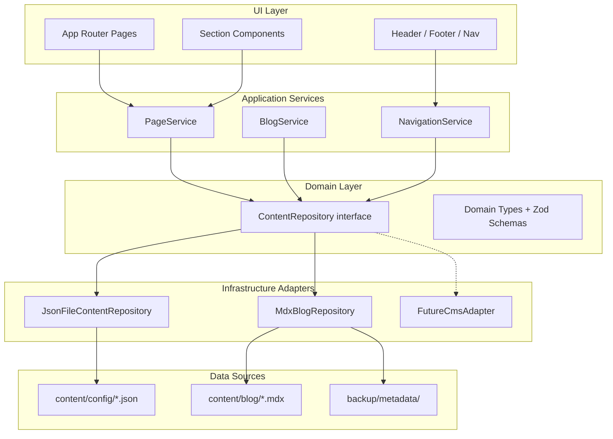

# Content Architecture

**Status:** Proposed (P1-02, 2026-09-02)  
**Related:** [[Tech-Stack]], [[System-Architecture]], [[Blog-URL-Preservation]], [[Navigation-Footer-Spec]], [[Folder-Structure]]

---

## Purpose

Define how site content is stored, validated, loaded, and consumed by UI components. Content must be **JSON-configurable now** and **CMS-swappable later** without rewriting pages.

Design tokens (`content/config/design-system.json`) are **out of scope** for this layer — they load via `src/lib/design-tokens.ts` and are the visual contract, not page content.

---

## Principles

| Principle | Implementation |
|-----------|----------------|
| Single abstraction | UI depends on `ContentRepository`, never on file paths |
| Adapter pattern | JSON files now; MDX for blog; future CMS = new adapter |
| Validation at boundary | Zod schemas parse all config at load time |
| URL preservation | 328 blog slugs from `backup/metadata/blog-inventory.json` — identical paths |
| Separation of concerns | Domain types in `src/domain/`, adapters in `src/infrastructure/` |
| No god objects | `PageService`, `BlogService`, `NavigationService` delegate to repository |

---

## Architecture diagram



---

## Content sources

### JSON config (marketing pages)

| File | Purpose | Phase |
|------|---------|-------|
| `content/config/site.json` | Company name, contact, social, partner badges | P1-05 |
| `content/config/navigation.json` | Header nav, mega menu, footer columns, CTA | P1-05 |
| `content/config/homepage.json` | 12 homepage sections | P2-02 |
| `content/config/services/{slug}.json` | Per-service page content | P3-05 |
| `content/config/case-studies.json` | Case study index + cards | P3-06 |
| `content/config/testimonials.json` | Named quotes | P2-02 |
| `content/config/faq.json` | Shared FAQ items | P2-05 |
| `content/config/design-system.json` | **Design tokens only** — not via ContentRepository | P0 (done) |
| `content/config/design-system-review.json` | `/design-system` page copy | P0 (done) |
| `content/config/browser-mockup.json` | Browser mockup demo data | P0 (done) |

### MDX blog (328 posts)

| Path | Purpose |
|------|---------|
| `content/blog/{slug}.mdx` | Blog post body + frontmatter |
| `backup/metadata/blog-inventory.json` | Source of truth for slug list during migration |
| `backup/metadata/api/posts-all.json` | Full WordPress content + Yoast metadata |

**Routing:** `src/app/[slug]/page.tsx` catch-all with `generateStaticParams()` from `getAllBlogSlugs()`.

**URL rule:** Slug must match current site exactly. Example: `/when-should-you-use-sponsored-display-ads/` → slug `when-should-you-use-sponsored-display-ads`. No path prefix like `/blog/`.

---

## Domain types

### SiteConfig

```typescript
interface SiteConfig {
  name: string;
  tagline: string;
  phone: string;
  email: string;
  address?: string;
  social: {
    facebook?: string;
    linkedin?: string;
    twitter?: string;
    youtube?: string;
  };
  partnerBadges: string[];
  claims: {
    revenueManaged?: string;
    retention?: string;
    teamSize?: string;
    since?: string;
  };
}
```

### NavigationConfig

```typescript
interface NavLink {
  label: string;
  href: string;
  external?: boolean;
}

interface MegaMenuColumn {
  title: string;
  links: NavLink[];
}

interface MegaMenuConfig {
  triggerLabel: string;
  columns: MegaMenuColumn[];
}

interface FooterColumn {
  title: string;
  links: NavLink[];
}

interface NavigationConfig {
  header: {
    cta: NavLink;
    items: NavLink[];
    megaMenu?: MegaMenuConfig;
  };
  footer: {
    preFooterCta: {
      title: string;
      button: NavLink;
    };
    columns: FooterColumn[];
    legal: NavLink[];
  };
}
```

### HomepageConfig

```typescript
type SectionType =
  | "hero"
  | "stats"
  | "services"
  | "process"
  | "caseStudies"
  | "testimonials"
  | "trustBar"
  | "faq"
  | "cta"
  | "blogPreview"
  | "sellerSegments"
  | "comparison"
  | "contactTeaser";

interface HomepageSection {
  id: string;
  type: SectionType;
  enabled: boolean;
  data: Record<string, unknown>; // Validated per section type via Zod discriminated union
}

interface HomepageConfig {
  sections: HomepageSection[];
  seo: PageSeo;
}
```

### ServicePageConfig

```typescript
interface ServicePageConfig {
  slug: string;
  hero: {
    title: string;
    subtitle: string;
    cta: NavLink;
  };
  stats: { label: string; value: string }[];
  deliverables: { title: string; description: string }[];
  faq: FaqItem[];
  relatedServices: string[];
  seo: PageSeo;
}
```

### BlogPost

```typescript
interface BlogPost {
  slug: string;
  title: string;
  excerpt: string;
  content: string; // Rendered MDX HTML or MDX component
  publishedAt: string;
  updatedAt: string;
  author: string;
  categories: string[];
  tags: string[];
  featuredImage: string;
  readingTimeMinutes?: number;
  seo: PageSeo;
}

interface PageSeo {
  metaTitle: string;
  metaDescription: string;
  canonical: string;
  ogImage?: string;
  robots?: { index: boolean; follow: boolean };
  schema?: "Article" | "Service" | "FAQPage" | "Organization";
}
```

### Shared types

```typescript
interface FaqItem {
  question: string;
  answer: string;
}

interface CaseStudyConfig {
  slug: string;
  title: string;
  client: string;
  metric: string;
  metricLabel: string;
  excerpt: string;
  featuredImage: string;
  href: string;
}

interface TestimonialConfig {
  quote: string;
  author: string;
  role: string;
  company: string;
}
```

---

## ContentRepository interface

**Location (implementation P1-06):** `src/domain/content/content-repository.ts`

```typescript
interface ContentRepository {
  // Site-wide
  getSiteConfig(): Promise<SiteConfig>;
  getNavigation(): Promise<NavigationConfig>;

  // Marketing pages
  getHomepage(): Promise<HomepageConfig>;
  getService(slug: string): Promise<ServicePageConfig | null>;
  getAllServiceSlugs(): Promise<string[]>;
  getCaseStudies(): Promise<CaseStudyConfig[]>;
  getTestimonials(): Promise<TestimonialConfig[]>;
  getFaq(scope?: string): Promise<FaqItem[]>;

  // Blog
  getBlogPost(slug: string): Promise<BlogPost | null>;
  getAllBlogSlugs(): Promise<string[]>;
  getRecentBlogPosts(limit: number): Promise<BlogPost[]>;
}
```

### Method contracts

| Method | Returns null when | Used by |
|--------|-------------------|---------|
| `getService(slug)` | Service JSON not found | `app/services/[slug]/page.tsx` → 404 |
| `getBlogPost(slug)` | MDX not found | `app/[slug]/page.tsx` → 404 |
| `getAllBlogSlugs()` | Never — returns `[]` if empty | `generateStaticParams`, sitemap |
| `getFaq(scope)` | Unknown scope → shared FAQ only | Homepage, service pages |

---

## Adapters

### JsonFileContentRepository (P1-06)

- Reads `content/config/*.json`
- Validates with Zod schemas in `src/domain/content/schemas/`
- Caches parsed config in memory for dev; re-reads on file change in dev only
- Throws descriptive error on schema mismatch (fail fast at build)

### MdxBlogRepository (P3-01+)

- Reads `content/blog/{slug}.mdx`
- Parses frontmatter with `gray-matter`
- Validates frontmatter against `BlogPostFrontmatterSchema`
- Renders MDX via `@next/mdx` or `next-mdx-remote`
- Migration script (`scripts/migration/wp-to-mdx.ts`) generates files from `backup/metadata/`

### FutureCmsAdapter (deferred)

- Implements same `ContentRepository` interface
- Fetches from Keystatic, Payload, or other headless CMS
- UI and services unchanged — swap adapter in DI container / factory only

---

## Application services

Services add business logic without knowing storage format.

```typescript
// src/domain/content/page-service.ts
class PageService {
  constructor(private readonly repo: ContentRepository) {}

  async getHomepageData() {
    const [homepage, testimonials] = await Promise.all([
      this.repo.getHomepage(),
      this.repo.getTestimonials(),
    ]);
    return { homepage, testimonials };
  }
}

// src/domain/content/blog-service.ts
class BlogService {
  constructor(private readonly repo: ContentRepository) {}

  async getPostOrThrow(slug: string) {
    const post = await this.repo.getBlogPost(slug);
    if (!post) throw new NotFoundError(`Blog post: ${slug}`);
    return post;
  }
}
```

---

## Dependency injection

**Factory (P1-06):** `src/infrastructure/content/create-content-repository.ts`

```typescript
export function createContentRepository(): ContentRepository {
  return new JsonFileContentRepository();
  // Future: return process.env.CMS_PROVIDER === "payload"
  //   ? new PayloadContentRepository()
  //   : new JsonFileContentRepository();
}
```

Server Components call factory once per request or use React `cache()` wrapper.

---

## Validation strategy

1. **Zod schema per config file** — co-located in `src/domain/content/schemas/`
2. **Parse at adapter boundary** — never pass raw JSON to components
3. **Build-time failure** — invalid config fails `next build`, not runtime in production
4. **Type export** — `type SiteConfig = z.infer<typeof siteConfigSchema>`

Example:

```typescript
// src/domain/content/schemas/site-config.schema.ts
export const siteConfigSchema = z.object({
  name: z.string().min(1),
  tagline: z.string(),
  phone: z.string(),
  email: z.string().email(),
  // ...
});

export type SiteConfig = z.infer<typeof siteConfigSchema>;
```

---

## Folder structure (target)

```
src/
├── domain/
│   └── content/
│       ├── content-repository.ts      # Interface
│       ├── page-service.ts
│       ├── blog-service.ts
│       ├── navigation-service.ts
│       ├── errors.ts                  # NotFoundError, ContentValidationError
│       └── schemas/
│           ├── site-config.schema.ts
│           ├── navigation.schema.ts
│           ├── homepage.schema.ts
│           └── blog-post.schema.ts
├── infrastructure/
│   └── content/
│       ├── json-content-repository.ts
│       ├── mdx-blog-repository.ts
│       └── create-content-repository.ts
content/
├── config/
│   ├── site.json                      # P1-05
│   ├── navigation.json                # P1-05
│   └── homepage.json                  # P2-02
└── blog/
    └── {slug}.mdx                     # P3-01
```

---

## Blog migration rules

1. Export slug inventory from `backup/metadata/blog-inventory.json` (328 URLs verified)
2. Generate one MDX file per slug — no batching, no slug changes
3. Preserve: title, body, publish date, modified date, author, categories, tags, featured image, Yoast meta
4. Record any content cleanup in `docs/project/CONTENT-AUDIT-LOG.md`
5. Verify all 328 URLs resolve in staging before production cutover (P3-04)

See [[Blog-URL-Preservation]] for full SEO requirements.

---

## What is NOT in ContentRepository

| Concern | Loader | Reason |
|---------|--------|--------|
| Design tokens | `src/lib/design-tokens.ts` | Visual contract, not page content |
| Review page copy | `src/lib/content-config.ts` | Dev-only `/design-system` page |
| Browser mockup demo | `content/config/browser-mockup.json` | Component preview data |

---

## Implementation phases

| Task | Delivers |
|------|----------|
| P1-02 | This document + interface definitions |
| P1-05 | `site.json`, `navigation.json` + Zod schemas |
| P1-06 | `ContentRepository` + `JsonFileContentRepository` |
| P2-02 | `homepage.json` + homepage schema |
| P3-01 | WP-to-MDX script + `MdxBlogRepository` |
| P3-02 | `app/[slug]/page.tsx` catch-all route |

---

## Decision record

Formal content architecture decision logged in `docs/project/DECISIONS.md` under P1-04 (Q3 stack + architecture).
