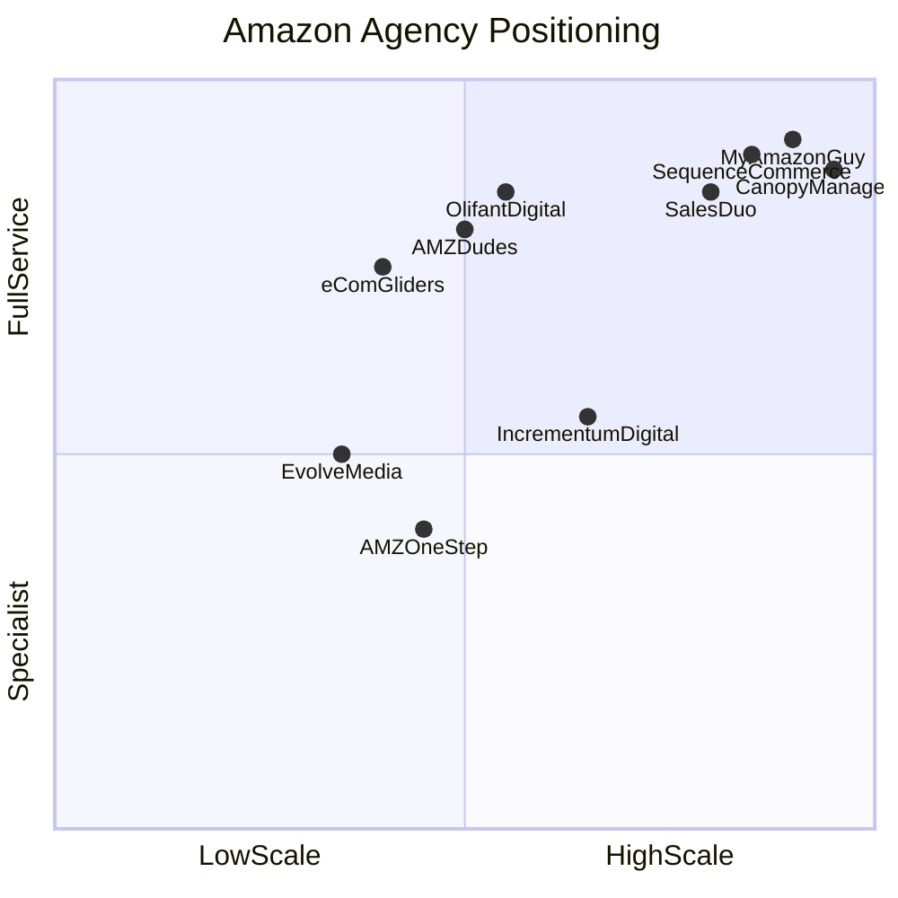

# Competitor Analysis

**Research date:** 2026-09-02  
**Status:** Complete  
**Related:** [[Niche-Website-Standards]], [[Current-Site-Audit]], [[Design-Inspiration]], [[Navigation-Footer-Spec]]

---

## Purpose

Tiered competitive analysis of Amazon agency websites to inform eCom Gliders migration design, positioning, and SEO strategy.

---

## eCom Gliders baseline

Source: `backup/pages/homepage.html`, `backup/metadata/manifest.json`

| Asset | Count/Value |
|-------|-------------|
| Blog posts | 328 (root-level URLs) |
| Pages | 26 |
| Revenue managed | $112M+ |
| Retention | 95% |
| Team | 20+ in-house specialists |
| Since | 2018 |
| Partner badge | Amazon Ads Verified Partner |
| Featured case study | GoSports 310% sales increase |

Current design tier: Between Tier C and Tier E. Target: Tier B + Tier C.

---

## Positioning map

---

## Tier 1 competitors

### User-provided

#### [[My Amazon Guy]]
- **URL:** https://myamazonguy.com/
- **Angle:** Full-service at enterprise scale
- **Scale:** 430+ brands, $1.2B, 400+ staff
- **Design:** Trust density, FAQ depth (10+), YouTube education
- **Nav:** Standard dropdown + "Free listing audit" CTA
- **Learn:** FAQ schema depth, trust bar, 4-pillar service grid
- **Do not copy:** Enterprise scale claims

#### [[AMZ Dudes]]
- **URL:** https://amzdudes.com/
- **Angle:** Conversion-focused account management
- **Scale:** $50M+, 500+ brands, 65% ACoS cut
- **Design:** Stat cards, lead modal, numbered services (01-09)
- **Nav:** Simple horizontal + modal CTA + phone
- **Learn:** Stat cards above fold, seller-type tabs, sticky CTA
- **Do not copy:** Emoji in UI, exit-intent modal as primary contact

#### [[Canopy Management]]
- **URL:** https://canopymanagement.com/
- **Angle:** Premium Amazon partner
- **Scale:** $3.2B, 1000+ brands, Inc 500 #325
- **Design:** Video case studies, awards wall (17+), category filter
- **Nav:** Clean horizontal + "Talk with expert" CTA
- **Learn:** Case study filter grid, video quotes, awards presentation
- **Do not copy:** Enterprise positioning

#### AMZ One Step
- **URL:** https://www.amzonestep.com/
- **Angle:** Creatives + PPC specialist
- **Design:** Before/after galleries, days-to-result data cards
- **Learn:** Portfolio layout for Visual Creativity service
- **Do not copy:** Overly narrow specialist positioning

### Industry benchmark

#### [[Olifant Digital]] (primary reference)
- **URL:** https://olifantdigital.com/
- **Angle:** Boutique premium, Clutch #1
- **Scale:** $10B+ client revenue, 93% retention, Clutch 5.0
- **Design:** Revenue ticker, 60-day guarantee, 15+ case cards
- **Nav:** Top bar + mega dropdown with CTA panel + "Free marketing plan"
- **Footer:** 5 columns, multi-city offices, tools/calculators
- **Learn:** Mega menu structure, header CTA, case study cards, guarantee badge
- **Do not copy:** Multi-office addresses (eCom Gliders has one NM address)

#### [[Sequence Commerce]]
- **URL:** https://sequencecommerce.com/
- **Angle:** Enterprise growth + AI SEO
- **Scale:** $500M+, 285% avg lift, 280+ reviews
- **Design:** Comparison tables, vertical playbooks, AIO/GEO section
- **Nav:** Awards strip + mega menu + "Free audit" CTA
- **Learn:** Agency vs in-house table, blog/research desk, review scores
- **Do not copy:** 12-office global presence

#### SalesDuo
- **URL:** https://salesduo.com/
- **Angle:** AI-powered full-service
- **Scale:** 300+ brands, $3B+ managed
- **Design:** Agency-type tabs, service segmentation
- **Learn:** Service segmentation by channel
- **Do not copy:** "AI-powered" marketing without genuine capability

#### Incrementum Digital
- **URL:** https://incrementumdigital.com/
- **Angle:** Advertising specialist, DataOwl platform
- **Design:** Proprietary tech showcase, founder story
- **Learn:** Advertising-led positioning
- **Skip:** Proprietary tool section (eCom Gliders has no equivalent)

---

## Tier 2 reference

| Agency | Angle | Design note |
|--------|-------|-------------|
| Evolve Media | Creative + content library | 200+ guides as homepage model |
| Trivium Group | PPC performance | Site unavailable during fetch |
| AMZ Pathfinder | PPC specialist | 5-step process model |
| Channel Key | Enterprise marketplace ops | Enterprise reference only |
| Buy Box Experts | Listing and catalog | Catalog service reference |
| Marknology | Performance marketing | $2B+ managed reference |
| eStore Factory | Budget SMB | Lower-tier design (avoid) |

---

## Design tier classification

| Tier | Agencies | Key traits |
|------|----------|------------|
| A - Enterprise premium | Canopy, Sequence, MAG | Dark hero, 10+ awards, video cases, global offices |
| B - Boutique premium | Olifant | Clean layout, guarantee, 15+ cases, named quotes |
| C - Conversion-optimized | AMZ Dudes, SalesDuo | Stat cards, lead modal, sticky CTA |
| D - Specialist | AMZ One Step, Evolve, Incrementum | Galleries, tools, content library |
| E - Basic | Budget SMB | Generic, footer-only contact. Avoid. |

**eCom Gliders target:** Tier B + Tier C.

---

## Section patterns to adopt

| Section | Best reference | eCom Gliders action |
|---------|---------------|---------------------|
| Hero | Olifant, Canopy | Outcome headline + CTA + trust line |
| Trust bar | MAG, Sequence | Logos + partner badge + reviews |
| Stats | AMZ Dudes | 4 cards: $112M+, 95%, 20+, since 2018 |
| Services | MAG, SalesDuo | 6 pillar cards in 3x2 grid |
| Segmentation | AMZ Dudes | New sellers, scaling brands, multi-ASIN |
| Case studies | Olifant, Canopy | 3+ cases with metric + quote |
| Process | Olifant | 4 steps: Audit, Strategy, Execute, Report |
| Comparison | Sequence | Agency vs DIY table |
| Testimonials | Olifant | 6-8 named quotes |
| FAQ | MAG | 10-12 questions, FAQPage schema |
| Blog | Evolve, Sequence | Prominent link, 328-post moat |
| CTA | AMZ Dudes, Olifant | Hero + sticky header + audit page |

---

## Gap analysis: eCom Gliders vs competitors

### Critical

- No header CTA button (all competitors have one)
- Service pages use blog template (Article schema instead of Service)

### High

- Duplicate nav systems (WPR mega menu + Elementor nav)
- Mega menu hidden "Inactive" H2 headings
- Footer service links use anchor hashes (#service_2)
- Only one case study prominently featured

### Medium

- Menu typos ("Advertisment", "Shiping")
- No top announcement bar
- Blog not in primary nav
- Testimonials as separate nav item (should be homepage section)

### Low (future)

- Tools/calculators (Olifant has 4)
- Multi-office footer

---

## Differentiation strategy

**Statement:** "Full-service Amazon account management with an in-house team of specialists. Not a call center. Not a software dashboard. Real people who treat your brand like their own."

**Compete on:**
- Personal attention and 95% retention
- In-house specialists (not outsourced)
- Amazon Ads Verified Partner
- 328 blog posts (content authority)
- GoSports 310% case study

**Do not compete on:**
- Enterprise scale ($3B+, 400+ staff)
- Global multi-office presence
- Proprietary software platforms
- AI-powered marketing claims

---

## Related notes

- [[Niche-Website-Standards]]
- [[Design-Inspiration]]
- [[Design-System]]
- [[Navigation-Footer-Spec]]
- [[Page-Templates]]
- [[Blog-URL-Preservation]]
- [[Keyword-Research]]
